# Day-3 : Scalability Fundamentals

## What is Scalability?

### Definition

Scalability is the ability of a system to handle increasing load while maintaining acceptable performance.

### Simple Definition

> Scalability is the ability of a system to continue working efficiently as users, requests, and data grow.

---

## Why Do We Need Scalability?

Imagine we build a simple Notes Application.

### Initial State

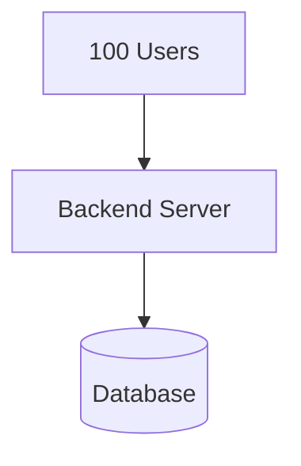

Everything works perfectly.

---

### Growth Phase

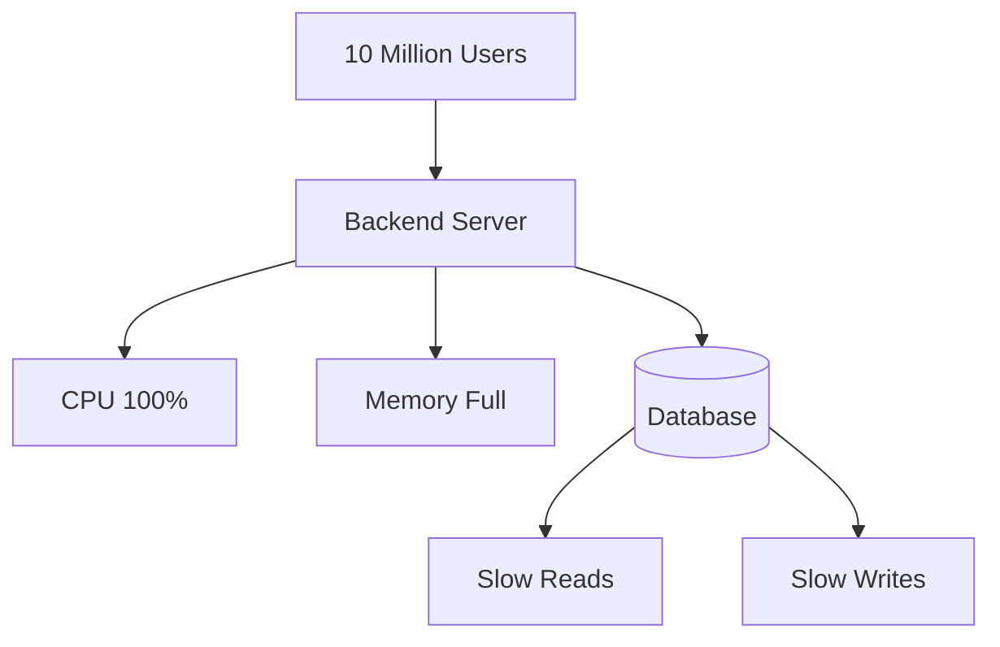

Problems:

- Server becomes overloaded.
- Database becomes overloaded.
- Requests timeout.
- User experience degrades.

This is why scalability becomes necessary.

---

# Why Do Companies Care About Scalability?

When systems grow:

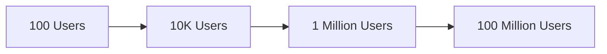

The architecture that works for 100 users will not necessarily work for 100 million users.

Large companies such as:

- Netflix
- YouTube
- Instagram
- Amazon
- Uber

must constantly design systems that scale.

---

# What is Load?

## Definition

Load is the amount of work that a system must perform.

---

## Examples of Load

### User Load

```text
100 Users
↓
10 Million Users
```

---

### Request Load

```text
100 Requests/sec
↓
100,000 Requests/sec
```

---

### Data Load

```text
1 GB
↓
100 TB
```

---

### Connection Load

```text
100 Active Connections
↓
1 Million Active Connections
```

---

# Types of Growth

Scalability is not only about users.

---

## 1. User Growth

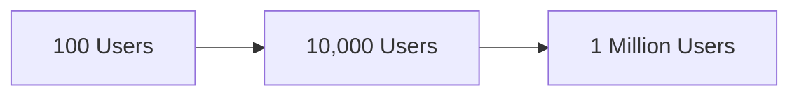

---

## 2. Request Growth

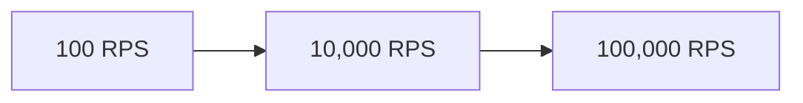

RPS = Requests Per Second

---

## 3. Data Growth

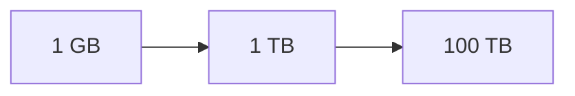

---

## 4. Geographic Growth

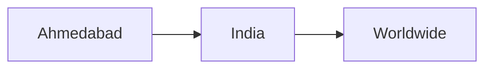

---

# What Makes a System Scalable?

A scalable system should:

- Handle more users.
- Handle more requests.
- Handle more data.
- Maintain acceptable performance.
- Continue working during growth.

---

# Non-Scalable Architecture

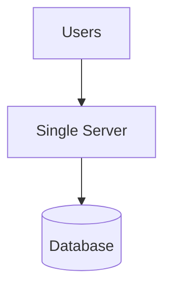

Problems:

### Single Point of Failure

If the server fails:

```text
System Down
```

---

### Capacity Limitation

```text
More Users
↓
More Requests
↓
Server Overloaded
```

---

# Scalable Architecture

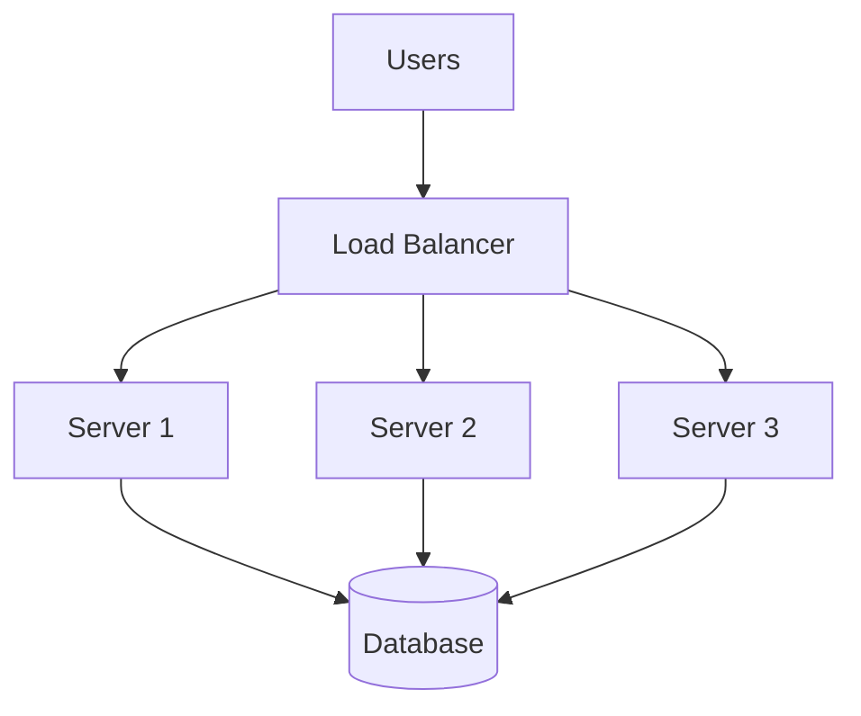

Benefits:

- Better performance.
- Better fault tolerance.
- Easier expansion.
- Higher availability.

---

# Common Scalability Bottlenecks

## What is a Bottleneck?

A bottleneck is the component that limits overall system performance.

---

## Bottleneck Flow

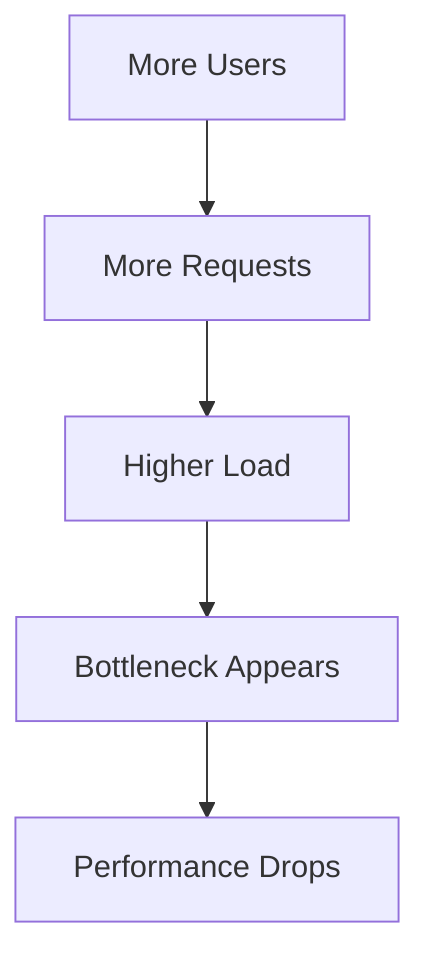

---

# Types of Bottlenecks

## 1. CPU Bottleneck

```text
CPU Usage = 100%
```

Symptoms:

- Slow responses.
- Request processing delays.

---

## 2. Memory Bottleneck

```text
RAM Full
```

Symptoms:

- Frequent Garbage Collection.
- Application crashes.

---

## 3. Database Bottleneck

Too many:

- Reads
- Writes

Symptoms:

- Slow queries.
- High response time.

---

## 4. Network Bottleneck

Bandwidth becomes limited.

Symptoms:

- Request delays.
- Timeouts.

---

## 5. Storage Bottleneck

Data grows faster than storage capacity.

Symptoms:

- Storage exhaustion.
- Slow I/O operations.

---

# Real World Example : Food Delivery Application

Suppose we build:

```text
Zomato
Swiggy
Uber Eats
```

---

## Initial Scale

```text
1,000 Orders/day
```

Simple architecture works.

---

## Large Scale

```text
5 Million Orders/day
```

Potential failure chain:

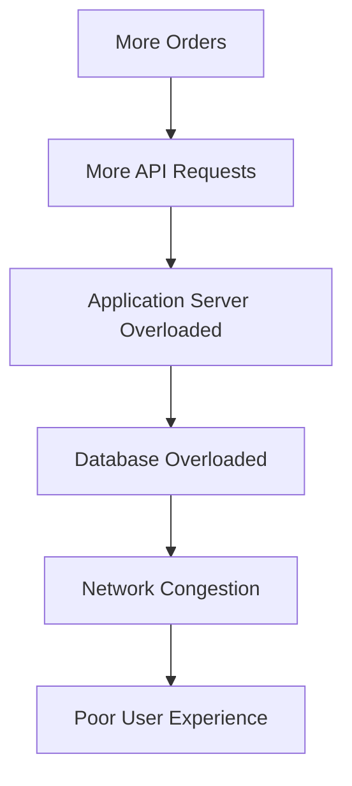

---

## Interview Answer

When the number of orders increases from 1,000 per day to 5 million per day, the application server may initially become the bottleneck because it can handle only a limited number of requests. As traffic continues to grow, the database often becomes the primary bottleneck due to heavy read and write operations. Eventually, network bandwidth and storage systems may also become bottlenecks.

---

# Scalability Thinking Framework

Whenever you see a system ask:

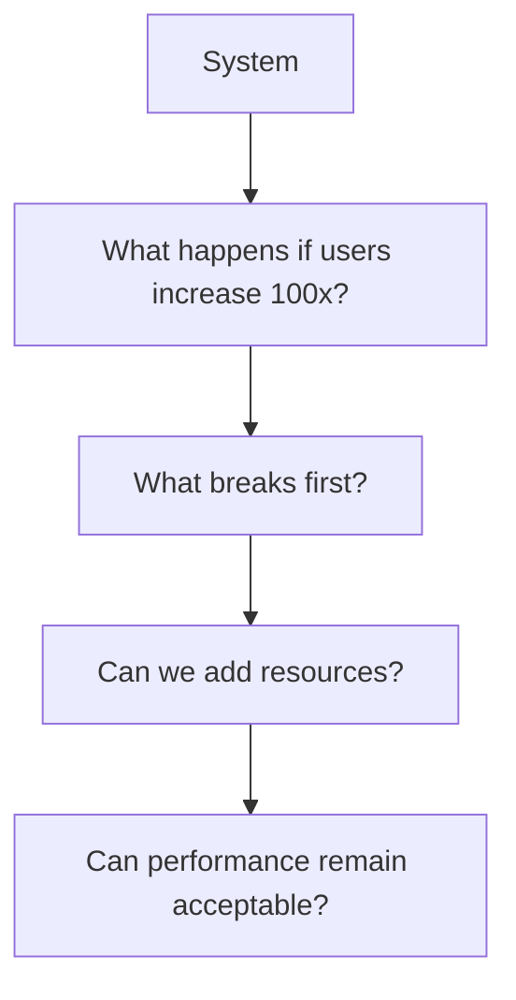

---

# How Scalability Connects to Future Topics

Every future System Design concept is a solution to a scalability problem.

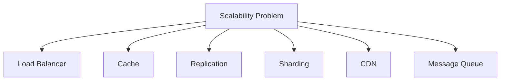

| Problem         | Solution      |
| --------------- | ------------- |
| Server Overload | Load Balancer |
| Database Reads  | Cache         |
| Read Bottleneck | Replication   |
| Data Growth     | Sharding      |
| Global Traffic  | CDN           |
| Traffic Spikes  | Message Queue |

---

# Interview Questions

## Q1. What is Scalability?

Scalability is the ability of a system to handle increasing users, requests, and data while maintaining acceptable performance.

---

## Q2. What is Load?

Load represents the amount of work a system must handle.

---

## Q3. What is a Bottleneck?

A bottleneck is the component that limits overall system performance.

---

## Q4. What are common bottlenecks?

- CPU
- Memory
- Database
- Network
- Storage

---

## Q5. Why is Scalability Important?

Scalability ensures that a system can continue to perform efficiently as traffic and data grow.

---

# Common Interview Mistakes

1. Thinking scalability means only more users.
2. Ignoring request growth.
3. Ignoring data growth.
4. Ignoring bottlenecks.
5. Designing without understanding scale.
6. Assuming one server can handle unlimited traffic.

---

# Revision Notes

## Must Remember

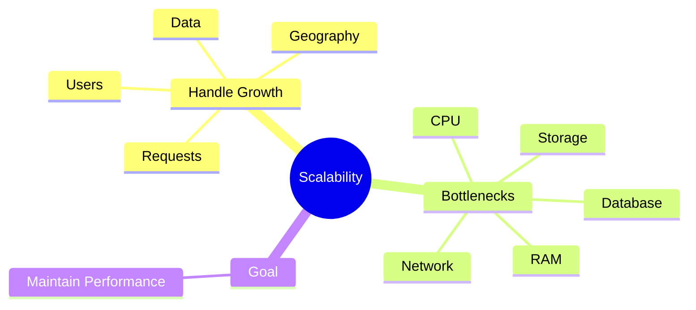

---

# 30 Second Revision

### Scalability

Ability to handle increasing load while maintaining acceptable performance.

### Load

Amount of work handled by the system.

### Bottleneck

Component limiting overall system performance.

### Common Bottlenecks

- Application Server
- Database
- CPU
- Memory
- Network
- Storage

### Growth Types

- Users
- Requests
- Data
- Geography

### Scalability Thinking

1. What happens if users increase 100x?
2. What breaks first?
3. Can resources be added?
4. Will performance remain acceptable?
