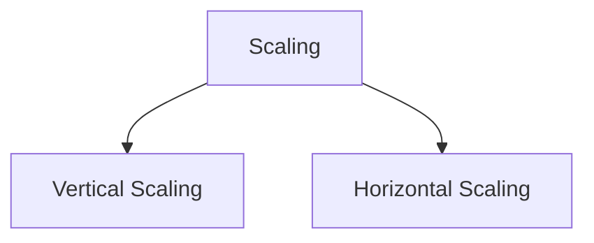
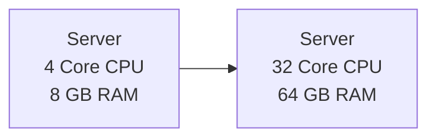
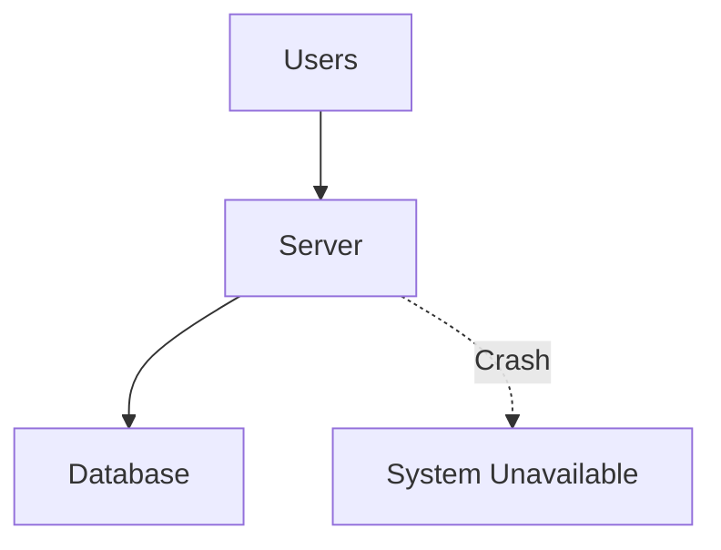
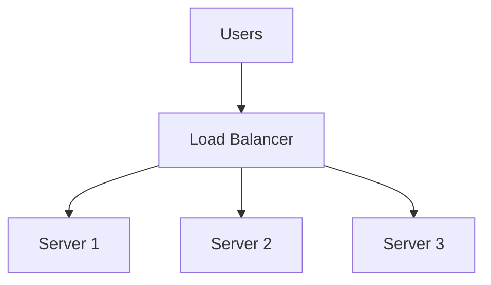
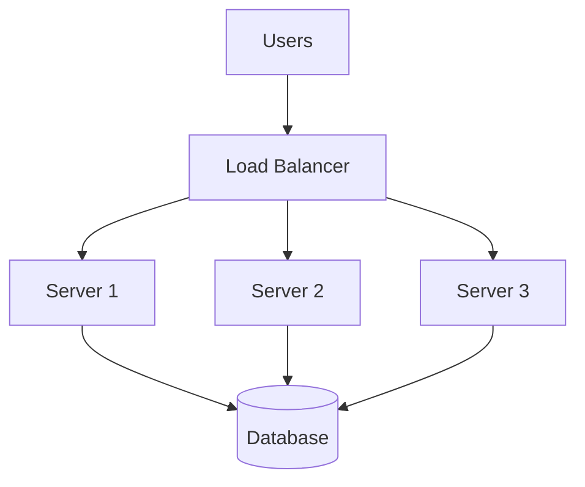
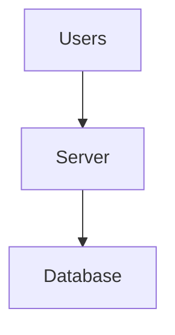
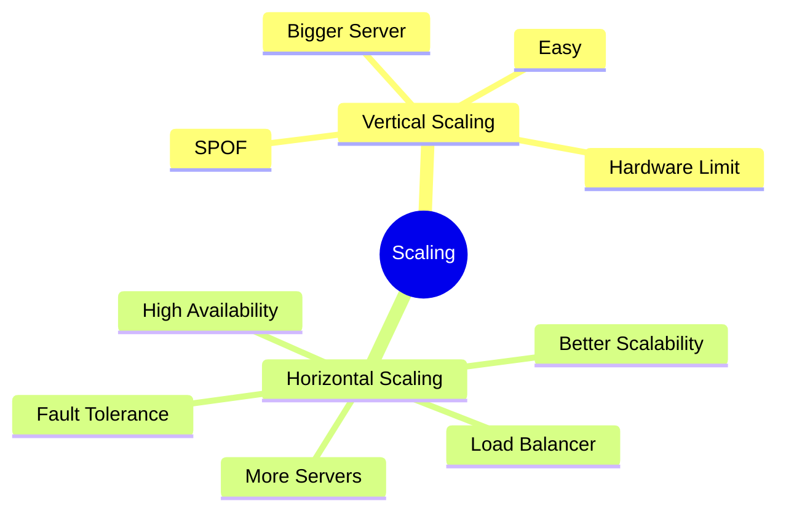

# Day-4 : Vertical Scaling vs Horizontal Scaling

## What is Scaling?

Scaling means increasing the resources available to a system so that it can handle more load.

When users, requests, or data increase, the system needs additional capacity.


---

# Types of Scaling

There are two major ways to scale a system:

1. Vertical Scaling (Scale Up)
2. Horizontal Scaling (Scale Out)



---

# Vertical Scaling (Scale Up)

## Definition

Vertical Scaling means increasing the resources of an existing machine.

### Example

Before:

```text
CPU : 4 Cores
RAM : 8 GB
Storage : 256 GB
```

After Upgrade:

```text
CPU : 32 Cores
RAM : 64 GB
Storage : 2 TB
```

The machine remains the same.

Only its capacity increases.

---

## Visual Representation



---

## Real World Example

Suppose your laptop has:

```text
8 GB RAM
```

and becomes slow.

You upgrade it to:

```text
32 GB RAM
```

You did not buy another laptop.

You upgraded the existing one.

This is Vertical Scaling.

---

## Advantages of Vertical Scaling

### Easy to Implement

No architecture changes required.

---

### Fast

Upgrade hardware and continue.

---

### Simple Management

Only one machine to manage.

---

### No Distributed System Complexity

No synchronization issues.

No consistency issues.

---

## Disadvantages of Vertical Scaling

### Hardware Limits

Every machine has a maximum capacity.

```text
8 GB RAM
↓
32 GB RAM
↓
64 GB RAM
↓
128 GB RAM
↓
Hardware Limit
```

---

### Expensive

High-end enterprise hardware is expensive.

---

### Single Point of Failure (SPOF)

If the only server fails:

```text
Application Down
```

---

## SPOF Diagram



---

# Horizontal Scaling (Scale Out)

## Definition

Horizontal Scaling means adding more machines instead of upgrading an existing machine.

### Example

Before:

```text
1 Server
```

After:

```text
10 Servers
```

Traffic is distributed across multiple servers.

---

## Visual Representation



---

## Real World Example

Imagine a restaurant.

Current Situation:

```text
1 Cashier
```

Long queue.

Instead of making one cashier faster:

```text
Add More Cashiers
```

This is Horizontal Scaling.

---

## Advantages of Horizontal Scaling

### Better Scalability

```text
1 Server
↓
10 Servers
↓
100 Servers
↓
1000 Servers
```

Can continue growing.

---

### Better Availability

If one server fails, other servers continue serving requests.

---

### Better Fault Tolerance

Failure of one machine does not bring down the entire system.

---

### Flexible Expansion

Additional servers can be added whenever required.

---

## Disadvantages of Horizontal Scaling

### Increased Complexity

Need:

- Load Balancers
- Distributed Systems
- Replication
- Synchronization

---

### Operational Overhead

Managing:

```text
1 Server
```

is easier than:

```text
100 Servers
```

---

### Data Consistency Challenges

Different servers must remain synchronized.

---

# Horizontal Scaling Architecture



---

# Vertical Scaling vs Horizontal Scaling

| Feature | Vertical Scaling | Horizontal Scaling |
|----------|----------|----------|
| Method | Bigger Server | More Servers |
| Cost | Expensive | Usually Cheaper |
| Scalability | Limited | Very High |
| Complexity | Low | High |
| Availability | Lower | Higher |
| Fault Tolerance | Lower | Higher |
| Single Point of Failure | Yes | No |
| Growth Capacity | Limited | Near Unlimited |

---

# Startup vs Large Company

## Startup

Example:

```text
500 Users
```

Recommended:

```text
Vertical Scaling
```

Reason:

- Simple
- Fast
- Cheap
- No Distributed Complexity

---

## Large Scale System

Example:

```text
200 Million Users
```

Recommended:

```text
Horizontal Scaling
```

Reason:

- Better Scalability
- Better Availability
- Better Fault Tolerance

---

# Why Large Companies Prefer Horizontal Scaling

Large companies cannot rely only on Vertical Scaling because:

1. Hardware eventually reaches its limits.
2. High-end machines are expensive.
3. Vertical Scaling creates a Single Point of Failure.
4. Horizontal Scaling allows continuous growth.

---

# Example : Instagram Growth

## Initial Stage



---

## Traffic Growth

Option 1:

```text
Upgrade Existing Server
```

Vertical Scaling.

---

Option 2:


Horizontal Scaling.

---

# Interview Questions

## Q1. What is Vertical Scaling?

Vertical Scaling is the process of increasing the resources of an existing machine to handle more load.

---

## Q2. What is Horizontal Scaling?

Horizontal Scaling is the process of adding more machines to distribute load and increase capacity.

---

## Q3. Why Can't Companies Rely Only on Vertical Scaling?

Because Vertical Scaling has hardware limits, is expensive, and creates a Single Point of Failure.

---

## Q4. What is a Single Point of Failure (SPOF)?

A Single Point of Failure is a component whose failure causes the entire system or a major part of the system to become unavailable.

Examples:

- Single Server
- Single Database
- Single Load Balancer

---

## Q5. Which Scaling Approach Provides Better Fault Tolerance?

Horizontal Scaling.

---

# Common Interview Mistakes

1. Thinking Horizontal Scaling is always better.
2. Ignoring hardware limits.
3. Ignoring cost.
4. Ignoring Single Point of Failure.
5. Not discussing trade-offs.

---

# Trade-Off Summary

## Vertical Scaling

### Pros

- Easy
- Fast
- Simple
- No Distributed Complexity

### Cons

- Hardware Limits
- Expensive
- Single Point of Failure

---

## Horizontal Scaling

### Pros

- Highly Scalable
- Better Availability
- Better Fault Tolerance
- Flexible Growth

### Cons

- Complex Architecture
- Requires Load Balancers
- Requires Distributed Systems
- Synchronization Challenges

---

# Key Takeaways

1. Scaling means increasing system capacity.
2. There are two major types of scaling:
   - Vertical Scaling
   - Horizontal Scaling
3. Vertical Scaling means upgrading existing hardware.
4. Horizontal Scaling means adding more machines.
5. Vertical Scaling is simple but limited.
6. Horizontal Scaling is complex but highly scalable.
7. Large-scale systems usually prefer Horizontal Scaling.

---

# Revision Notes

## Vertical Scaling

```text
Scale Up

1 Server
↓
Bigger Server
```

Pros:

- Simple
- Easy

Cons:

- Hardware Limit
- SPOF

---

## Horizontal Scaling

```text
Scale Out

1 Server
↓
10 Servers
↓
100 Servers
```

Pros:

- Better Availability
- Better Fault Tolerance
- High Scalability

Cons:

- More Complexity

---

## 30-Second Revision


