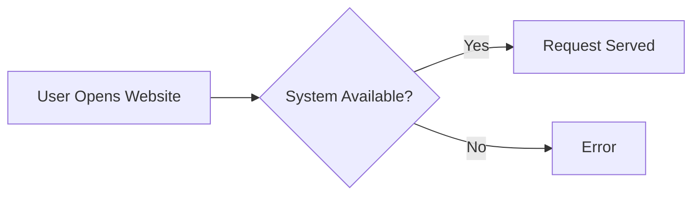
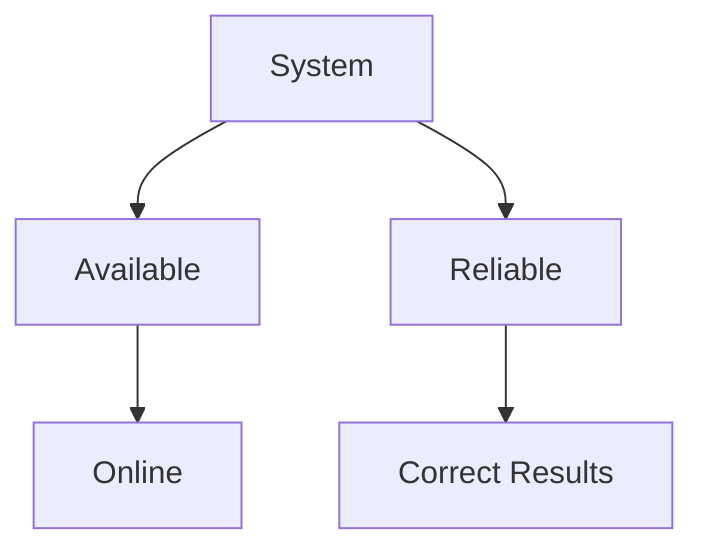
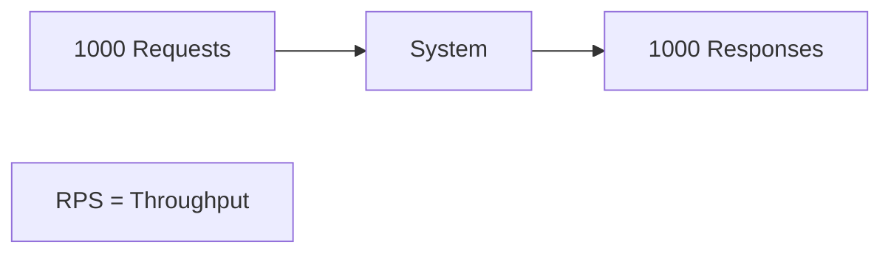
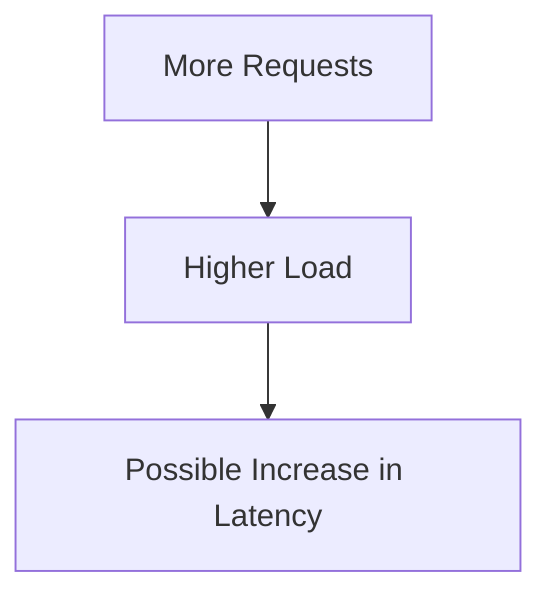

# Day-5 : Availability, Reliability, Latency & Throughput

## Why Do We Need These Metrics?

When designing a system, we need to evaluate:

- Is the system online?
- Is the system working correctly?
- How fast is the response?
- How many requests can it handle?

These questions are answered by:

- Availability
- Reliability
- Latency
- Throughput

---

# Availability

## Definition

Availability measures how often a system is operational and accessible when users need it.

### Simple Definition

> Availability = Uptime

---

## Example

Suppose a system runs for:

```text
365 Days
```

and is down for:

```text
1 Day
```

Availability:

```text
364 / 365
≈ 99.7%
```

---

## Visual Representation



---

## Real World Example

Google Search

```text
User Searches
     ↓
Results Returned
```

Available System

---

```text
User Searches
     ↓
Server Error
```

Unavailable System

---

## Why Availability Matters

If Amazon goes down during a sale:

```text
No Users
No Orders
No Revenue
```

---

## Common Availability Levels

| Availability | Downtime Per Year |
|-------------|------------------|
| 99% | ~3.65 Days |
| 99.9% | ~8.7 Hours |
| 99.99% | ~52 Minutes |
| 99.999% | ~5 Minutes |

---

# Reliability

## Definition

Reliability measures whether the system consistently performs its intended function correctly.

### Simple Definition

> Reliability = Correctness

---

## Example

WhatsApp Message

```text
Send Message
      ↓
Delivered
```

Reliable

---

```text
Send Message
      ↓
Message Lost
```

Not Reliable

---

## Real World Example

Bank Transfer

```text
Transfer ₹10,000
       ↓
Money Debited
       ↓
Money Credited
```

Reliable

---

```text
Transfer ₹10,000
       ↓
Money Debited
       ↓
Money Lost
```

Not Reliable

---

## Availability vs Reliability

### System A

```text
Always Online
Sometimes Loses Data
```

Availability = High

Reliability = Low

---

### System B

```text
Occasionally Down
Never Loses Data
```

Availability = Low

Reliability = High

---

## Visual Representation



---

# Latency

## Definition

Latency measures the time taken for a request to receive a response.

### Simple Definition

> Latency = Response Time

---

## Example

Search Request

```text
User Searches Movie
         ↓
100 ms
         ↓
Results Returned
```

Latency = 100 ms

---

## Real World Example

Instagram Feed

```text
Open App
    ↓
Feed Loads in 200 ms
```

Latency = 200 ms

---

## Good vs Bad Latency

Good:

```text
50 ms
100 ms
200 ms
```

Bad:

```text
5 Seconds
10 Seconds
```

---

## Visual Representation


---

# Throughput

## Definition

Throughput measures the number of requests processed by a system per unit time.

### Simple Definition

> Throughput = Requests Processed Per Second

---

## Example

```text
1000 Requests / Second
```

Throughput:

```text
1000 RPS
```

---

## Real World Example

IPL Ticket Booking

```text
100,000 Users
      ↓
Book Ticket
```

System's ability to process these requests is its throughput.

---

## Visual Representation



---

# Latency vs Throughput

| Latency | Throughput |
|----------|----------|
| How Fast? | How Much? |
| Time Taken | Requests Processed |
| Measured in ms/sec | Measured in RPS |
| Lower is Better | Higher is Better |

---

## Easy Memory Trick

```text
Latency
    ↓
How Fast?

Throughput
    ↓
How Much?
```

---

# Relationship Between Latency and Throughput



Note:

High Throughput does NOT always mean High Latency.

A well-designed system can achieve:

```text
High Throughput
Low Latency
```

simultaneously.

---

# Real System Example

Food Delivery Application

Requirements:

### Availability

```text
99.99%
```

---

### Reliability

```text
No Lost Orders
```

---

### Latency

```text
Search < 200 ms
```

---

### Throughput

```text
50,000 Requests/sec
```

---

# Common Interview Questions

## Q1. What is Availability?

Availability measures how often a system is operational and accessible.

---

## Q2. What is Reliability?

Reliability measures whether a system consistently performs correctly without failures or data loss.

---

## Q3. Difference Between Availability and Reliability?

Availability measures whether the system is online.

Reliability measures whether the system is producing correct results.

---

## Q4. What is Latency?

Latency is the time taken for a request to receive a response.

---

## Q5. What is Throughput?

Throughput is the number of requests processed by a system per unit time.

---

## Q6. Difference Between Latency and Throughput?

Latency measures:

```text
How Fast?
```

Throughput measures:

```text
How Much?
```

---

# Common Interview Mistakes

1. Confusing Availability with Reliability.
2. Confusing Latency with Throughput.
3. Thinking High Throughput automatically means High Latency.
4. Ignoring business requirements.
5. Not discussing trade-offs.

---

# Trade-Off Examples

## Banking System

Priority:

```text
Reliability > Availability
```

Reason:

Never lose money.

---

## Google Search

Priority:

```text
Availability > Reliability
```

Reason:

Users expect search to always work.

---

## WhatsApp

Priority:

```text
Reliability > Availability
```

Reason:

Message loss is unacceptable.

---

# Key Takeaways

1. Availability = Uptime.
2. Reliability = Correctness.
3. Latency = How Fast?
4. Throughput = How Much?
5. Availability and Reliability are different concepts.
6. Latency and Throughput are different metrics.
7. Different systems prioritize different metrics.

---

# 30-Second Revision

```text
Availability
    ↓
System Online?

Reliability
    ↓
System Correct?

Latency
    ↓
How Fast?

Throughput
    ↓
How Much?
```

---

## Interview Keywords

```text
Availability = Uptime

Reliability = Correctness

Latency = Response Time

Throughput = Requests Per Second (RPS)

High Availability = System Stays Online

High Reliability = No Data Loss

Low Latency = Fast Response

High Throughput = More Requests Processed
```