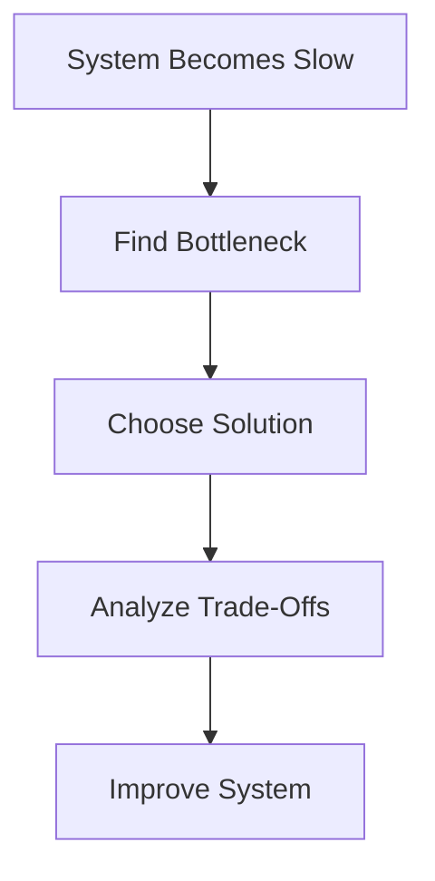

# Day-6 : Bottlenecks & System Design Trade-Offs

## What is a Bottleneck?

A bottleneck is the component that limits the overall performance, scalability, or throughput of a system.

### Simple Definition

> A bottleneck is the slowest or weakest component in a system.

---

## Why Do Bottlenecks Exist?

Every component in a system has limited resources.

Examples:

- CPU
- Memory (RAM)
- Network
- Database
- Storage

As traffic grows, one component eventually becomes overloaded and starts limiting the entire system.

---

## Real World Example

Imagine a restaurant:

```text
10 Chefs
10 Waiters
1 Cashier
```

Even though chefs and waiters are fast, customers still have to wait at the cashier.

The cashier becomes the bottleneck.

---

## Software Example

Suppose:

```text
Application Server = 10,000 Requests/sec

Database = 500 Requests/sec
```

Maximum throughput of the entire system:

```text
500 Requests/sec
```

because the database becomes the bottleneck.

---

## Common Types of Bottlenecks

### 1. CPU Bottleneck

Occurs when CPU utilization reaches very high levels.

Examples:

- Image Processing
- Video Processing
- Encryption

Symptoms:

- Slow responses
- High CPU usage

---

### 2. Memory Bottleneck

Occurs when RAM becomes insufficient.

Symptoms:

- Application crashes
- Out Of Memory Errors

---

### 3. Database Bottleneck

Most common bottleneck in backend systems.

Examples:

- Millions of reads
- Millions of writes

Symptoms:

- Slow queries
- Timeouts
- High database CPU usage

---

### 4. Network Bottleneck

Occurs when available bandwidth becomes insufficient.

Examples:

- Video streaming
- File downloads

Symptoms:

- High latency
- Slow downloads

---

### 5. Storage Bottleneck

Occurs when storage systems cannot keep up with requests.

Examples:

- YouTube
- Netflix
- Instagram Reels

Symptoms:

- Slow file retrieval
- High disk I/O

---

# Bottleneck Identification Framework

Whenever a system becomes slow, ask:

### Question 1

What component receives the most traffic?

---

### Question 2

What component performs the most work?

---

### Question 3

What component stores the most data?

---

### Question 4

Which component is hardest to scale?

---

These questions usually reveal the bottleneck.

---

# Example: Food Delivery Application

Initial Traffic:

```text
1,000 Orders/day
```

Everything works.

---

Traffic Increases:

```text
5 Million Orders/day
```

Possible bottlenecks:

- Application Server
- Database
- Network
- Storage

The actual bottleneck depends on the architecture.

---

# Bottleneck Thinking

Whenever a system slows down:

```text
System Slow
    ↓
Find Bottleneck
    ↓
Apply Solution
    ↓
Analyze Trade-Off
```

---

# What is a Trade-Off?

A trade-off is a compromise where improving one aspect of a system comes at the cost of another aspect.

### Simple Definition

> There is no free lunch in System Design.

Every solution has advantages and disadvantages.

---

# Why Do Trade-Offs Exist?

Perfect systems do not exist.

Every design decision involves:

```text
Pros
and
Cons
```

Choosing the correct trade-off is one of the most important skills in System Design.

---

# Trade-Off Example 1 : Vertical vs Horizontal Scaling

## Vertical Scaling

Pros:

- Simple
- Easy to implement
- Fast setup

Cons:

- Hardware limits
- Single Point of Failure
- Expensive hardware

---

## Horizontal Scaling

Pros:

- Better scalability
- Better availability
- Better fault tolerance

Cons:

- More complexity
- Synchronization challenges
- Operational overhead

---

# Trade-Off Example 2 : Caching

Pros:

- Faster reads
- Lower database load
- Lower latency

Cons:

- Stale data
- Cache invalidation problems
- Additional complexity

---

# Trade-Off Example 3 : SQL vs NoSQL

## SQL

Pros:

- Strong consistency
- ACID properties
- Relationships support

Cons:

- Generally harder to scale horizontally

---

## NoSQL

Pros:

- Easier horizontal scaling
- Flexible schema

Cons:

- Often weaker consistency guarantees

---

# Golden Interview Rule

Whenever you suggest a solution, immediately ask:

```text
What trade-offs does this introduce?
```

This is what separates average answers from strong answers.

---

# Weak Interview Answer

Interviewer:

> Database is slow. What would you do?

Candidate:

```text
Add Cache
```

---

# Strong Interview Answer

```text
We can add a cache to reduce database reads and improve response times.

However, this introduces cache consistency challenges and may lead to stale data.
```

---

# There is No Perfect Architecture

System Design is not:

```text
Finding the Best Architecture
```

System Design is:

```text
Choosing the Best Trade-Off
```

based on business requirements.

---

# Real World Example

## Banking System

Priority:

```text
Reliability
```

over

```text
Availability
```

Reason:

Never lose money.

---

## Google Search

Priority:

```text
Availability
```

over

```text
Perfect Consistency
```

Reason:

Users expect search to always work.

---

# Common Interview Questions

### Q1. What is a bottleneck?

A bottleneck is the component that limits the overall performance, scalability, or throughput of a system.

---

### Q2. How do you identify bottlenecks?

By identifying:

- Most heavily used component
- Most overloaded component
- Hardest component to scale

---

### Q3. What are common bottlenecks?

- CPU
- Memory
- Database
- Network
- Storage

---

### Q4. What is a trade-off?

A trade-off is a compromise where improving one aspect of a system comes at the cost of another aspect.

---

### Q5. Why is there no perfect architecture?

Because every architectural decision introduces advantages and disadvantages.

---

# Common Interview Mistakes

### Mistake 1

Assuming the database is always the bottleneck.

---

### Mistake 2

Giving solutions without discussing trade-offs.

---

### Mistake 3

Thinking one architecture works for every system.

---

### Mistake 4

Ignoring business requirements.

---

# Key Takeaways

1. Every system eventually develops bottlenecks.
2. A bottleneck limits overall system performance.
3. Bottlenecks can exist in CPU, Memory, Network, Database, or Storage.
4. Every architectural decision introduces trade-offs.
5. System Design is about choosing the best trade-off.
6. There is no perfect architecture.

---

# Architecture Thinking Framework



---

# 30-Second Revision

```text
Bottleneck
↓
Component Limiting Performance

Common Bottlenecks
↓
CPU
Memory
Database
Network
Storage

Trade-Off
↓
Every Solution Has Pros & Cons

System Design
↓
Find Bottleneck
↓
Apply Solution
↓
Discuss Trade-Offs
```

---

## Interview Keywords

```text
Bottleneck = Limiting Component

Trade-Off = Compromise

Database Bottleneck = Slow Queries

CPU Bottleneck = High CPU Usage

Cache Trade-Off = Stale Data

System Design = Choosing Best Trade-Off
```
