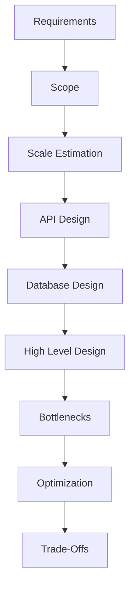

# Day-7 : Requirement Gathering & System Design Framework

## Why Do We Need a Framework?

When an interviewer asks:

```text
Design Instagram
```

Most beginners immediately start discussing:

```text
Redis
Kafka
Microservices
MongoDB
```

This is incorrect.

Before designing any system, we must first understand:

- What are we building?
- What features are needed?
- How many users will use it?
- What are the business requirements?

System Design is not about technologies.

System Design is about understanding the problem before proposing solutions.

---

# System Design Interview Rule #1

```text
Never Design Before Understanding The Problem
```

---

# What is Requirement Gathering?

Requirement Gathering is the process of understanding what exactly needs to be built before designing the system.

---

# Step 1 : Gather Functional Requirements

Functional Requirements answer:

```text
What should the system do?
```

---

## Example : Instagram

Functional Requirements:

- User Registration
- Login
- Upload Posts
- Like Posts
- Comment on Posts
- Follow Users
- View Feed

---

## Interview Questions

Instead of asking:

```text
What are the Functional Requirements?
```

Ask:

```text
Should the platform support only posts or also stories and reels?

Can users follow each other?

Can users upload videos?
```

---

# Step 2 : Gather Non-Functional Requirements

Non-Functional Requirements answer:

```text
How should the system behave?
```

---

## Example : Instagram

Non-Functional Requirements:

- High Availability
- Low Latency
- Scalability
- Reliability

---

## Interview Questions

Instead of asking:

```text
What are the Non Functional Requirements?
```

Ask:

```text
How quickly should the feed load?

What level of availability is expected?

Are there any reliability requirements?
```

---

# Step 3 : Define Scope

Scope determines what will be discussed and what will be ignored.

Without scope, the discussion becomes too large.

---

## Example : YouTube

Possible Features:

- Upload Videos
- Watch Videos
- Comments
- Likes
- Subscriptions
- Recommendations
- Ads
- Analytics

---

### Good Scope Definition

#### In Scope

- Upload Videos
- Watch Videos

#### Out Of Scope

- Recommendations
- Ads
- Analytics

---

# Why Scope is Important?

A System Design interview usually lasts:

```text
30 - 45 Minutes
```

It is impossible to design every feature.

Scope keeps the discussion manageable.

---

# Step 4 : Estimate Scale

Before discussing architecture, understand:

```text
How Big Is The System?
```

---

## Example

System A:

```text
100 Users
```

System B:

```text
100 Million Users
```

Both require very different architectures.

---

## Interview Questions

Ask:

```text
How many daily active users should I assume?

How many requests per second are expected?

How much data is generated daily?
```

---

# System Design Interview Rule #2

```text
Never Discuss Architecture Before Understanding Scale
```

---

# Step 5 : Design APIs

APIs define how clients communicate with the backend.

---

## Example : Instagram

Create Post

```http
POST /posts
```

---

Get Feed

```http
GET /feed
```

---

Like Post

```http
POST /posts/{id}/like
```

---

# Why APIs Before Database?

APIs reveal:

```text
What Operations Need To Be Supported
```

which helps determine:

```text
Database Design
```

---

# Step 6 : Design Database

Identify:

```text
What Data Needs To Be Stored?
```

---

## Example : Instagram

### User Table

```text
userId
username
email
```

---

### Post Table

```text
postId
userId
imageUrl
timestamp
```

---

### Follow Table

```text
followerId
followingId
```

---

# Step 7 : High Level Design (HLD)

Now we start designing the architecture.

---

## Basic Architecture

```text
Client
 ↓
Backend
 ↓
Database
```

---

## Scalable Architecture

```text
Client
 ↓
Load Balancer
 ↓
Application Servers
 ↓
Database
```

---

Additional Components:

- Cache
- Queue
- CDN
- Storage
- Replicas

are added only when required.

---

# Step 8 : Identify Bottlenecks

Ask:

```text
What Will Break First?
```

Possible Bottlenecks:

- Database
- Application Server
- Storage
- Network

---

# Step 9 : Optimize the System

Once bottlenecks are identified:

Apply solutions.

Examples:

- Load Balancer
- Cache
- Replication
- Sharding
- CDN
- Message Queue

---

# Step 10 : Discuss Trade-Offs

Every solution introduces trade-offs.

---

## Example

Caching

Pros:

- Fast Reads
- Reduced Database Load

Cons:

- Stale Data
- Cache Invalidation Complexity

---

# Complete System Design Framework

```text
1. Gather Requirements

2. Define Scope

3. Estimate Scale

4. Design APIs

5. Design Database

6. High Level Design

7. Identify Bottlenecks

8. Optimize

9. Discuss Trade-Offs
```

---

# Internal Checklist vs Interview Conversation

This is one of the most important lessons.

---

## Internal Checklist

Inside your mind:

```text
Requirements
Scope
Scale
API
Database
HLD
Bottlenecks
Trade-Offs
```

---

## Interview Conversation

Do NOT say:

```text
Functional Requirements?
Non Functional Requirements?
```

Instead ask:

```text
Should we support only posts or also stories and reels?

How many daily active users should I assume?

Which features are in scope?
```

---

# Example : Design Instagram

Bad Start:

```text
Let's use Redis.
```

---

Good Start:

```text
Before designing, I'd like to clarify a few requirements.

Should we focus on posts only or include stories and messaging?

How many daily active users should I assume?

What are the most important features?
```

---

# Common Interview Questions

## Q1. Why should requirements be gathered first?

Because designing without understanding the problem often leads to incorrect solutions.

---

## Q2. Why is scope important?

Scope prevents the discussion from becoming too large and keeps focus on important features.

---

## Q3. Why is scale estimation important?

Scale determines architectural decisions.

---

## Q4. Why design APIs before databases?

APIs reveal what operations the database must support.

---

## Q5. Why discuss trade-offs?

Because every design decision has advantages and disadvantages.

---

# Common Interview Mistakes

### Mistake 1

Jumping directly to technologies.

---

### Mistake 2

Ignoring scale.

---

### Mistake 3

Ignoring requirements.

---

### Mistake 4

Ignoring trade-offs.

---

### Mistake 5

Starting architecture too early.

---

# Key Takeaways

1. Never start with technologies.
2. Gather requirements first.
3. Define scope clearly.
4. Estimate scale before architecture.
5. APIs come before database design.
6. Architecture comes after understanding the problem.
7. Every design decision has trade-offs.
8. Use the framework internally.
9. Ask real-world questions externally.

---

# Architecture Flow



---

# 30-Second Revision

```text
Requirements
↓
Scope
↓
Scale
↓
API
↓
Database
↓
HLD
↓
Bottlenecks
↓
Optimizations
↓
Trade-Offs
```

---

# Interview Keywords

```text
Requirements = What?

Non Functional = How?

Scope = What To Include?

Scale = How Big?

API = Communication Layer

Database = Data Storage

HLD = Architecture

Bottlenecks = What Breaks First?

Optimization = Fix Bottlenecks

Trade-Offs = Pros vs Cons
```