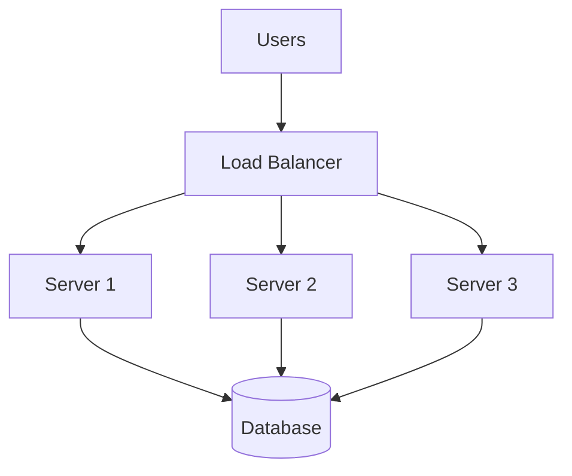
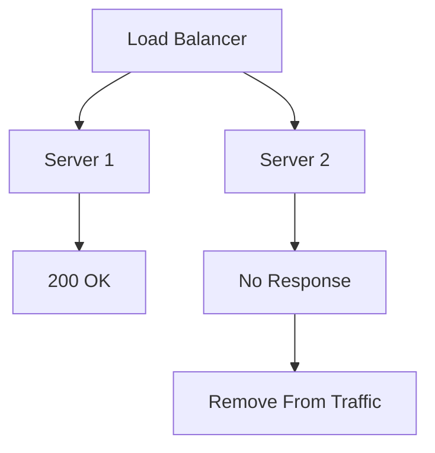

# Day-8 : Load Balancers

## The Problem

Suppose we have:

```text
Users
  ↓
Server
  ↓
Database
```

Initially:

```text
100 Users
```

Everything works.

---

As traffic grows:

```text
10 Million Users
```

Problems begin to appear:

- High CPU Usage
- High Memory Usage
- Slow Responses
- Request Failures

The server becomes a bottleneck.

---

# First Solution

Most engineers think:

```text
Add More Servers
```

Example:

```text
Server 1
Server 2
Server 3
```

But now a new problem appears:

```text
How do users know which server to connect to?
```

This is where a Load Balancer comes into the picture.

---

# What is a Load Balancer?

## Definition

A Load Balancer distributes incoming requests across multiple servers.

### Interview Definition

> A Load Balancer distributes incoming requests across multiple servers to improve scalability, availability, and fault tolerance.

---

### Simple Definition

```text
Load Balancer
=
Traffic Manager
```

---

# Why Do We Need a Load Balancer?

Without a Load Balancer:

```text
Users
  ↓
Single Server
  ↓
Database
```

Problems:

- Limited Scalability
- Server Overload
- Single Point of Failure

---

With a Load Balancer:

```text
Users
   ↓
Load Balancer
  /   |   \
S1   S2   S3
      ↓
   Database
```

Traffic is distributed across multiple servers.

---

# Restaurant Analogy

Imagine:

```text
100 Customers
```

arrive.

Without a manager:

```text
All Customers
      ↓
Cashier 1
```

Huge queue.

---

With a manager:

```text
Customers
    ↓
Manager
  /  |  \
C1  C2  C3
```

The manager distributes customers.

Manager = Load Balancer.

---

# Benefits of Load Balancers

## 1. Scalability

Instead of:

```text
1 Server
```

we can add:

```text
10 Servers
50 Servers
100 Servers
```

and distribute traffic.

---

## 2. High Availability

If one server crashes:

```text
Server 2 ❌
```

Traffic continues flowing to:

```text
Server 1
Server 3
```

Users can still access the application.

---

## 3. Fault Tolerance

Failure of one server does not bring down the entire system.

---

## 4. Easier Horizontal Scaling

Need more capacity?

Add:

```text
Server 4
Server 5
```

The Load Balancer starts routing traffic to them.

---

# Load Balancer Architecture



---

# Health Checks

Very important interview topic.

---

## Problem

Suppose:

```text
Server 2 crashes
```

How does the Load Balancer know?

---

## Solution

Health Checks.

The Load Balancer periodically asks:

```text
Are you alive?
```

Example:

```http
GET /health
```

Healthy Response:

```text
200 OK
```

---

No Response:

```text
Server Removed
From Traffic
```

---

# Health Check Flow



---

# Load Balancing Algorithms

The Load Balancer needs a strategy for distributing traffic.

---

# 1. Round Robin

Requests:

```text
R1
R2
R3
R4
R5
R6
```

Distribution:

```text
R1 → S1

R2 → S2

R3 → S3

R4 → S1

R5 → S2

R6 → S3
```

---

## Advantages

- Simple
- Easy to Implement
- Fair Distribution

---

## Disadvantages

Assumes all servers have equal capacity.

---

# 2. Weighted Round Robin

Suppose:

```text
Server 1 = Powerful
Server 2 = Medium
Server 3 = Weak
```

Traffic Distribution:

```text
Server 1 = 50%

Server 2 = 30%

Server 3 = 20%
```

More requests go to stronger servers.

---

## Use Case

Different server capacities.

---

# 3. Least Connections

The Load Balancer sends requests to the server with the fewest active connections.

Example:

```text
Server 1 = 100 Connections

Server 2 = 20 Connections

Server 3 = 50 Connections
```

New Request:

```text
→ Server 2
```

because it is least busy.

---

## Use Case

When request durations vary significantly.

---

# Choosing an Algorithm

| Scenario                    | Best Choice          |
| --------------------------- | -------------------- |
| Equal Servers               | Round Robin          |
| Different Server Capacities | Weighted Round Robin |
| Uneven Workloads            | Least Connections    |

---

# Load Balancer as a SPOF

New Architecture:

```text
Users
  ↓
Load Balancer
  ↓
Servers
```

Question:

```text
What if the Load Balancer crashes?
```

Now the Load Balancer becomes a:

```text
Single Point Of Failure
```

---

## Current Solution

Recognize the problem.

---

## Future Solution

During High Availability:

- Active-Passive
- Active-Active
- Failover

We will revisit this topic later.

---

# Real World Examples

## Netflix

Distributes traffic across thousands of servers.

---

## Amazon

Distributes shopping traffic across multiple application servers.

---

## Instagram

Distributes feed requests among multiple backend servers.

---

# Common Interview Questions

## Q1. What is a Load Balancer?

A component that distributes incoming requests across multiple servers.

---

## Q2. Why do we need a Load Balancer?

To improve:

- Scalability
- Availability
- Fault Tolerance

---

## Q3. What are Health Checks?

A mechanism used by a Load Balancer to determine whether a server is healthy.

---

## Q4. What is Round Robin?

A strategy that distributes requests sequentially among servers.

---

## Q5. What is Weighted Round Robin?

A strategy that sends more traffic to stronger servers.

---

## Q6. What is Least Connections?

A strategy that sends requests to the least busy server.

---

## Q7. Can a Load Balancer become a SPOF?

Yes.

If the Load Balancer fails, the entire system can become unavailable.

---

# Common Interview Mistakes

### Mistake 1

Thinking Load Balancer increases server capacity.

It does not.

It only distributes traffic.

---

### Mistake 2

Ignoring Health Checks.

---

### Mistake 3

Ignoring Load Balancer SPOF.

---

### Mistake 4

Using Round Robin for servers with very different capacities.

---

### Mistake 5

Adding multiple servers without a Load Balancer.

---

# Key Takeaways

1. Load Balancer distributes incoming traffic.
2. Load Balancers enable Horizontal Scaling.
3. Health Checks detect failed servers.
4. Round Robin assumes equal servers.
5. Weighted Round Robin supports different server capacities.
6. Least Connections routes traffic to the least busy server.
7. Load Balancers improve scalability, availability, and fault tolerance.
8. Load Balancers themselves can become SPOFs.

---

# 30-Second Revision

```text
Traffic Increase
       ↓
Need More Servers
       ↓
Need Load Balancer

Load Balancer
       ↓
Distributes Requests

Benefits
       ↓
Scalability
Availability
Fault Tolerance

Algorithms
       ↓
Round Robin
Weighted Round Robin
Least Connections

Health Checks
       ↓
Detect Failed Servers

Load Balancer
       ↓
Can Become SPOF
```

---

# Interview Keywords

```text
Load Balancer = Traffic Manager

Health Check = Server Monitoring

Round Robin = Equal Distribution

Weighted Round Robin = Capacity Based Distribution

Least Connections = Least Busy Server

Horizontal Scaling = Multiple Servers

Load Balancer = Required For Horizontal Scaling

Load Balancer Failure = SPOF
```
