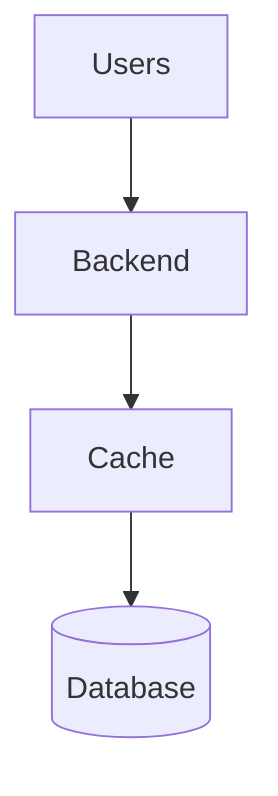
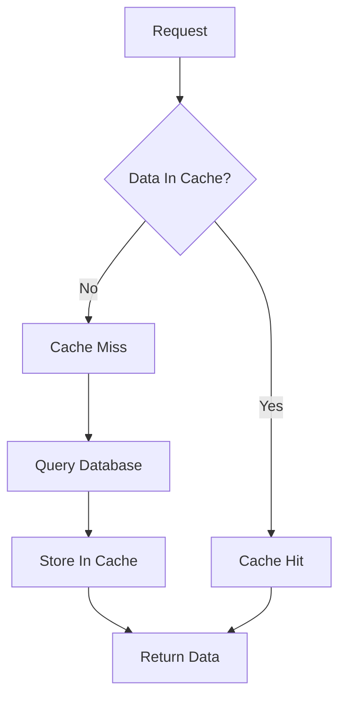
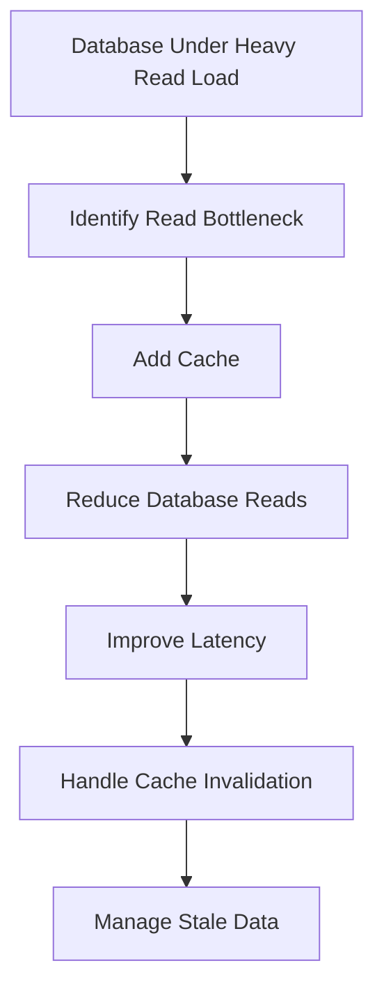

# Day-9 : Caching Fundamentals

## The Problem

Suppose we have:

```text
Users
 ↓
Backend
 ↓
Database
```

A user requests data.

Example:

```text
Get User Profile
```

The backend queries the database and returns the result.

---

Now traffic grows:

```text
1 Million Users
```

Many users repeatedly request the same data.

Example:

```text
Virat Kohli Profile
```

Again and again.

Question:

```text
Should the database be queried
1 Million Times?
```

No.

This creates unnecessary load on the database.

---

# What is a Cache?

## Definition

A Cache is a temporary high-speed storage layer that stores frequently accessed data.

---

## Interview Definition

> A cache stores frequently accessed data closer to the application to reduce latency and database load.

---

## Simple Definition

```text
Cache
=
Shortcut To Data
```

---

# Why Do We Need Cache?

Suppose:

```text
Database Capacity
=
1000 Reads/sec
```

Traffic:

```text
50,000 Reads/sec
```

The database becomes the bottleneck.

---

Solution:

```text
Store Frequently Used Data
In Cache
```

Most requests can now avoid the database.

---

# Architecture Without Cache

```text
Users
 ↓
Backend
 ↓
Database
```

Every request hits the database.

---

# Architecture With Cache

```text
Users
 ↓
Backend
 ↓
Cache
 ↓
Database
```

The backend checks the cache first.

---

# Cache Architecture



---

# Cache Request Flow

### Step 1

User sends request.

---

### Step 2

Backend checks cache.

---

### Step 3

If data exists:

```text
Return Data
```

No database query.

---

### Step 4

If data does not exist:

```text
Query Database
```

---

### Step 5

Store result in cache.

---

### Step 6

Return response to user.

---

# Cache Hit

Suppose:

```text
User Profile
```

already exists in cache.

Request:

```text
Get User Profile
```

Result:

```text
Cache → Data Found
```

This is called:

## Cache Hit

---

# Cache Miss

Suppose data is not present.

Request:

```text
Get User Profile
```

Result:

```text
Cache → Data Not Found
```

Backend queries database.

This is called:

## Cache Miss

---

# Cache Hit Flow



---

# Cache Hit Ratio

One of the most important cache metrics.

Formula:

```text
Cache Hits
------------
Total Requests
```

---

## Example

```text
100 Requests

80 Cache Hits

20 Cache Misses
```

Hit Ratio:

```text
80%
```

---

Higher cache hit ratio is generally better.

---

# Why Cache Improves Performance

Without Cache:

```text
Database Query

≈ 200 ms
```

---

With Cache:

```text
Cache Query

≈ 5 ms
```

Much faster response.

---

# What Should Be Cached?

## Good Candidates

- User Profiles
- Product Details
- Trending Videos
- Popular Posts
- Frequently Viewed Content

---

## Why?

Because:

```text
Many Reads
Few Writes
```

---

# What Should NOT Be Cached?

Usually avoid:

- Sensitive Financial Data
- Rapidly Changing Data
- Real-Time Stock Prices
- Frequently Updated Records

---

## Why?

Higher risk of:

```text
Stale Data
```

---

# Benefits of Caching

## 1. Faster Responses

```text
Cache Access
<
Database Access
```

---

## 2. Reduced Database Load

Fewer database queries.

---

## 3. Better Scalability

Database can support more users.

---

## 4. Lower Latency

Users get faster responses.

---

# Trade-Offs of Caching

Every optimization introduces trade-offs.

---

## Benefit

```text
Fast Reads
```

---

## Cost

```text
Stale Data
```

---

## Benefit

```text
Lower DB Load
```

---

## Cost

```text
Additional Infrastructure
```

---

## Benefit

```text
Improved Scalability
```

---

## Cost

```text
More Complexity
```

---

# Stale Data Problem

Database:

```text
Price = ₹999
```

Cache:

```text
Price = ₹999
```

---

Product price changes:

```text
Price = ₹1199
```

Database updated.

---

Cache still contains:

```text
₹999
```

Users see old information.

---

This is called:

## Stale Data

---

# Cache Invalidation

Question:

```text
When should cached data be removed or updated?
```

This is called:

## Cache Invalidation

---

## Important Interview Point

```text
Caching Improves Performance

But

Caching Introduces Consistency Problems
```

---

# Real World Examples

## Instagram

- User Profiles
- Feed Data

---

## YouTube

- Trending Videos
- Popular Videos

---

## Amazon

- Product Information

---

## Netflix

- Frequently Watched Content

---

# Interview Discussion Example

## Scenario

Database CPU:

```text
95%
```

Most traffic:

```text
Read Requests
```

---

## Strong Answer

```text
I would consider adding a cache because the system is read-heavy.

This can reduce database load and improve latency.

However, caching introduces cache invalidation challenges and the possibility of stale data.
```

---

# Common Interview Questions

## Q1. Why do we need caching?

To reduce database load and improve response time.

---

## Q2. What is a Cache Hit?

Data found in cache.

---

## Q3. What is a Cache Miss?

Data not found in cache.

---

## Q4. What is Cache Hit Ratio?

```text
Cache Hits
------------
Total Requests
```

---

## Q5. What is Stale Data?

Cached data that no longer matches the database.

---

## Q6. What is Cache Invalidation?

The process of updating or removing outdated cached data.

---

# Common Interview Mistakes

### Mistake 1

Caching everything.

---

### Mistake 2

Ignoring stale data.

---

### Mistake 3

Ignoring cache invalidation.

---

### Mistake 4

Adding cache without identifying a bottleneck first.

Remember:

```text
Find Bottleneck
↓
Apply Solution
↓
Discuss Trade-Off
```

---

### Mistake 5

Assuming cache removes consistency problems.

It introduces them.

---

# Key Takeaways

1. Cache stores frequently accessed data.
2. Cache reduces database load.
3. Cache improves latency.
4. Cache Hit = Data Found.
5. Cache Miss = Data Not Found.
6. Cache Hit Ratio measures cache effectiveness.
7. Cache introduces stale data risk.
8. Cache invalidation is a critical challenge.
9. Cache works best for read-heavy systems.
10. Every cache solution involves trade-offs.

---

# Caching Thinking Framework



---

# 30-Second Revision

```text
Database Read Bottleneck
          ↓
       Cache

Cache
          ↓
Fast Access

Cache Hit
          ↓
Data Found

Cache Miss
          ↓
Query Database

Benefits
          ↓
Fast Reads
Low Latency
Reduced DB Load

Trade-Offs
          ↓
Stale Data
Cache Invalidation
Complexity
```

---

# Interview Keywords

```text
Cache = High Speed Storage

Cache Hit = Data Found

Cache Miss = Data Not Found

Hit Ratio = Cache Effectiveness

Stale Data = Outdated Cached Data

Cache Invalidation = Removing Old Data

Read Heavy System = Good Candidate For Cache

Caching = Faster Reads + Trade-Offs
```
