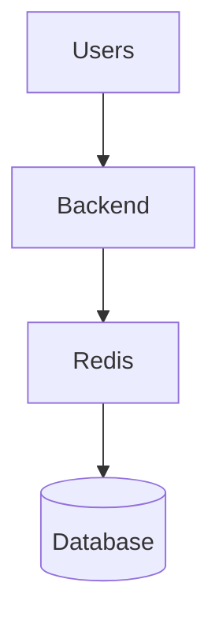
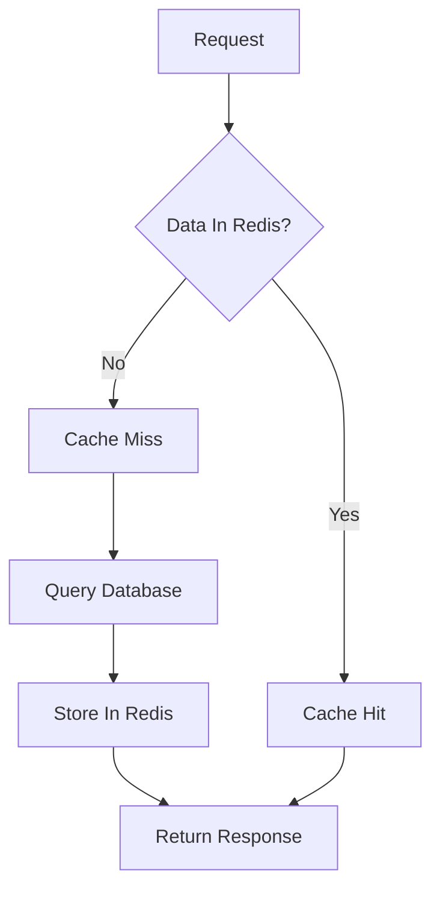
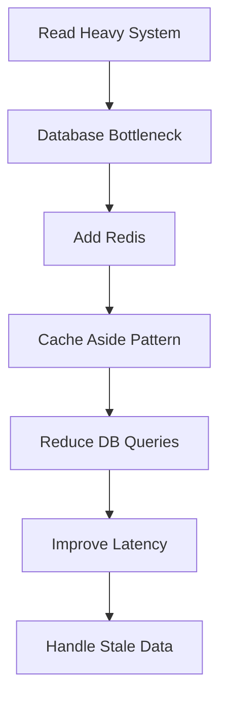

# Day-10 : Redis & Cache Aside Pattern

## The Problem

Suppose we have:

```text
Users
 ↓
Backend
 ↓
Database
```

A user requests:

```text
Get User Profile
```

The backend queries the database and returns the response.

---

Now traffic grows:

```text
10 Million Users
```

Many users repeatedly request the same data.

Example:

```text
Virat Kohli Profile
```

Again and again.

Question:

```text
Should the Database Answer
10 Million Times?
```

No.

This creates unnecessary database load.

---

# What is Redis?

## Simple Definition

Redis is a very fast storage system that stores data in RAM.

---

## Interview Definition

> Redis is an in-memory key-value data store commonly used as a cache to reduce database load and improve application performance.

---

## Beginner Friendly Definition

Think:

```text
Database
=
Large Warehouse

Redis
=
Small Table Next To You
```

---

Without Redis:

```text
Need Item
 ↓
Go To Warehouse
 ↓
Bring Item
```

Slow.

---

With Redis:

```text
Need Item
 ↓
Take From Nearby Table
```

Fast.

---

# Why is Redis Fast?

Redis stores data in:

```text
RAM
```

instead of:

```text
Disk
```

---

## Storage Speed Comparison

| Storage | Speed   |
| ------- | ------- |
| RAM     | Fastest |
| SSD     | Fast    |
| HDD     | Slow    |

---

Because Redis stores data in RAM, it can return results extremely quickly.

---

# What Does Redis Store?

Redis stores data as:

```text
Key
 ↓
Value
```

pairs.

---

## Example

```text
Key:
user:10

Value:
Virat Kohli Profile
```

---

Another Example

```text
Key:
product:123

Value:
iPhone Details
```

---

## DSA Analogy

Redis behaves similarly to:

```text
HashMap
Dictionary
Map
```

---

# Redis Example

Suppose:

```text
user:10
```

contains:

```text
Virat Kohli
```

When the backend requests:

```text
user:10
```

Redis instantly returns:

```text
Virat Kohli
```

without querying the database.

---

# Why Companies Use Redis

Without Redis:

```text
Database
 ↓
Database
 ↓
Database
 ↓
Database
```

Millions of times.

---

With Redis:

```text
Redis
 ↓
Redis
 ↓
Redis
 ↓
Redis
```

Much faster.

Much cheaper.

Less database load.

---

# Common Redis Use Cases

## 1. User Profiles

Instagram

```text
user:10
 ↓
Profile Data
```

---

## 2. Product Information

Amazon

```text
product:100
 ↓
Product Details
```

---

## 3. Trending Videos

YouTube

```text
video:20
 ↓
Video Metadata
```

---

## 4. Session Storage

Used for login sessions.

(Will be covered later.)

---

# Is Redis a Database?

Technically:

```text
Yes
```

---

Practically:

```text
Mostly Used As Cache
```

For interviews:

```text
Redis
=
Cache Layer
```

---

# Redis Architecture

```text
Users
 ↓
Backend
 ↓
Redis
 ↓
Database
```

---

# Architecture Diagram



---

# What is Cache Aside Pattern?

The most commonly used caching strategy in industry.

---

## Core Idea

```text
Check Cache First

If Not Found

Check Database
```

---

# Cache Aside Flow

### Step 1

Backend receives request.

---

### Step 2

Check Redis.

```text
Do you have user:10?
```

---

### Case A

Redis says:

```text
Yes
```

Return data.

---

This is called:

## Cache Hit

---

### Case B

Redis says:

```text
No
```

---

This is called:

## Cache Miss

---

### Step 3

Query database.

```sql
SELECT * FROM users
WHERE id = 10;
```

---

### Step 4

Database returns result.

---

### Step 5

Store result in Redis.

```text
user:10
 ↓
Virat Kohli
```

---

### Step 6

Return response to user.

---

# Cache Aside Pattern Flow



---

# Why Store Data Back in Redis?

Suppose:

```text
Request 1
```

causes a cache miss.

The backend queries the database.

---

If we store the result in Redis:

```text
Request 2
Request 3
Request 4
```

can become:

```text
Cache Hits
```

instead of database queries.

---

Benefits:

- Faster responses
- Reduced DB load
- Lower latency

---

# Benefits of Redis

## 1. Very Fast

RAM-based storage.

---

## 2. Reduced Database Load

Fewer database queries.

---

## 3. Improved Scalability

Database can handle more traffic.

---

## 4. Lower Latency

Users get faster responses.

---

# Redis Trade-Offs

Every optimization introduces trade-offs.

---

## Benefit

```text
Fast Reads
```

---

## Cost

```text
Additional Infrastructure
```

---

## Benefit

```text
Reduced Database Load
```

---

## Cost

```text
More Complexity
```

---

## Benefit

```text
Lower Latency
```

---

## Cost

```text
Stale Data Risk
```

---

# Stale Data Problem

Initially:

```text
Database:
Profile Picture = A

Redis:
Profile Picture = A
```

---

User updates profile picture.

Database becomes:

```text
Profile Picture = B
```

---

Redis still contains:

```text
Profile Picture = A
```

---

Result:

Users see old information.

---

This is called:

## Stale Data

---

# Important Interview Observation

When stale data occurs:

```text
Database = Correct

Redis = Incorrect
```

The problem exists in:

```text
Redis Cache
```

not in the database.

---

# Cache Invalidation

Question:

```text
When should Redis be updated
or cleared?
```

This is called:

## Cache Invalidation

We will learn strategies later.

For now remember:

```text
Cache
 ↓
Fast

But

Stale Data Risk
```

---

# Redis vs Database

| Redis                    | Database          |
| ------------------------ | ----------------- |
| RAM                      | Disk              |
| Very Fast                | Slower            |
| Cache Layer              | Source Of Truth   |
| Temporary Data           | Permanent Data    |
| Performance Optimization | Long Term Storage |

---

# Golden Interview Rule

Whenever you hear:

```text
Read Heavy System
```

think:

```text
Cache
 ↓
Redis
```

Examples:

- Instagram Profiles
- Product Pages
- Trending Videos
- Feed Data

---

# Common Interview Questions

## Q1. Why is Redis faster than a database?

Because Redis stores data in RAM.

---

## Q2. Why do companies use Redis?

To reduce database load and improve performance.

---

## Q3. What type of data does Redis store?

Key-Value pairs.

---

## Q4. What is Cache Aside Pattern?

Check cache first.

If not found, query database and store result in cache.

---

## Q5. What happens during a Cache Miss?

Database is queried and the result is stored in Redis.

---

## Q6. Can Redis replace a database?

No.

Redis is usually a cache layer.

The database remains the source of truth.

---

## Q7. What are Redis trade-offs?

- Stale Data
- Additional Infrastructure
- Cache Invalidation Complexity

---

# Common Interview Mistakes

### Mistake 1

Thinking Redis replaces the database.

---

### Mistake 2

Caching everything.

---

### Mistake 3

Ignoring stale data.

---

### Mistake 4

Ignoring cache invalidation.

---

### Mistake 5

Using Redis without identifying a bottleneck first.

Remember:

```text
Find Bottleneck
 ↓
Apply Solution
 ↓
Discuss Trade-Offs
```

---

# Key Takeaways

1. Redis stores data in RAM.
2. Redis is extremely fast.
3. Redis stores Key-Value pairs.
4. Redis is commonly used as a cache.
5. Redis reduces database load.
6. Cache Aside is the most common caching pattern.
7. Cache Hit = Data found in Redis.
8. Cache Miss = Query database.
9. Database is the source of truth.
10. Redis introduces stale data challenges.

---

# Redis Thinking Framework



---

# 30-Second Revision

```text
Read Heavy System
          ↓
Database Bottleneck
          ↓
Redis

Redis
          ↓
RAM Based Storage

Redis
          ↓
Key → Value

Cache Aside
          ↓
Check Redis

Hit
          ↓
Return Data

Miss
          ↓
Database
          ↓
Store In Redis

Trade-Offs
          ↓
Stale Data
Cache Invalidation
```

---

# Cache Eviction Policies

Cache memory is limited because Redis stores data in RAM.

When the cache becomes full, Redis must decide:

```text
Which Data Should Be Removed?
```

This process is called:

## Cache Eviction

---

# 1. LRU (Least Recently Used)

Remove the item that has not been accessed for the longest time.

---

## Example

Current Cache:

```text
A B C D
```

Recent Accesses:

```text
A
B
A
```

Least Recently Used:

```text
C
```

So:

```text
C is removed
```

---

## Use Case

Works well when recently accessed data is likely to be accessed again.

---

## Interview Point

Most commonly used eviction strategy.

---

# 2. LFU (Least Frequently Used)

Remove the item that has been accessed the fewest number of times.

---

## Example

```text
A → 100 accesses

B → 50 accesses

C → 2 accesses
```

Remove:

```text
C
```

because it is used least frequently.

---

## Use Case

Useful when frequently accessed items should remain in cache for a long time.

---

# 3. FIFO (First In First Out)

Remove the item that entered the cache first.

---

## Example

Insertion Order:

```text
A
B
C
D
```

Cache Full.

Remove:

```text
A
```

because it was inserted first.

---

## Analogy

Works like a queue.

```text
First In
↓
First Out
```

---

## Use Case

Simple systems where insertion order matters.

---

# 4. TTL (Time To Live)

Every cached item gets an expiration time.

After that time expires, Redis automatically removes the item.

---

## Example

```text
Product Details

TTL = 10 Minutes
```

After:

```text
10 Minutes
```

the cache entry is automatically deleted.

---

## Use Case

Frequently changing data.

Examples:

- Product Prices
- News Feeds
- Trending Content
- Weather Data

---

# Comparison of Eviction Policies

| Policy | Removes                    |
| ------ | -------------------------- |
| LRU    | Least Recently Used Item   |
| LFU    | Least Frequently Used Item |
| FIFO   | Oldest Inserted Item       |
| TTL    | Expired Item               |

---

# Which One Is Most Common?

For interviews:

```text
LRU
```

is the most frequently discussed policy.

Redis also heavily uses:

```text
TTL
```

for automatic expiration.

---

# Interview Questions

## Q1. Why do we need cache eviction?

Because cache memory is limited.

---

## Q2. What is LRU?

Removes the item that has not been used recently.

---

## Q3. What is LFU?

Removes the least frequently accessed item.

---

## Q4. What is FIFO?

Removes the oldest inserted item.

---

## Q5. What is TTL?

Automatically removes data after a fixed amount of time.

---

# Interview Keywords

```text
Redis = In-Memory Cache

RAM = Fast

Database = Source Of Truth

Redis = Performance Optimization

Cache Hit = Found In Redis

Cache Miss = Query Database

Cache Aside = Most Common Caching Pattern

Stale Data = Redis Not Updated

Cache Invalidation = Removing Old Cache
```
