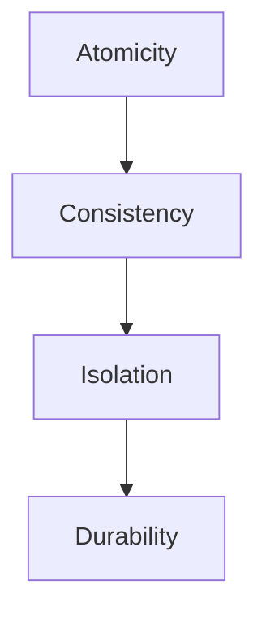
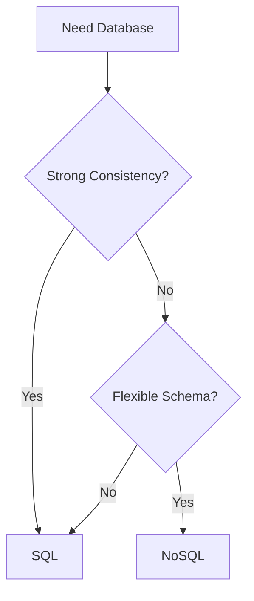

# Day-11 : Database Fundamentals & Database Selection

## Why Do Databases Exist?

Suppose we build a:

```text
Notes Application
```

A user creates:

```text
Buy Milk
```

Question:

```text
Where Should We Store It?
```

---

## Option 1 : RAM

```text
Store Data In Memory
```

Problem:

```text
System Restart
↓
Data Lost
```

---

## Option 2 : Files

```text
Store Data In Files
```

Works for:

```text
1 User
10 Users
```

But becomes difficult for:

```text
Millions Of Users
```

because searching, updating, and managing data becomes slow.

---

## Solution

```text
Database
```

A database helps us efficiently store, retrieve, update, and manage data.

---

# What is a Database?

## Simple Definition

A database is a system that stores and manages data efficiently.

---

## Interview Definition

> A database is an organized system used to store, retrieve, update, and manage data efficiently.

---

# Why Do We Need Databases?

Databases provide:

### 1. Persistence

```text
Restart Server
↓
Data Still Exists
```

---

### 2. Fast Queries

```text
Find User 123
```

quickly.

---

### 3. Concurrent Access

```text
Millions Of Users
```

can access data simultaneously.

---

### 4. Reliability

Data should not disappear unexpectedly.

---

# Database Responsibilities

```text
Store Data

Retrieve Data

Update Data

Delete Data
```

Efficiently.

---

# Types of Databases

For interviews:

```text
SQL

vs

NoSQL
```

---

# SQL Databases

Examples:

- MySQL
- PostgreSQL
- Oracle
- SQL Server

---

# How SQL Stores Data

Data is stored in:

```text
Tables
```

---

## Example

### Users Table

| id | name |
|----|------|
| 1 | Virat |
| 2 | Rohit |

---

### Posts Table

| postId | userId |
|--------|--------|
| 101 | 1 |
| 102 | 2 |

---

SQL is highly structured.

---

# Why SQL Exists

SQL is excellent when data contains:

```text
Relationships
```

Example:

```text
User
 ↓
Posts
 ↓
Comments
 ↓
Likes
```

---

# SQL Strengths

### Structured Data

---

### Relationships

---

### Strong Consistency

---

### ACID Transactions

---

# SQL Weaknesses

### Rigid Schema

Suppose:

```text
Users

name
email
```

Tomorrow:

```text
favorite_color
```

must be added.

Schema changes are required.

---

### Horizontal Scaling Is Harder

Compared to many NoSQL systems.

---

# What is NoSQL?

NoSQL means:

```text
Not Only SQL
```

---

Examples:

- MongoDB
- Cassandra
- DynamoDB

---

# How NoSQL Stores Data

Instead of tables:

```json
{
  "name":"Virat",
  "email":"virat@gmail.com",
  "followers":1000000
}
```

Document-based storage.

---

# Why NoSQL Exists

Some applications have:

```text
Frequently Changing Schema
```

Example:

Today:

```text
name
email
```

Tomorrow:

```text
name
email
bio
profilePic
favoriteTeam
```

NoSQL handles this more naturally.

---

# NoSQL Strengths

### Flexible Schema

---

### Easier Horizontal Scaling

---

### Good For Massive Data

---

### Faster Development

---

# NoSQL Weaknesses

### Weaker Relationship Support

---

### Consistency Trade-Offs

(Some systems prioritize scalability.)

---

# SQL vs NoSQL

| SQL | NoSQL |
|------|--------|
| Tables | Documents |
| Fixed Schema | Flexible Schema |
| Strong Consistency | Often More Scalable |
| Strong Relationships | Flexible Data |
| MySQL, PostgreSQL | MongoDB, Cassandra |

---

# ACID Properties

Very Important Interview Topic.

---

# A — Atomicity

Either:

```text
Everything Happens
```

or

```text
Nothing Happens
```

---

## Banking Example

Transfer:

```text
₹1000
A → B
```

Cannot:

```text
Deduct From A

But Not Add To B
```

---

# C — Consistency

Database rules remain valid.

Example:

```text
Balance Cannot Become Negative
```

if business rules prevent it.

---

# I — Isolation

Multiple transactions should not interfere with each other.

---

# D — Durability

Once data is committed:

```text
Server Crash
↓
Data Still Exists
```

---

# ACID Visualization



---

# Real World Database Choices

## Banking System

Requirements:

```text
Money Transfers

Transactions

Account Balances
```

Choose:

```text
MySQL / PostgreSQL
```

Reason:

```text
ACID
Consistency
Relationships
```

---

## Instagram Profiles

Requirements:

```text
Flexible Fields

Millions Of Users
```

Choose:

```text
MongoDB
```

Reason:

```text
Flexible Schema
Easy To Evolve
```

---

## Product Catalog

Requirements:

```text
Phones
Laptops
Shoes
Watches
```

All have different attributes.

Choose:

```text
MongoDB
```

Reason:

```text
Flexible Product Structure
```

---

# Database Selection Framework

When selecting a database ask:

---

### Question 1

Do I need strong consistency?

---

### Question 2

Do I need transactions?

---

### Question 3

Do I have lots of relationships?

---

### Question 4

Does schema change frequently?

---

### Question 5

Do I need massive scale?

---

# Selection Flow



---

# Multi-Database Systems

Very Important Concept.

```text
One System
≠
One Database
```

---

Example:

Instagram

### Profiles

```text
MongoDB
```

---

### Payments

```text
PostgreSQL
```

---

### Cache

```text
Redis
```

---

# Why?

Different problems require different tools.

---

# Golden Interview Rule

Never Say:

```text
Use MongoDB
```

---

Instead Say:

```text
I would choose MongoDB because the schema changes frequently and the profile structure is flexible.
```

---

Or:

```text
I would choose PostgreSQL because strong consistency and ACID transactions are required.
```

---

# Common Interview Questions

## Q1. What is a Database?

A system that stores and manages data efficiently.

---

## Q2. Why do databases exist?

To efficiently store, retrieve, update, and manage data.

---

## Q3. What is SQL?

A relational database system that stores structured data in tables.

---

## Q4. What is NoSQL?

A database system designed for flexible schemas and large-scale applications.

---

## Q5. What are ACID Properties?

Atomicity, Consistency, Isolation, Durability.

---

## Q6. When should SQL be used?

When transactions, relationships, and strong consistency are important.

---

## Q7. When should NoSQL be used?

When schema changes frequently and scalability is a priority.

---

## Q8. Can a system use both SQL and NoSQL?

Yes.

Many large-scale systems use multiple databases.

---

# Common Interview Mistakes

### Mistake 1

Choosing databases without reasoning.

---

### Mistake 2

Thinking NoSQL replaces SQL.

---

### Mistake 3

Thinking SQL cannot scale.

---

### Mistake 4

Using one database for every component.

---

### Mistake 5

Ignoring business requirements.

---

# Key Takeaways

1. Databases exist to manage data efficiently.
2. SQL databases store data in tables.
3. NoSQL databases store flexible document-style data.
4. SQL is strong for relationships and transactions.
5. NoSQL is strong for flexible schemas and scale.
6. ACID properties are critical for transactional systems.
7. Database selection depends on requirements.
8. Large systems often use multiple databases.
9. One system does not mean one database.
10. Always explain WHY you chose a database.

---

# 30-Second Revision

```text
Need Strong Consistency?
        ↓
       SQL

Need Transactions?
        ↓
       SQL

Need Relationships?
        ↓
       SQL

Need Flexible Schema?
        ↓
      NoSQL

Need Rapid Changes?
        ↓
      NoSQL

One System
        ↓
Can Use
Multiple Databases
```

---

# Interview Keywords

```text
Database = Data Storage System

SQL = Structured Data

NoSQL = Flexible Data

ACID = Transaction Guarantees

MySQL = Relational Database

PostgreSQL = Relational Database

MongoDB = Document Database

Relationships = SQL

Flexible Schema = NoSQL

Payments = SQL

Profiles = NoSQL

One System ≠ One Database
```