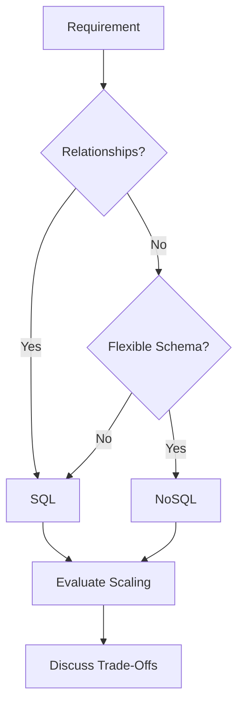

# Day-12 : SQL vs NoSQL (Deep Dive)

## Important Lesson From Today

Before today's topic, the biggest learning was:

```text
Slow System
≠
Change Database
```

Always think:

```text
System Slow
      ↓
Find Bottleneck
      ↓
Choose Solution
      ↓
Discuss Trade-Offs
```

This mindset will be used throughout System Design.

---

# Why SQL Still Exists?

Many students think:

```text
SQL = Old

NoSQL = Modern
```

This is incorrect.

Even today:

- Amazon
- Netflix
- Uber
- PhonePe
- Razorpay

heavily use SQL databases.

---

## Golden Rule

Never ask:

```text
Which Database Is Better?
```

Instead ask:

```text
Which Database Fits The Requirements?
```

---

# Relationships In Data

Consider Instagram:

```text
User
 ↓
Posts
 ↓
Comments
 ↓
Likes
 ↓
Followers
```

All entities are related.

---

# SQL Loves Relationships

### Users Table

| userId | name |
|---------|---------|
| 1 | Virat |

---

### Posts Table

| postId | userId |
|---------|---------|
| 101 | 1 |

---

Relationship:

```text
Users
↔
Posts
```

This is naturally handled by SQL.

---

# What is a JOIN?

Suppose we want:

```text
Show All Posts
Along With User Name
```

SQL can combine multiple tables using JOIN.

Example:

```sql
SELECT *
FROM Users
JOIN Posts
ON Users.userId = Posts.userId;
```

---

## Why JOINs Matter?

Many real-world systems have:

```text
Orders
Customers
Products
Payments
```

All related.

SQL handles these relationships efficiently.

---

# Why NoSQL Struggles With Relationships

MongoDB stores data as documents:

```json
{
  "name":"Virat",
  "posts":[
    {
      "id":101
    }
  ]
}
```

Relationships are possible.

However:

```text
Complex Relationships
```

are generally easier to manage in SQL.

---

# Interview Shortcut

Whenever you see:

```text
Many Relationships
```

think:

```text
SQL
```

---

# Schema Design

## SQL Schema

Before storing data:

```text
Columns
Data Types
Constraints
```

must be defined.

Example:

```sql
CREATE TABLE Users (
    id INT,
    name VARCHAR(100)
);
```

This is:

```text
Schema First
```

---

# NoSQL Schema

Today:

```json
{
  "name":"Virat"
}
```

Tomorrow:

```json
{
  "name":"Virat",
  "favoriteTeam":"RCB"
}
```

Still valid.

No migration required.

---

This is called:

```text
Flexible Schema
```

---

# Normalization

One of the most important SQL concepts.

---

# Problem

Suppose we store:

| User | City | Country |
|--------|--------|--------|
| Virat | Delhi | India |
| Rohit | Delhi | India |
| Dhoni | Delhi | India |

---

Problem:

```text
Duplicate Data
```

---

# Solution

Split into multiple tables.

### Users Table

| userId | cityId |
|---------|---------|
| 1 | 10 |

---

### Cities Table

| cityId | cityName |
|---------|---------|
| 10 | Delhi |

---

This process is called:

## Normalization

---

# Benefits of Normalization

```text
Less Duplicate Data

Less Storage

Easy Updates

Better Consistency
```

---

# Trade-Offs

```text
More Tables

More JOINs

More Complexity
```

---

# Denormalization

Opposite of Normalization.

Instead of splitting data:

```text
Store Related Data Together
```

---

# Benefits

```text
Faster Reads

Fewer Queries

Less JOIN Cost
```

---

# Trade-Offs

```text
Duplicate Data

More Storage

Update Complexity
```

---

# Normalization vs Denormalization

| Normalization | Denormalization |
|--------------|----------------|
| Less Duplication | More Duplication |
| Better Consistency | Faster Reads |
| More JOINs | Fewer JOINs |
| More Tables | Simpler Reads |

---

# Which One Is Better?

Interview Answer:

```text
Depends On Requirements
```

---

Use Normalization when:

```text
Consistency Matters
```

---

Use Denormalization when:

```text
Read Performance Matters
```

---

# When SQL Starts Struggling

Imagine:

```text
Instagram

1 Billion Users

100 Billion Posts
```

Heavy JOINs become expensive.

Scaling becomes harder.

---

# When NoSQL Shines

### Flexible Schema

---

### Massive Scale

---

### Rapid Development

---

### Distributed Systems

---

# Product Catalog Example

Phone:

```json
{
 "name":"iPhone",
 "ram":"8GB"
}
```

---

Shoes:

```json
{
 "name":"Nike",
 "size":"10"
}
```

---

Furniture:

```json
{
 "name":"Table",
 "woodType":"Oak"
}
```

Different products.

Different fields.

NoSQL fits naturally.

---

# SQL vs NoSQL Deep Comparison

| Feature | SQL | NoSQL |
|----------|----------|----------|
| Schema | Fixed | Flexible |
| Relationships | Excellent | Weaker |
| JOINs | Excellent | Limited |
| Consistency | Strong | Often Relaxed |
| Transactions | Strong | Limited |
| Scaling | Harder | Easier |
| Flexibility | Less | More |

---

# Real Interview Example

## Weak Answer

```text
Use MongoDB
```

---

## Strong Answer

```text
Orders and Payments require strong consistency and transactions.

Therefore I would use PostgreSQL.

Product Catalog contains flexible data, so MongoDB may be a better fit.
```

---

# Multi Database Thinking

Never think:

```text
SQL vs NoSQL
```

Think:

```text
SQL + NoSQL
```

---

Example:

### Product Catalog

```text
MongoDB
```

---

### Orders

```text
PostgreSQL
```

---

### Payments

```text
PostgreSQL
```

---

### Cache

```text
Redis
```

---

# Database Selection Framework

Whenever choosing a database ask:

### Question 1

Do I need ACID transactions?

---

### Question 2

Do I have many relationships?

---

### Question 3

Does schema change frequently?

---

### Question 4

Do I need huge scale?

---

### Question 5

Is consistency more important than flexibility?

---

# Most Important Interview Lesson

```text
Slow System
↓
Find Bottleneck
↓
Apply Solution
```

NOT:

```text
Slow System
↓
Change Database
```

Possible solutions before changing databases:

```text
Caching

Indexing

Read Replicas

Query Optimization

Denormalization
```

---

# Common Interview Questions

## Q1. What is a JOIN?

Combining data from multiple related tables.

---

## Q2. What is Normalization?

Splitting data into multiple tables to reduce duplication.

---

## Q3. What is Denormalization?

Combining data to improve read performance.

---

## Q4. When should SQL be preferred?

When relationships and transactions are important.

---

## Q5. When should NoSQL be preferred?

When schema is flexible and scalability is important.

---

## Q6. Is NoSQL always better?

No.

Database selection depends on requirements.

---

## Q7. Can SQL and NoSQL be used together?

Yes.

Many large systems use both.

---

# Common Interview Mistakes

### Mistake 1

SQL is outdated.

False.

---

### Mistake 2

MongoDB solves every problem.

False.

---

### Mistake 3

Ignoring relationships.

---

### Mistake 4

Ignoring trade-offs.

---

### Mistake 5

Changing databases before identifying bottlenecks.

---

# Key Takeaways

1. SQL is excellent for relationships and transactions.
2. NoSQL is excellent for flexible schemas and scale.
3. JOINs are a major strength of SQL.
4. Normalization reduces duplication.
5. Denormalization improves read performance.
6. One system can use multiple databases.
7. SQL and NoSQL are complementary, not competitors.
8. Database selection depends on requirements.
9. Always identify bottlenecks before changing architecture.
10. System Design is about trade-offs.

---

# Architecture Thinking



---

# 30-Second Revision

```text
Many Relationships
        ↓
       SQL

Flexible Schema
        ↓
      NoSQL

Normalization
        ↓
Less Duplication

Denormalization
        ↓
Faster Reads

SQL + NoSQL
        ↓
Common Architecture

Slow System
        ↓
Find Bottleneck First
```

---

# Interview Keywords

```text
JOIN = Combine Related Tables

Normalization = Reduce Duplication

Denormalization = Improve Read Performance

SQL = Relationships + Transactions

NoSQL = Flexibility + Scale

Schema First = SQL

Flexible Schema = NoSQL

Many Relationships = SQL

Product Catalog = Often NoSQL

Payments = SQL

Find Bottleneck First
```