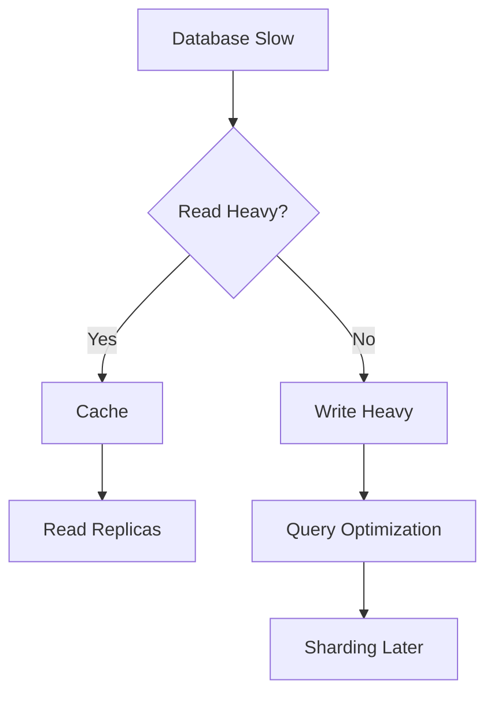
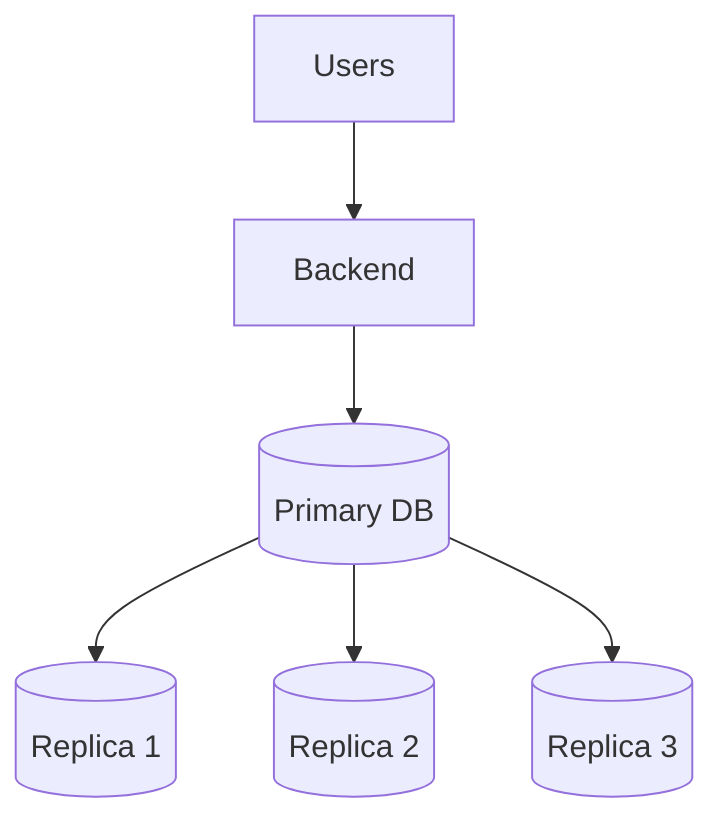

# Day-13 : Database Replication & Read Replicas

## Important Learning

Whenever a database becomes slow:

```text
Database Slow
      ↓
Find Bottleneck
      ↓
Apply Solution
```

Not:

```text
Database Slow
      ↓
Change Database
```

---

# The Problem

Suppose we built Instagram.

Architecture:

```text
Users
 ↓
Backend
 ↓
Database
```

Initially:

```text
100 Users
```

Everything works.

---

Later:

```text
10 Million Users
```

Database traffic increases.

---

Database Statistics:

```text
Reads  = 95%

Writes = 5%
```

Examples of Read Operations:

```text
View Profile

View Feed

View Posts

View Comments
```

---

Question:

```text
What becomes the bottleneck?
```

Answer:

```text
Database Read Traffic
```

The database becomes overloaded handling millions of read requests.

---

# What is Database Replication?

## Simple Definition

Replication means:

```text
Copying Data
From One Database
To Another Database
```

---

## Interview Definition

> Database Replication is the process of maintaining copies of the same data across multiple database servers.

---

# Why Do We Need Replication?

Suppose:

```text
Database Capacity

10,000 Reads/sec
```

---

Traffic:

```text
100,000 Reads/sec
```

---

Single database becomes overloaded.

---

Instead of:

```text
1 Database
```

Use:

```text
Multiple Database Copies
```

to distribute traffic.

---

# Primary Database

Also called:

```text
Master Database
```

Responsibilities:

```text
INSERT

UPDATE

DELETE
```

All write operations go here.

---

# Read Replica

Also called:

```text
Replica Database

Slave Database
```

Responsibilities:

```text
SELECT Queries
```

All read operations can be distributed to replicas.

---

# Primary + Replica Architecture

```text
                 Primary DB
                /    |    \
               /     |     \
       Replica1 Replica2 Replica3
```

---

# Request Flow

## Write Request

Example:

```text
Update Profile Picture
```

Goes to:

```text
Primary Database
```

---

## Read Request

Example:

```text
View Profile
```

Goes to:

```text
Read Replica
```

---

# Why Is This Useful?

Without Replicas:

```text
Primary Handles Reads + Writes
```

---

With Replicas:

```text
Primary
↓
Writes

Replicas
↓
Reads
```

This significantly reduces database load.

---

# Read Replica

## Definition

A Read Replica is a copy of the primary database that serves read queries.

---

Examples:

### Instagram

```text
View Profile

View Feed
```

---

### Amazon

```text
View Product
```

---

### Netflix

```text
View Movie Metadata
```

---

All can use replicas.

---

# How Does Replica Get Data?

Question:

```text
If writes happen on Primary,
how does Replica get updates?
```

---

Answer:

```text
Replication
```

---

Flow:

```text
Primary Updated
        ↓
Replication
        ↓
Replica Updated
```

---

# Replication Lag

Most Important Interview Topic.

---

Suppose:

### Primary Database

```text
Name = King Kohli
```

---

### Replica Database

```text
Name = Virat Kohli
```

---

Question:

```text
How can both be different?
```

---

Answer:

```text
Replication Lag
```

Replica has not yet received the latest update.

---

# Real Example

User updates profile picture.

---

Primary:

```text
New Profile Picture
```

---

Replica:

```text
Old Profile Picture
```

---

User immediately refreshes.

Still sees:

```text
Old Picture
```

---

This delay is called:

## Replication Lag

---

# Important Observation

```text
Primary = Correct Data

Replica = Old Data
```

---

The database is not broken.

The replica is simply behind.

---

# Benefits of Replication

### 1. More Read Capacity

---

### 2. Better Scalability

---

### 3. Reduced Primary Database Load

---

### 4. Improved Performance

---

# Trade-Offs of Replication

### Replication Lag

---

### More Infrastructure

---

### Higher Cost

---

### More Operational Complexity

---

# Why Not Multiple Primaries?

Suppose:

```text
Primary A

Primary B
```

Both accept writes.

---

Example:

```text
Primary A

Balance = ₹1000
```

---

```text
Primary B

Balance = ₹1200
```

---

Question:

```text
Which Value Is Correct?
```

Conflict occurs.

---

For SDE-1 Interviews:

Think:

```text
Single Primary

Multiple Replicas
```

---

# Load Balancer + Replicas

Suppose:

```text
10 Read Replicas
```

---

Question:

```text
How do we distribute read traffic?
```

---

Answer:

```text
Load Balancer
```

---

Architecture:

```text
                    Primary
                  /    |    \
                R1    R2    R3
                     ...
                   R10
```

Reads can be distributed among replicas.

---

# Replication vs Caching

Very Common Interview Question.

| Cache | Read Replica |
|---------|---------|
| Redis | Database Copy |
| RAM Based | Database Storage |
| Very Fast | Fast |
| Reduces DB Queries | Shares DB Load |
| Stale Data Possible | Replication Lag Possible |

---

# When Should We Use Replication?

Use Replication When:

```text
Read Heavy System
```

Example:

```text
Reads = 95%

Writes = 5%
```

---

Examples:

- Instagram
- Amazon Product Pages
- Netflix Metadata
- YouTube Video Metadata

---

# When Replication Does NOT Help

Suppose:

```text
Reads = 10%

Writes = 90%
```

---

Question:

```text
Will 10 Read Replicas Help?
```

---

Answer:

```text
No
```

Because:

```text
Read Replicas
↓
Handle Reads

Writes
↓
Still Go To Primary
```

---

Primary remains the bottleneck.

---

# Read Heavy vs Write Heavy

| System Type | Solution |
|-------------|-----------|
| Read Heavy | Cache + Read Replicas |
| Write Heavy | Query Optimization, Sharding, Write Scaling |

---

# Replication Thinking Framework



---

# Architecture Diagram



---

# Common Interview Questions

## Q1. What is Database Replication?

Creating copies of the same database across multiple servers.

---

## Q2. What is a Read Replica?

A copy of the primary database used for read queries.

---

## Q3. Why do companies use Read Replicas?

To reduce database read load and improve scalability.

---

## Q4. What is Replication Lag?

Delay between updates reaching the primary and replica databases.

---

## Q5. Can Replicas Handle Writes?

No.

Writes go to the primary database.

---

## Q6. When should Replication be used?

Read-heavy systems.

---

## Q7. Does Replication solve write bottlenecks?

No.

It primarily helps with reads.

---

# Common Interview Mistakes

### Mistake 1

Using replication for write-heavy systems.

---

### Mistake 2

Ignoring replication lag.

---

### Mistake 3

Thinking replicas accept writes.

---

### Mistake 4

Changing databases before identifying bottlenecks.

---

### Mistake 5

Not checking if reads are actually the problem.

---

# Key Takeaways

1. Replication creates copies of a database.
2. Primary database handles writes.
3. Replicas handle reads.
4. Replication improves read scalability.
5. Replication introduces lag.
6. Read replicas are ideal for read-heavy systems.
7. Replication does not solve write bottlenecks.
8. Cache and replication often work together.
9. Always identify the bottleneck before choosing a solution.
10. Read-heavy and write-heavy systems require different solutions.

---

# 30-Second Revision

```text
Database Slow
      ↓
Find Bottleneck

Read Heavy?
      ↓
Cache
Read Replicas

Write Heavy?
      ↓
Query Optimization
Sharding

Primary
      ↓
Writes

Replicas
      ↓
Reads

Replication Lag
      ↓
Replica Has Old Data
```

---

# Interview Keywords

```text
Replication = Database Copy

Primary DB = Writes

Read Replica = Reads

Read Heavy = Replication

Write Heavy = Replication Not Enough

Replication Lag = Delayed Updates

Cache = Reduce Queries

Replica = Share Read Load

Single Primary = Common Design

Find Bottleneck First
```