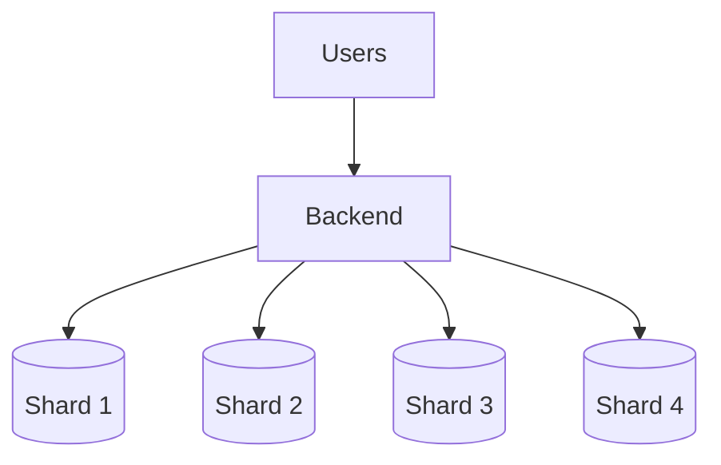
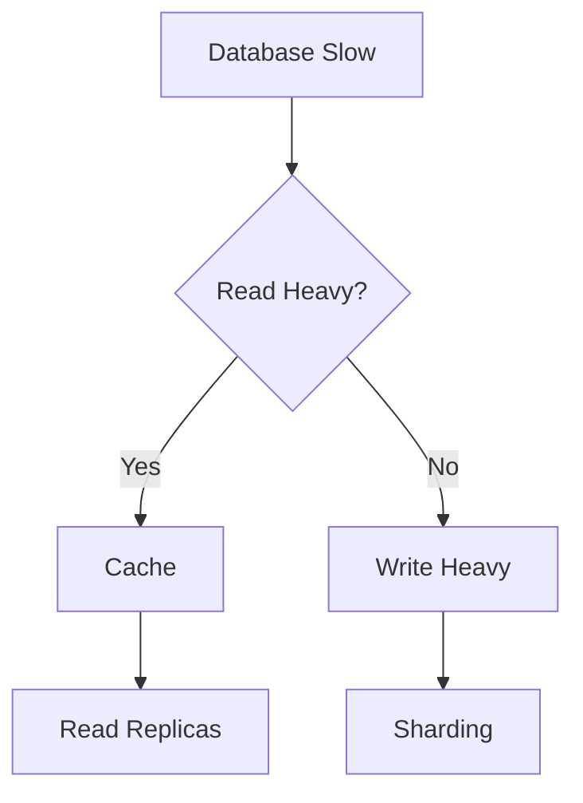

# Day-14 : Database Sharding & Partitioning

## Important Connection From Day 13

Day 13 solved:

```text
Read Bottleneck
```

using:

```text
Cache

Read Replicas
```

---

But what if:

```text
Reads = 10%

Writes = 90%
```

and:

```text
Primary Database CPU = 100%
```

---

Question:

```text
Will Read Replicas Help?
```

Answer:

```text
No
```

Because:

```text
Writes
↓
Still Go To Primary Database
```

This leads us to:

# Sharding

---

# What is Sharding?

## Simple Definition

```text
Sharding = Splitting Data Across Multiple Databases
```

---

## Interview Definition

> Sharding is a database scaling technique where data is horizontally partitioned across multiple database servers.

---

# Why Do We Need Sharding?

Suppose:

```text
100 Million Users
```

are stored in:

```text
One Database
```

---

Problems:

```text
Too Much Data

Too Many Writes

Storage Growth

Database CPU Bottleneck
```

---

Instead of:

```text
One Huge Database
```

use:

```text
Database 1

Database 2

Database 3

Database 4
```

Each stores only part of the data.

---

# Example

Without Sharding:

```text
Users 1 → 100 Million

Stored In One Database
```

---

With Sharding:

```text
DB1
Users 1 → 25 Million
```

```text
DB2
Users 25M → 50M
```

```text
DB3
Users 50M → 75M
```

```text
DB4
Users 75M → 100M
```

---

Result:

```text
Load Distributed

Write Capacity Increased

Storage Distributed
```

---

# Why Sharding Helps

Without Sharding:

```text
All Writes
↓
One Database
```

---

With Sharding:

```text
Writes
↓
Distributed Across
Multiple Databases
```

---

Benefits:

```text
More Write Capacity

More Storage

Better Scalability
```

---

# Sharding vs Replication

Very Important Interview Question.

---

## Replication

```text
Copy Data
```

Example:

```text
Primary
 ↓
Replica 1
 ↓
Replica 2
```

All contain:

```text
Same Data
```

---

Purpose:

```text
Read Scaling
```

---

## Sharding

```text
Split Data
```

Example:

```text
Shard 1
Users 1-1000
```

```text
Shard 2
Users 1001-2000
```

```text
Shard 3
Users 2001-3000
```

Each contains:

```text
Different Data
```

---

Purpose:

```text
Write Scaling
```

---

# Quick Comparison

| Replication              | Sharding                  |
| ------------------------ | ------------------------- |
| Copies Data              | Splits Data               |
| Same Data Everywhere     | Different Data Everywhere |
| Read Scaling             | Write Scaling             |
| Read Bottleneck Solution | Write Bottleneck Solution |

---

# What is a Shard Key?

Question:

```text
User ID = 105

Which Database Should Store It?
```

Need a rule.

---

Example:

```text
UserId % 4
```

If:

```text
105 % 4 = 1
```

Store in:

```text
Shard 1
```

---

If:

```text
106 % 4 = 2
```

Store in:

```text
Shard 2
```

---

Definition:

```text
Shard Key
```

determines:

```text
Which Data Goes To Which Shard
```

---

# Good Shard Key

A good shard key should:

```text
Distribute Data Evenly

Distribute Traffic Evenly
```

---

Examples:

```text
UserId

CustomerId

OrderId
```

---

# Bad Shard Key

Example:

```text
Country
```

Suppose:

```text
India = 90 Million Users

Bhutan = 1 Million Users
```

Result:

```text
India Shard Overloaded
```

---

# Hot Shard Problem

Definition:

```text
One Shard Receives
Most Of The Traffic
```

while others remain underutilized.

---

Example:

```text
Shard A
90% Traffic
```

```text
Shard B
5% Traffic
```

```text
Shard C
5% Traffic
```

---

Problem:

```text
Sharding Exists

But Bottleneck Still Exists
```

---

# Partitioning vs Sharding

Interviewers sometimes use these terms interchangeably.

---

## Partitioning

General concept:

```text
Split Data
```

---

## Sharding

A special type of partitioning where:

```text
Data Is Split Across
Multiple Physical Databases
```

---

# Horizontal Partitioning

Split rows.

Example:

```text
Users 1-1000

Users 1001-2000

Users 2001-3000
```

---

This is:

```text
Horizontal Partitioning
```

and most sharding systems use horizontal partitioning.

---

# Vertical Partitioning

Split columns.

Suppose:

```text
Users Table
```

contains:

```text
Name

Email

Bio

Profile Picture

Address
```

---

Split into:

```text
Basic Info Table

Profile Info Table
```

---

This is:

```text
Vertical Partitioning
```

---

# Re-Sharding

Very Important Interview Topic.

---

Suppose:

```text
Shard 1
Users 1-1M

Shard 2
Users 1M-2M

Shard 3
Users 2M-3M
```

---

Everything works.

Then:

```text
100 Million Users
```

arrive.

Need:

```text
More Shards
```

---

Question:

```text
Can We Just Add New Shards?
```

Not always.

---

Example:

Initially:

```text
UserId % 3
```

---

Later:

```text
UserId % 6
```

because new shards were added.

---

Now many users belong to different shards than before.

---

Definition:

```text
Re-Sharding
```

means:

```text
Changing The Number Of Shards

OR

Changing The Sharding Strategy
```

---

Examples:

```text
3 Shards → 6 Shards
```

```text
Country Based → UserId Based
```

Both are:

```text
Re-Sharding
```

---

# Shard Migration

When re-sharding happens:

```text
Existing Data
```

must move.

---

Example:

```text
User 10

Old Location:
Shard 1
```

After re-sharding:

```text
New Location:
Shard 4
```

---

Data must be physically moved.

---

Definition:

```text
Shard Migration
```

means:

```text
Moving Existing Data
From One Shard
To Another
```

---

# Why Shard Migration Is Difficult

## Problem 1

```text
Huge Data Movement
```

---

## Problem 2

```text
Time Consuming
```

---

## Problem 3

```text
Risk Of Downtime
```

---

## Problem 4

```text
Consistency Challenges
```

during migration.

---

# Cross-Shard Query Problem

Suppose:

```text
User A
Shard 1
```

```text
User B
Shard 3
```

Question:

```text
Find Both Together
```

Need:

```text
Query Multiple Shards
```

---

Problem:

```text
Complex Queries

More Network Calls

Higher Latency
```

---

# Replication + Sharding

Large systems use both.

---

Example:

```text
Shard 1
 ↓
Replica 1
Replica 2
```

---

```text
Shard 2
 ↓
Replica 1
Replica 2
```

---

Result:

```text
Sharding
↓
Write Scaling
```

and

```text
Replication
↓
Read Scaling
```

---

# Real World Examples

## Instagram

```text
Users

Posts

Comments
```

can be sharded.

---

## WhatsApp

```text
Messages
```

can be sharded.

---

## Amazon

```text
Orders
```

can be sharded.

---

## Uber

```text
Trips
```

can be sharded.

---

# Architecture Diagram



---

# Scaling Decision Tree



---

# Common Interview Questions

## Q1. What is Sharding?

Splitting data across multiple databases.

---

## Q2. Why do companies use Sharding?

To improve write scalability and storage capacity.

---

## Q3. What is a Shard Key?

A key used to determine which shard stores a particular piece of data.

---

## Q4. What is a Hot Shard?

A shard that receives disproportionately high traffic.

---

## Q5. Difference Between Replication and Sharding?

Replication copies data.

Sharding splits data.

---

## Q6. What is Re-Sharding?

Changing the number of shards or sharding strategy.

---

## Q7. What is Shard Migration?

Moving data from one shard to another during re-sharding.

---

# Common Interview Mistakes

### Mistake 1

Confusing replication with sharding.

---

### Mistake 2

Using read replicas for write bottlenecks.

---

### Mistake 3

Choosing a poor shard key.

---

### Mistake 4

Ignoring hot shards.

---

### Mistake 5

Ignoring re-sharding complexity.

---

# Key Takeaways

1. Sharding solves write bottlenecks.
2. Replication solves read bottlenecks.
3. Sharding splits data.
4. Replication copies data.
5. A shard key decides data placement.
6. Poor shard keys create hot shards.
7. Re-sharding becomes necessary as systems grow.
8. Re-sharding often requires shard migration.
9. Cross-shard queries add complexity.
10. Large systems use both sharding and replication.

---

# 30-Second Revision

```text
Read Heavy
      ↓
Cache
Read Replicas

Write Heavy
      ↓
Sharding

Replication
      ↓
Copy Data

Sharding
      ↓
Split Data

Bad Shard Key
      ↓
Hot Shard

More Shards
      ↓
Re-Sharding

Re-Sharding
      ↓
Shard Migration
```

---

# Interview Keywords

```text
Sharding = Split Data

Replication = Copy Data

Shard Key = Data Placement Rule

Hot Shard = Uneven Traffic

Horizontal Partitioning = Split Rows

Vertical Partitioning = Split Columns

Re-Sharding = Change Shards

Shard Migration = Move Data

Read Scaling = Replication

Write Scaling = Sharding
```
