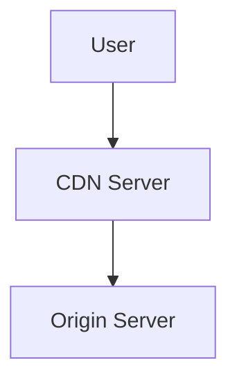
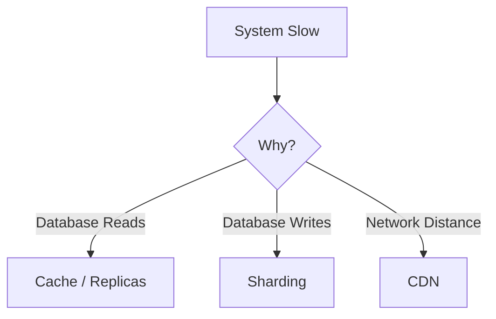

# Day-15 : Content Delivery Networks (CDN)

## Important Connection From Previous Topics

So far we learned:

```text
Read Bottleneck
↓
Cache
Read Replicas
```

```text
Write Bottleneck
↓
Sharding
```

---

But today the bottleneck is different.

```text
User Far Away
↓
High Network Latency
```

---

Question:

```text
Can Cache Solve This?

Can Replicas Solve This?

Can Sharding Solve This?
```

Answer:

```text
No
```

Because the bottleneck is:

```text
Network Distance
```

---

# The Problem

Suppose YouTube stores a video in:

```text
California, USA
```

---

A user opens YouTube from:

```text
India
```

---

Request Path:

```text
India
 ↓
USA
 ↓
India
```

---

Result:

```text
High Latency

Slow Loading

Poor User Experience
```

---

Even if:

```text
Database = Healthy

CPU = Healthy

Cache = Healthy
```

the application may still feel slow.

---

Reason:

```text
Network Distance
```

---

# What is a CDN?

## Simple Definition

A CDN stores copies of content closer to users.

---

## Interview Definition

> A Content Delivery Network (CDN) is a geographically distributed network of servers that caches and delivers content from locations closer to users.

---

# Core Idea

Instead of:

```text
Move Users Closer To Content
```

we do:

```text
Move Content Closer To Users
```

---

# Without CDN

```text
User
 ↓
Origin Server
```

Every request goes to the origin.

---

# With CDN

```text
User
 ↓
CDN Server
 ↓
Origin Server
```

Most requests are served from the CDN.

---

# What is an Origin Server?

The original source of the content.

Examples:

```text
Main YouTube Server

Main Netflix Server

Main Amazon Server
```

---

The CDN stores copies.

The Origin stores the original content.

---

# CDN Flow

Suppose a user requests:

```text
profile.jpg
```

---

Step 1

CDN checks:

```text
Do I Have This File?
```

---

If Yes:

```text
Serve Immediately
```

This is:

## Cache Hit

---

If No:

```text
Fetch From Origin

Store Copy

Serve User
```

This is:

## Cache Miss

---

# CDN = Distributed Cache

Think of CDN as:

```text
Redis For Files
```

distributed across the world.

---

# Architecture Diagram



---

# Why Companies Use CDN

## Benefit 1

### Lower Latency

Content is physically closer to users.

---

## Benefit 2

### Faster Loading

```text
Images

Videos

Static Files
```

load faster.

---

## Benefit 3

### Reduced Origin Load

Without CDN:

```text
Every Request
↓
Origin
```

---

With CDN:

```text
Most Requests
↓
CDN
```

---

## Benefit 4

### Better Scalability

Millions of users can access content simultaneously.

---

# What Should Be Stored In CDN?

Ideal Candidates:

```text
Images

Videos

CSS Files

JavaScript Files

PDF Files

Audio Files
```

---

Think:

```text
Static Content
```

---

# What Should NOT Be Stored?

Examples:

```text
Bank Balance

Payment Status

Live Stock Price
```

---

Reason:

```text
Changes Frequently
```

---

CDNs work best for:

```text
Read Heavy

Static Content
```

---

# CDN vs Redis

Very Common Interview Question

| Redis | CDN |
|---------|---------|
| Application Cache | Content Cache |
| Stores Metadata | Stores Files |
| Stores Query Results | Stores Images/Videos |
| RAM Based | Distributed Edge Servers |

---

# Example

Instagram

### Redis Stores

```text
Follower Count

Profile Metadata

User Information
```

---

### CDN Stores

```text
Profile Pictures

Story Images

Reel Thumbnails

Videos
```

---

# CDN Trade-Offs

## Benefits

```text
Lower Latency

Reduced Origin Load

Better Scalability

Better User Experience
```

---

## Costs

```text
Extra Infrastructure

Extra Cost

Cache Invalidation Challenges

Data Freshness Challenges
```

---

# Stale Content Problem

Suppose:

```text
profile.jpg
```

already exists in CDN.

---

User uploads:

```text
New Profile Picture
```

---

Origin Server:

```text
Updated
```

---

CDN:

```text
Still Has Old Image
```

---

Result:

```text
User Sees Old Image
```

---

This is called:

## Stale Content

---

# CDN Invalidation

Solution:

```text
Remove Old Cached Content
```

from CDN.

---

This process is called:

```text
Cache Invalidation
```

---

# CDN vs Replication

Very Important

| CDN | Replication |
|---------|---------|
| Stores Files | Stores Database Data |
| Solves Network Latency | Solves Read Bottleneck |
| Global Distribution | Database Scaling |
| Images/Videos | Rows/Tables/Documents |

---

# Real World Examples

## YouTube

```text
Videos

Thumbnails
```

---

## Netflix

```text
Movies

TV Shows
```

---

## Instagram

```text
Photos

Stories

Reels
```

---

## Amazon

```text
Product Images
```

---

# Common CDN Providers

Examples:

- Cloudflare
- Akamai
- Amazon CloudFront
- Fastly

---

# CDN Decision Framework



---

# Common Interview Questions

## Q1. What is a CDN?

A distributed network of servers that delivers content from locations closer to users.

---

## Q2. Why do companies use CDNs?

To reduce latency, improve performance, and reduce origin server load.

---

## Q3. What is an Origin Server?

The original source of the content.

---

## Q4. What is a Cache Hit?

CDN already has the content.

---

## Q5. What is a Cache Miss?

CDN fetches content from the origin server.

---

## Q6. What is Stale Content?

Old content exists in CDN after origin content changes.

---

## Q7. What is CDN Invalidation?

Removing outdated content from CDN caches.

---

# Interview Practice Scenarios

## Scenario 1

### Situation

```text
Instagram users in India report:

Images Load Slowly

Servers exist only in USA
```

---

### Question

What is the bottleneck?

What solution would you suggest?

---

### Interview Answer

The bottleneck is network distance. Users in India must communicate with servers in the USA, increasing latency.

I would introduce CDN servers closer to users in India so images can be served locally, reducing latency and improving user experience.

---

## Scenario 2

### Situation

```text
A company stores:

Profile Pictures
Videos
CSS Files

directly on application servers.
```

Traffic increases massively.

---

### Question

Would CDN help?

Why?

---

### Interview Answer

Yes. CDN is ideal for static content such as images, videos, and CSS files. It reduces load on the application servers and delivers content from locations closer to users, improving performance and scalability.

---

## Scenario 3

### Situation

```text
User updates:

profile.jpg
```

Immediately refreshes the page.

Still sees the old image.

---

### Question

What happened?

---

### Interview Answer

The CDN is serving stale content. The origin server has the updated image, but the CDN cache has not been invalidated or refreshed yet.

---

## Scenario 4

### Situation

```text
Website Slow In India

Website Fast In USA
```

---

### Question

Would you suggest:

```text
Sharding

Read Replicas

CDN
```

Why?

---

### Interview Answer

I would first identify the bottleneck.

Since the website is only slow in India and performs well in the USA, the likely bottleneck is network latency caused by geographic distance.

Therefore, CDN is the most appropriate solution.

---

## Scenario 5

### Situation

Netflix has:

```text
100 Million Users
```

watching the same movie worldwide.

---

### Question

Why is CDN better than serving all requests directly from the origin server?

---

### Interview Answer

CDN stores copies of the movie closer to users across multiple geographic regions.

This reduces network latency, improves video loading speed, and prevents the origin server from becoming overloaded with millions of requests.

---

# Key Takeaways

1. CDN solves network latency problems.
2. CDN moves content closer to users.
3. CDN is ideal for static content.
4. CDN reduces load on origin servers.
5. Cache Hit = Content already exists in CDN.
6. Cache Miss = Content fetched from origin.
7. CDN can serve millions of users efficiently.
8. CDN introduces stale content challenges.
9. Cache invalidation is required to refresh outdated content.
10. CDN solves a different bottleneck than caching, replication, or sharding.

---

# 30-Second Revision

```text
User Far Away
      ↓
Network Latency
      ↓
CDN

CDN
      ↓
Copies Of Content

Origin Server
      ↓
Original Content

Cache Hit
      ↓
Serve Directly

Cache Miss
      ↓
Fetch From Origin

Static Files
      ↓
CDN

Images
Videos
CSS
JS

Stale Content
      ↓
Cache Invalidation
```

---

# Interview Keywords

```text
CDN = Content Delivery Network

Origin Server = Original Source

Cache Hit = File Already Cached

Cache Miss = Fetch From Origin

Static Content = CDN

Network Latency = CDN Problem

Stale Content = Old Cached Data

Cache Invalidation = Refresh CDN

Redis = Metadata

CDN = Images/Videos/Files
```