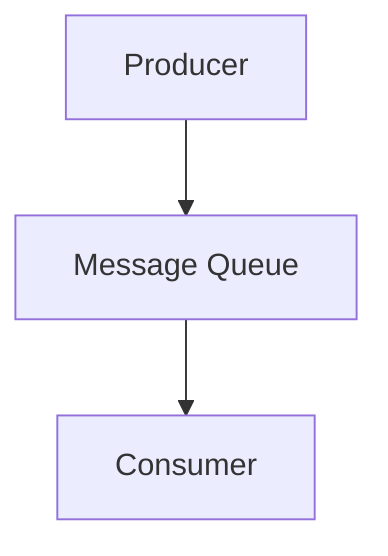
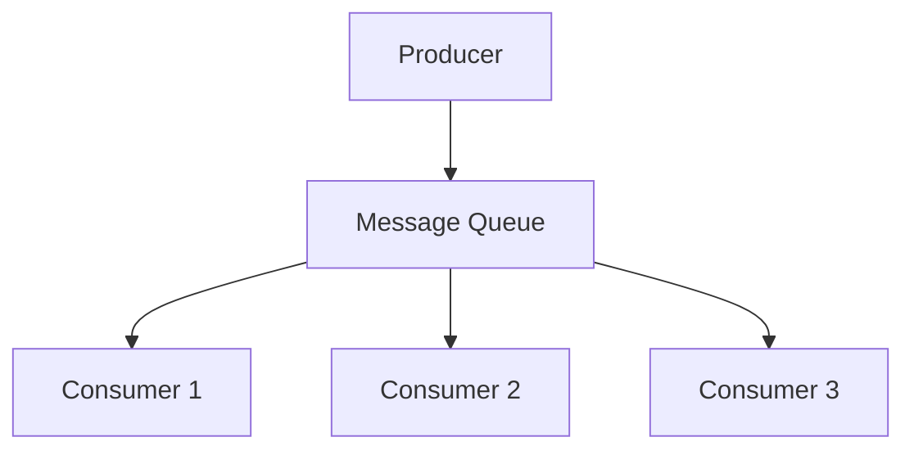
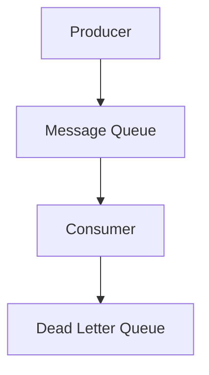
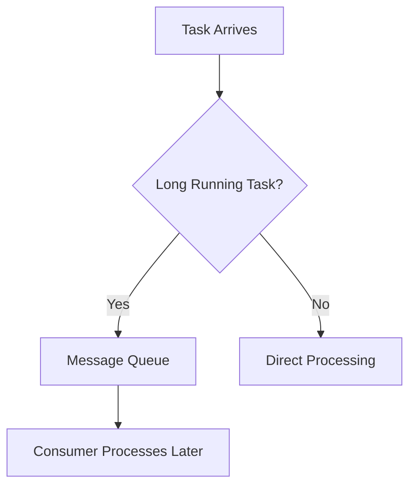

# Day-16 : Message Queues & Producer Consumer Pattern

## Important Connection From Previous Topics

So far we learned:

```text
Load Balancer
↓
Distribute Requests
```

```text
Replication
↓
Distribute Reads
```

```text
Sharding
↓
Distribute Writes
```

Today:

```text
Message Queue
↓
Distribute Work
```

---

# The Problem

Suppose a user signs up on Instagram.

Tasks:

```text
Create User

Send Welcome Email

Generate Profile Thumbnail

Notify Analytics Service
```

---

Without Queue:

```text
Create User (3 sec)

Send Email (2 sec)

Generate Thumbnail (3 sec)

Analytics (1 sec)
```

Total:

```text
9 Seconds
```

---

User Experience:

```text
Terrible
```

---

Question:

Can we immediately tell the user:

```text
Account Created Successfully
```

and process the remaining work later?

Answer:

```text
Yes
```

This is where Message Queues help.

---

# What is a Message Queue?

## Simple Definition

A Message Queue temporarily stores tasks until another service processes them.

---

## Interview Definition

> A Message Queue is a buffer that enables asynchronous communication between services by temporarily storing messages until consumers process them.

---

# Restaurant Analogy

Customer:

```text
Places Order
```

---

Kitchen:

```text
Prepares Food
```

---

Question:

Should the customer enter the kitchen?

```text
No
```

---

Instead:

```text
Order Slip
↓
Queue
↓
Kitchen Processes
```

---

That order slip queue is exactly:

```text
Message Queue
```

---

# Producer Consumer Pattern

Most Important Concept

---

## Producer

Creates messages.

---

Example:

```text
Signup Service
```

creates:

```text
Send Welcome Email
```

message.

---

## Consumer

Processes messages.

---

Example:

```text
Email Service
```

processes:

```text
Send Welcome Email
```

message.

---

# Core Architecture

```text
Producer
   ↓
Queue
   ↓
Consumer
```

---

# Example

```text
Signup Service
      ↓
Message Queue
      ↓
Email Service
```

---

# Architecture Diagram



---

# Why Not Direct Service Calls?

Without Queue:

```text
Signup Service
      ↓
Email Service
```

---

Problem:

If Email Service crashes:

```text
Signup Fails
```

---

Bad User Experience.

---

# With Queue

```text
Signup Service
      ↓
Queue
      ↓
Email Service
```

---

If Email Service crashes:

```text
Message Remains In Queue
```

---

When service recovers:

```text
Message Gets Processed
```

---

# Loose Coupling

One of the biggest benefits.

---

Question:

Does Signup Service care how Email Service sends emails?

```text
No
```

---

It simply says:

```text
Please Send Email
```

and pushes a message.

---

This is called:

```text
Loose Coupling
```

---

# Synchronous vs Asynchronous

## Synchronous

```text
Request
↓
Wait
↓
Response
```

---

Example:

```text
Login
```

User must wait.

---

## Asynchronous

```text
Request
↓
Queue
↓
Immediate Response
```

---

Processing happens later.

---

Examples:

```text
Send Email

Generate Thumbnail

Analytics

Notifications
```

---

# Why Companies Love Message Queues

## Benefit 1

### Faster User Experience

Users don't wait for long-running tasks.

---

## Benefit 2

### Load Smoothing

Suppose:

```text
1,000 Requests/sec
```

suddenly become:

```text
100,000 Requests/sec
```

---

Without Queue:

```text
System Crashes
```

---

With Queue:

```text
Requests Buffered

Consumers Process Gradually
```

---

## Benefit 3

### Reliability

Consumer crashes?

```text
Message Still Exists
```

---

Can retry later.

---

## Benefit 4

### Scalability

Need more processing?

Add:

```text
More Consumers
```

---

# Multiple Consumers



---

Think:

```text
Load Balancer

But For Tasks
```

---

# Traffic Spike Example

Normal:

```text
10 Messages/sec
```

---

Suddenly:

```text
10,000 Messages/sec
```

---

Without Queue:

```text
Requests Lost
```

---

With Queue:

```text
Requests Buffered

Consumers Continue Processing
```

---

# Queue Backlog

Suppose:

Producer:

```text
1,000,000 Messages/minute
```

---

Consumers:

```text
100,000 Messages/minute
```

---

Result:

```text
Queue Keeps Growing
```

---

This is called:

```text
Queue Backlog

or

Message Lag
```

---

# How To Solve Queue Backlog?

### Add More Consumers

---

### Optimize Consumer Logic

---

### Increase Consumer Resources

---

### Partition The Queue

---

# Dead Letter Queue (DLQ)

Interview Favorite

---

Suppose:

```text
Send Email
```

fails.

---

Retry:

```text
Fail

Fail

Fail
```

---

Question:

Should we retry forever?

```text
No
```

---

Move message to:

```text
Dead Letter Queue
```

---

Definition:

A queue that stores messages which repeatedly fail processing.

---

# DLQ Flow



---

# Message Ordering

Sometimes order matters.

---

Example:

```text
Withdraw ₹500

Deposit ₹1000
```

---

Wrong Order:

```text
Deposit

Withdraw
```

may create issues.

---

Some queues guarantee ordering.

Some don't.

Trade-off.

---

# Queue vs Database

Common Interview Question

| Database          | Queue              |
| ----------------- | ------------------ |
| Stores Data       | Stores Tasks       |
| Permanent Storage | Temporary Buffer   |
| User Records      | Background Jobs    |
| Query Focused     | Processing Focused |

---

Example:

```text
User Profile
```

→ Database

---

```text
Send Welcome Email
```

→ Queue

---

# Queue vs Cache

| Cache        | Queue              |
| ------------ | ------------------ |
| Stores Data  | Stores Work        |
| Faster Reads | Async Processing   |
| Redis        | RabbitMQ/Kafka/SQS |

---

# Popular Message Queues

Examples:

- RabbitMQ
- Apache Kafka
- Amazon SQS
- ActiveMQ

No need to memorize internals yet.

---

# Real World Examples

## Instagram

```text
Notifications

Thumbnail Generation

Analytics
```

---

## YouTube

```text
Video Processing

Thumbnail Generation
```

---

## Uber

```text
Trip Events

Notifications
```

---

## Amazon

```text
Order Processing

Emails
```

---

# Message Queue Decision Framework



---

# Common Interview Questions

## Q1. What is a Message Queue?

A temporary buffer that stores tasks until consumers process them.

---

## Q2. What is a Producer?

A service that creates messages.

---

## Q3. What is a Consumer?

A service that processes messages.

---

## Q4. Why use Message Queues?

To improve responsiveness, scalability, reliability, and decoupling.

---

## Q5. What is Loose Coupling?

Services communicate through a queue instead of depending directly on each other.

---

## Q6. What is a Dead Letter Queue?

A queue that stores messages which repeatedly fail processing.

---

## Q7. What is Queue Backlog?

When producers create messages faster than consumers can process them.

---

# Interview Practice Scenarios

## Scenario 1

### Situation

Instagram Signup:

```text
Create User

Send Welcome Email

Generate Thumbnail
```

---

### Question

Why would a queue help?

---

### Interview Answer

A queue allows the system to immediately respond to the user after account creation while background tasks such as sending emails and generating thumbnails are processed asynchronously by consumers.

---

## Scenario 2

### Situation

Traffic increases:

```text
1,000 Orders/sec

↓

100,000 Orders/sec
```

---

### Question

How does a queue prevent system failure?

---

### Interview Answer

The queue buffers incoming requests instead of overwhelming downstream services. Consumers process tasks gradually, preventing sudden traffic spikes from crashing the system.

---

## Scenario 3

### Situation

Email Service crashes.

---

### Question

What happens if a queue exists between Signup Service and Email Service?

---

### Interview Answer

Messages remain safely stored in the queue. Once the Email Service recovers, it can continue processing pending messages. Signup functionality remains unaffected due to loose coupling.

---

## Scenario 4

### Situation

A company stores:

```text
Send Email Tasks
```

inside MySQL.

---

### Question

Why might a dedicated queue be better?

---

### Interview Answer

Although MySQL can store tasks, message queues are specifically designed for asynchronous processing and provide retries, ordering guarantees, dead letter queues, consumer scaling, and higher throughput.

---

## Scenario 5

### Situation

Producer creates:

```text
1,000,000 Messages/minute
```

Consumers process:

```text
100,000 Messages/minute
```

---

### Question

What problem appears?

How would you solve it?

---

### Interview Answer

A queue backlog develops because messages arrive faster than they are processed. The solution is to scale consumers horizontally, optimize processing logic, partition queues, or increase consumer resources.

---

# Key Takeaways

1. Message Queues enable asynchronous processing.
2. Producers create messages.
3. Consumers process messages.
4. Queues improve user responsiveness.
5. Queues smooth traffic spikes.
6. Queues improve reliability.
7. DLQ handles repeatedly failing messages.
8. Multiple consumers improve throughput.
9. Queue backlog occurs when producers outpace consumers.
10. Message Queues distribute work across services.

---

# 30-Second Revision

```text
Producer
↓
Creates Work

Queue
↓
Stores Work

Consumer
↓
Processes Work

Long Task
↓
Message Queue

Traffic Spike
↓
Queue Buffer

Consumer Crash
↓
Message Waits

Repeated Failure
↓
DLQ

Producer Faster Than Consumer
↓
Queue Backlog
```

---

# Interview Keywords

```text
Producer = Creates Messages

Consumer = Processes Messages

Queue = Stores Work

Async Processing = Background Execution

Loose Coupling = Services Independent

Traffic Spike = Queue Buffer

DLQ = Failed Messages

Queue Backlog = Consumer Lag

RabbitMQ = Message Queue

Kafka = Message Queue
```
