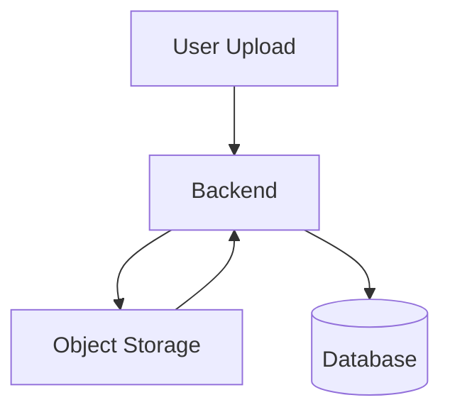
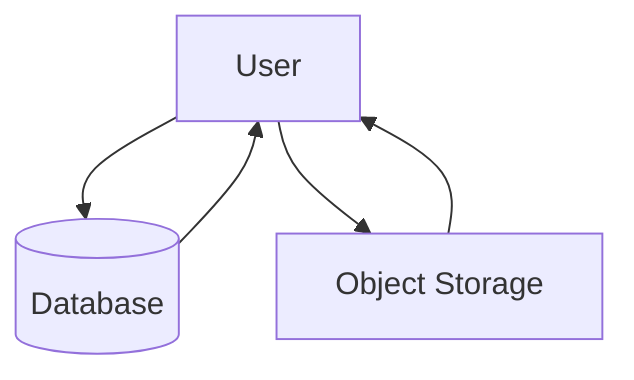
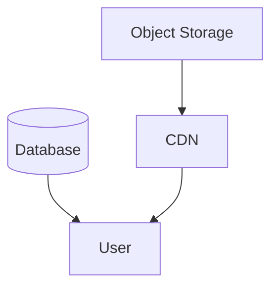
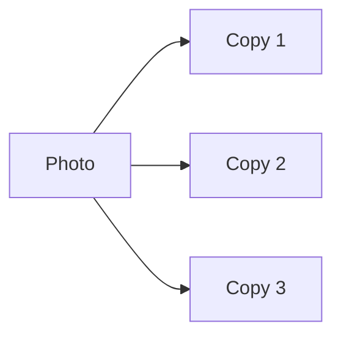

# Day-17 : Storage Systems & File Storage Design

## Important Connection From Previous Topics

So far we have learned:

```text
Database
↓
Stores Structured Data
```

```text
CDN
↓
Delivers Content Faster
```

```text
Message Queue
↓
Processes Background Tasks
```

---

But a new question appears:

```text
Where Should We Store

Images?

Videos?

PDFs?

Documents?

Audio Files?
```

---

Answer:

```text
Object Storage
```

---

# The Problem

Suppose Instagram has:

```text
100 Million Users
```

Each user uploads:

```text
5 MB Image
```

---

Question:

```text
Should We Store Images
Inside MySQL?
```

Technically:

```text
Yes
```

---

Practically:

```text
Terrible Idea
```

---

Reason:

Databases are optimized for:

```text
Structured Data
```

not:

```text
Large Files
```

---

# Structured Data vs File Data

## Structured Data

Examples:

```text
User Name

Email

Phone Number

Likes Count

Comments Count

Follower Count
```

Stored in:

```text
Database
```

---

## File Data

Examples:

```text
Images

Videos

PDFs

Audio Files

Documents
```

Stored in:

```text
Object Storage
```

---

# What is Object Storage?

## Simple Definition

```text
A Storage System
Designed Specifically
For Large Files
```

---

Examples:

```text
Images

Videos

Audio

Documents

Backups
```

---

Popular Examples:

```text
Amazon S3

Google Cloud Storage

Azure Blob Storage
```

---

# Real Instagram Example

## Database Stores

```text
User ID

Caption

Upload Time

Likes Count

Comments Count

Image URL
```

---

## Storage Stores

```text
Actual Image File
```

---

# What is Metadata?

Suppose:

```text
vacation.jpg
```

exists.

---

Metadata:

```text
Image URL

Owner ID

Upload Time

File Size
```

---

Actual File:

```text
vacation.jpg
```

stored in Object Storage.

---

# Core Principle

```text
Database
↓
Stores Metadata

Storage
↓
Stores Files
```

---

# Upload Flow

Suppose user uploads:

```text
profile.jpg
```

---

Flow:

```text
User
 ↓
Backend
 ↓
Object Storage
 ↓
URL Generated
 ↓
Database Stores URL
```

---

# Upload Architecture



---

# Why Store URLs Instead Of Files?

Suppose:

```text
Image Size = 5 MB
```

---

Instead of storing:

```text
Entire Image
```

inside database,

store:

```text
https://storage.com/image123.jpg
```

---

Benefits:

```text
Smaller Database

Faster Queries

Cheaper Storage

Better Scalability
```

---

# Retrieval Flow

User opens profile.

---

Flow:

```text
Database
↓
Returns Image URL
```

---

Then:

```text
Storage
↓
Returns Actual Image
```

---

# Retrieval Architecture



---

# Storage + CDN

Connection to Day 15.

---

Question:

```text
Should Every User
Download Directly
From Storage?
```

Not ideal.

---

Instead:

```text
Storage
 ↓
CDN
 ↓
User
```

---

# Architecture



---

# Complete Flow

```text
Upload Photo
↓
Store In Object Storage
↓
Storage Returns URL
↓
URL Stored In Database
↓
CDN Caches File
↓
User Accesses CDN
```

---

# Storage vs Database

| Database | Storage |
|-----------|----------|
| Structured Data | Files |
| User Data | Images |
| Orders | Videos |
| Metadata | Documents |
| Query Optimized | File Optimized |

---

# Storage vs CDN

| Storage | CDN |
|----------|----------|
| Original File | Cached Copy |
| Permanent | Temporary |
| Source Of Truth | Faster Delivery |
| Stores Data | Distributes Data |

---

# Warehouse Analogy

```text
Object Storage
=
Main Warehouse
```

---

```text
CDN
=
Local Shop
```

---

Excellent Interview Analogy.

---

# Storage vs Cache

| Cache | Storage |
|---------|----------|
| Temporary | Permanent |
| Can Expire | Durable |
| Faster Access | Long-Term Storage |
| Redis | S3/GCS |

---

# Storage vs Queue

| Queue | Storage |
|---------|---------|
| Stores Work | Stores Files |
| Temporary | Permanent |
| Async Processing | File Management |

---

# Durability

Very Important Interview Term.

---

Definition:

```text
Probability That Data
Will Not Be Lost
```

---

Examples:

```text
Photos

Videos

Documents

Bank Records
```

must survive failures.

---

# How Storage Systems Achieve Durability

Suppose:

```text
Photo A
```

---

Stored as:

```text
Copy 1

Copy 2

Copy 3
```

across multiple machines.

---

If one machine dies:

```text
Data Still Exists
```

---

# Replication In Storage



---

# Availability vs Durability

Very Important Interview Question.

---

## Availability

```text
Can I Access The Data?
```

---

Example:

```text
Storage Server Down
```

User cannot access file.

---

## Durability

```text
Will Data Be Lost?
```

---

If copies exist:

```text
Data Safe
```

---

# Real World Examples

## Instagram

### Database

```text
Caption

Likes

Comments

Image URL
```

---

### Storage

```text
Photos

Stories

Reels
```

---

## YouTube

### Database

```text
Video Metadata

Title

Views
```

---

### Storage

```text
Videos
```

---

## Google Drive

### Database

```text
File Metadata
```

---

### Storage

```text
Documents

Images

Files
```

---

# Common Interview Questions

## Q1. What is Object Storage?

A storage system optimized for large files such as images, videos, and documents.

---

## Q2. Why not store images in MySQL?

Databases are optimized for structured data, not large files. Storing files increases database size and reduces performance.

---

## Q3. What is Metadata?

Information about a file such as URL, owner, upload time, and size.

---

## Q4. What is Durability?

The probability that data will not be lost.

---

## Q5. Difference Between Storage and CDN?

Storage stores original files.

CDN stores cached copies closer to users.

---

## Q6. Difference Between Storage and Database?

Databases store metadata.

Storage stores files.

---

# Interview Practice Scenarios

## Scenario 1

### Situation

Instagram stores:

```text
User ID

Caption

Likes

Comments

Images
```

---

### Question

Which data belongs in the database?

Which belongs in storage?

---

### Interview Answer

The database should store metadata such as User ID, Caption, Likes, Comments, and Image URL.

The actual image files should be stored in object storage because storage systems are optimized for large files.

---

## Scenario 2

### Situation

A startup stores videos directly inside MySQL.

Traffic grows to:

```text
100 Million Users
```

---

### Question

What problem appears?

What would you change?

---

### Interview Answer

The database size grows significantly, making queries slower and increasing storage costs.

I would move videos to object storage and store only the video URLs in the database.

---

## Scenario 3

### Question

Difference between Storage and CDN?

---

### Interview Answer

Object Storage stores the original source of files and acts as the source of truth.

CDN stores cached copies closer to users to reduce latency and improve performance.

---

## Scenario 4

### Situation

A storage server crashes.

---

### Question

How can storage systems avoid losing files?

---

### Interview Answer

Storage systems maintain multiple replicas of files across different machines. If one server fails, other copies remain available, ensuring durability.

---

## Scenario 5

### Situation

Instagram photo upload.

---

### Question

Describe the complete flow from upload to user viewing the image.

---

### Interview Answer

```text
User Uploads Photo
        ↓
Backend Receives File
        ↓
File Stored In Object Storage
        ↓
Storage Returns URL
        ↓
URL Stored In Database
        ↓
CDN Caches File
        ↓
User Requests Photo
        ↓
Database Returns URL
        ↓
CDN Serves File
        ↓
User Sees Photo
```

---

# Key Takeaways

1. Databases store metadata.
2. Object Storage stores files.
3. Large files should not be stored in databases.
4. Storage systems provide durability through replication.
5. CDN stores cached copies of files.
6. Storage stores original files.
7. Metadata includes URLs and file information.
8. Upload flow stores file first, then URL.
9. Retrieval flow fetches URL first, then file.
10. Most modern systems combine Database + Storage + CDN.

---

# 30-Second Revision

```text
Database
↓
Metadata

Object Storage
↓
Files

CDN
↓
Cached Copies

Upload
↓
Storage
↓
URL
↓
Database

Retrieve
↓
Database
↓
URL
↓
CDN

Storage
=
Warehouse

CDN
=
Local Shop

Durability
↓
Multiple Copies
```

---

# Interview Keywords

```text
Object Storage = File Storage

Metadata = File Information

Database = Structured Data

Storage = Files

CDN = Cached Copies

Durability = Data Not Lost

Replication = Multiple Copies

Upload Flow = Storage → URL → DB

Retrieval Flow = DB → URL → CDN

Storage + CDN = Modern Architecture
```