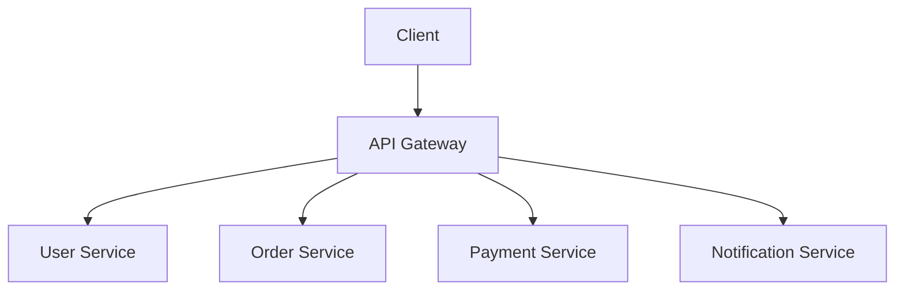

# Day-18 : API Design for Large Systems

## Important Connection From Previous Topics

So far we have learned:

```text
Load Balancer
↓
Distribute Requests

Cache
↓
Reduce DB Reads

Replication
↓
Scale Reads

Sharding
↓
Scale Writes

CDN
↓
Deliver Content Faster

Message Queue
↓
Process Background Tasks

Storage
↓
Store Files
```

---

Question:

```text
How Do Clients Communicate
With The Backend?
```

Answer:

```text
API
```

---

# What is an API?

## Simple Definition

An API is a way for two software systems to communicate.

---

## Real Life Analogy

```text
Customer
↓
Waiter
↓
Kitchen
```

---

Customer:

```text
Places Order
```

---

Kitchen:

```text
Prepares Food
```

---

Waiter:

```text
API
```

---

The customer never enters the kitchen.

The waiter acts as the communication layer.

---

# Request & Response Model

Every API follows:

```text
Request
↓
Backend Processing
↓
Response
```

---

Example

Request:

```http
GET /users/101
```

---

Response:

```json
{
  "id": 101,
  "name": "Shashwat"
}
```

---

# REST APIs

Most commonly used API style.

For interviews think:

```text
REST
=
HTTP Based APIs
```

---

# HTTP Methods

## GET

Fetch Data.

Example:

```http
GET /users/123
```

Meaning:

```text
Get User 123
```

---

## POST

Create Data.

Example:

```http
POST /users
```

Meaning:

```text
Create New User
```

---

## PUT

Replace Entire Resource.

Example:

```http
PUT /users/123
```

---

## PATCH

Partial Update.

Example:

```http
PATCH /users/123
```

---

## DELETE

Delete Resource.

Example:

```http
DELETE /users/123
```

---

# Resource-Based API Design

Bad:

```text
/getUser

/createUser

/deleteUser
```

---

Good:

```http
GET /users

POST /users

DELETE /users/123
```

---

Interview Rule:

Think:

```text
Users

Posts

Products

Orders
```

Not:

```text
getUser()

deleteUser()
```

---

# API Status Codes

## 200

```text
Success
```

---

## 201

```text
Created Successfully
```

---

## 400

```text
Bad Request
```

---

## 401

```text
Unauthorized
```

---

## 403

```text
Forbidden
```

---

## 404

```text
Resource Not Found
```

---

## 500

```text
Internal Server Error
```

---

# Pagination

## Why Pagination?

Suppose Instagram has:

```text
100 Million Posts
```

---

Question:

Should backend return:

```text
All 100 Million Posts
```

?

```text
No
```

---

Problems:

```text
Huge Response Size

High Memory Usage

Slow Network Transfer

Poor User Experience
```

---

Solution:

```text
Pagination
```

---

# Type 1: Offset Pagination

Example:

```http
GET /posts?page=2&limit=20
```

---

SQL:

```sql
SELECT *
FROM posts
LIMIT 20 OFFSET 20;
```

---

Meaning:

```text
Skip First 20 Posts

Return Next 20
```

---

## Benefits

```text
Easy To Implement

Supports Jumping To Any Page

Good For Search Results
```

---

## Problems

Suppose:

```text
Page = 500000
```

Database must skip millions of rows.

---

Result:

```text
Slow Query
```

---

Another Problem:

```text
Pagination Drift
```

When new data is inserted, some records may repeat or disappear.

---

# Type 2: Cursor Pagination

Used By:

```text
Instagram

Twitter

Facebook

LinkedIn
```

---

Instead Of:

```text
Page Number
```

we use:

```text
Last Seen Item
```

---

Example:

Response:

```text
Post100
Post99
Post98
Post97
Post96
```

---

Cursor:

```text
96
```

---

Next Request:

```http
GET /posts?cursor=96
```

---

Meaning:

```text
Give Posts After Post96
```

---

Response:

```text
Post95
Post94
Post93
Post92
Post91
```

---

New Cursor:

```text
91
```

---

## Benefits

```text
Very Fast

Scales Well

Works With Infinite Scroll

No Pagination Drift
```

---

## Limitation

Cannot directly jump to:

```text
Page 500
```

---

# Offset vs Cursor Pagination

| Feature             | Offset | Cursor |
| ------------------- | ------ | ------ |
| Easy To Implement   | ✅     | ❌     |
| Infinite Scroll     | ❌     | ✅     |
| Jump To Page 500    | ✅     | ❌     |
| Large Scale Systems | ❌     | ✅     |
| Instagram Feed      | ❌     | ✅     |
| Search Results      | ✅     | ❌     |

---

# API Versioning

Suppose:

```text
/api/v1/users
```

is used by millions of clients.

---

Need Breaking Change.

Bad:

```text
Modify Existing API
```

---

Good:

```text
/api/v1/users

/api/v2/users
```

---

Benefits:

```text
Backward Compatibility

Safe Migration
```

---

# Idempotency

Interview Favorite.

---

Problem:

User clicks:

```text
Pay ₹1000
```

---

Network Times Out.

User clicks:

```text
Pay Again
```

---

Question:

```text
Should Money Be Deducted Twice?
```

---

Answer:

```text
No
```

---

# Idempotency Key Flow

```text
Client
↓
Generate Unique Key
↓
Send Request
↓
Server Checks Key
```

---

If key exists:

```text
Return Previous Response
```

---

If key doesn't exist:

```text
Process Request

Store Key
```

---

Benefit:

```text
Duplicate Requests
Do Not Cause
Duplicate Operations
```

---

Used In:

```text
Payments

Orders

Ticket Booking
```

---

# Rate Limiting

Problem:

One user sends:

```text
1 Million Requests
```

per minute.

---

Result:

```text
Server Overload
```

---

Solution:

```text
Limit Requests
```

Example:

```text
100 Requests / Minute
```

---

# Fixed Window Algorithm

Example:

```text
Limit = 100 Requests

Window = 1 Minute
```

---

Count Requests.

If:

```text
Count > 100
```

Reject.

---

## Problem

User sends:

```text
99 Requests
11:59
```

and

```text
99 Requests
12:00
```

---

Effectively:

```text
198 Requests
In 2 Seconds
```

---

# Sliding Window Algorithm

Interview Favorite.

---

Instead of current minute:

```text
Check Last 60 Seconds
```

continuously.

---

Benefits:

```text
More Accurate

Fairer
```

---

# Token Bucket Algorithm

Most Practical.

---

Imagine:

```text
Bucket
=
100 Tokens
```

---

Every Request:

```text
Consumes 1 Token
```

---

No Tokens:

```text
Reject Request
```

---

Tokens refill gradually.

---

Benefits:

```text
Allows Small Bursts

Widely Used
```

---

# Rate Limiting Cheat Sheet

```text
Fixed Window
↓
Simple

Sliding Window
↓
Accurate

Token Bucket
↓
Most Practical
```

---

# API Gateway

Suppose System Has:

```text
User Service

Order Service

Payment Service

Notification Service
```

---

Without API Gateway:

```text
Client
 ↓
User Service

Client
 ↓
Order Service

Client
 ↓
Payment Service
```

Messy.

---

# With API Gateway

```text
Client
 ↓
API Gateway
 ↓
Services
```

---

# Architecture



---

# Responsibilities Of API Gateway

## Authentication

Verify User Identity.

---

## Rate Limiting

Prevent Abuse.

---

## Routing

```text
/users
↓
User Service

/orders
↓
Order Service
```

---

## Logging

Central Request Tracking.

---

## Load Balancing

Distribute Requests.

---

## API Versioning

Manage:

```text
v1

v2
```

---

# Common API Design Mistakes

### Mistake 1

Returning Huge Datasets.

---

### Mistake 2

Ignoring Pagination.

---

### Mistake 3

Poor Endpoint Naming.

---

### Mistake 4

No Versioning.

---

### Mistake 5

Ignoring Idempotency.

---

### Mistake 6

No Rate Limiting.

---

# Common Interview Questions

## Q1. What is an API?

A communication layer between software systems.

---

## Q2. Difference Between GET and POST?

GET fetches data.

POST creates data.

---

## Q3. What is Pagination?

Fetching data in smaller chunks instead of returning everything at once.

---

## Q4. Difference Between Offset and Cursor Pagination?

Offset uses page numbers.

Cursor uses the last seen item.

---

## Q5. What is Idempotency?

Executing the same request multiple times produces the same result.

---

## Q6. Why Is Idempotency Important?

Prevents duplicate payments and duplicate orders.

---

## Q7. What Is Rate Limiting?

Restricting the number of requests a user can make.

---

## Q8. What Does API Gateway Do?

Authentication, routing, rate limiting, logging, and load balancing.

---

# Interview Practice Scenarios

## Scenario 1

### Situation

Instagram Feed:

```text
100 Million Posts
```

---

### Question

Why is returning all posts a bad idea?

---

### Interview Answer

Returning all posts creates huge responses, increases memory consumption, network transfer time, and API latency. Pagination should be used to fetch data incrementally.

---

## Scenario 2

### Situation

Design APIs for:

```text
Create User

Get User

Delete User
```

---

### Interview Answer

```http
POST /users

GET /users/123

DELETE /users/123
```

---

## Scenario 3

### Situation

Payment API times out.

User clicks:

```text
Pay Again
```

---

### Question

What problem appears?

---

### Interview Answer

Duplicate requests may cause duplicate payments. Idempotency keys ensure the request is processed only once.

---

## Scenario 4

### Situation

Current API:

```text
/api/v1/users
```

Breaking changes required.

---

### Interview Answer

Create:

```text
/api/v2/users
```

and gradually migrate clients before deprecating v1.

---

## Scenario 5

### Situation

Instagram Feed Uses:

```text
GET /feed?page=50000
```

---

### Question

Would you agree?

---

### Interview Answer

No.

Large offsets become slow and may cause pagination drift. Cursor pagination is more scalable and suitable for continuously changing feeds.

---

# Key Takeaways

1. APIs enable communication between systems.
2. REST APIs use HTTP methods.
3. Resource-based URLs are preferred.
4. Pagination prevents huge responses.
5. Offset pagination supports random page access.
6. Cursor pagination supports infinite scrolling.
7. Version APIs instead of breaking existing clients.
8. Idempotency prevents duplicate operations.
9. Rate limiting protects systems from abuse.
10. API Gateway centralizes request management.

---

# 30-Second Revision

```text
API
↓
Communication Layer

GET
↓
Read

POST
↓
Create

PUT
↓
Replace

PATCH
↓
Update

DELETE
↓
Remove

Offset Pagination
↓
Page Numbers

Cursor Pagination
↓
Last Seen Item

Idempotency
↓
No Duplicate Processing

Rate Limiting
↓
Protect System

API Gateway
↓
Authentication
Routing
Logging
Rate Limiting
```

---

# Interview Keywords

```text
REST API

GET

POST

PUT

PATCH

DELETE

Pagination

Offset Pagination

Cursor Pagination

API Versioning

Idempotency

Idempotency Key

Rate Limiting

Fixed Window

Sliding Window

Token Bucket

API Gateway

Authentication

Routing

Load Balancing
```
