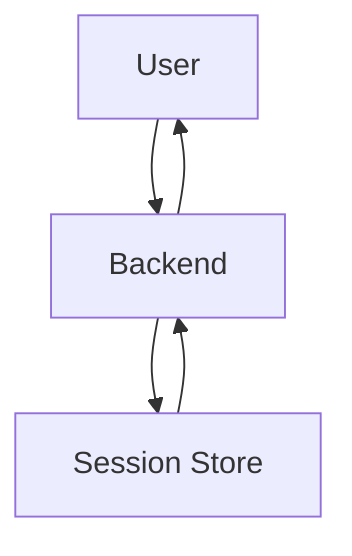
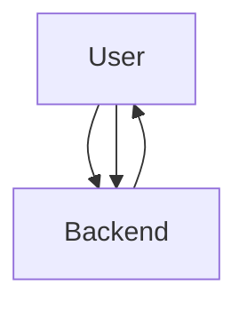

# Day-19 : Authentication & Authorization Systems

## Important Connection From Previous Topics

So far we learned:

```text
API
↓
Communication

Database
↓
Stores Data

Load Balancer
↓
Distributes Requests
```

---

Question:

```text
How Does The Backend Know

Who Is Sending The Request?

And

What Is The User Allowed To Do?
```

---

Answer:

```text
Authentication

Authorization
```

---

# Authentication vs Authorization

## Authentication

Question:

```text
Who Are You?
```

---

Examples:

```text
Email + Password

Google Login

GitHub Login
```

---

Think:

```text
Identity Verification
```

---

## Authorization

Question:

```text
What Are You Allowed To Do?
```

---

Example:

```text
User
↓
Can Create Posts

Admin
↓
Can Delete Users
```

---

Think:

```text
Permission Verification
```

---

# Airport Analogy

## Authentication

```text
Show Passport
```

Question:

```text
Who Are You?
```

---

## Authorization

```text
Business Class?

Economy?

VIP?
```

Question:

```text
What Can You Access?
```

---

# Complete Authentication Lifecycle

## Step 1: Signup

User submits:

```text
Email

Password
```

---

Question:

Should password be stored directly?

```text
NO
```

---

# Password Hashing

Suppose:

```text
password123
```

---

Backend:

```text
password123
↓
Hash Function
↓
ABC_HASH_123
```

---

Database stores:

```text
ABC_HASH_123
```

---

Never:

```text
password123
```

---

# Why Hash Passwords?

Suppose database leaks.

Without Hashing:

```text
Attacker Sees Passwords
```

---

With Hashing:

```text
Attacker Sees Hashes
```

---

Much safer.

---

# Salt

Suppose two users use:

```text
password123
```

---

Without Salt:

```text
password123
↓
HASH_A

password123
↓
HASH_A
```

---

Same Hash.

Bad.

---

Add Random Salt:

```text
password123 + xyz
↓
HASH_X

password123 + abc
↓
HASH_Y
```

---

Now hashes differ.

---

# Step 2: Login

User submits:

```text
Email

Password
```

---

Backend:

```text
Fetch Stored Hash
```

from DB.

---

Backend hashes entered password again.

```text
Entered Password
↓
Hash
↓
Generated Hash
```

---

Compare:

```text
Generated Hash

vs

Stored Hash
```

---

If Match:

```text
Login Success
```

---

# The Main Problem

After login:

```text
How Does Backend Remember

User Is Logged In?
```

---

Two Approaches:

```text
Sessions

JWT
```

---

# Session Based Authentication

Traditional Approach.

---

# Session Flow

User logs in.

---

Backend creates:

```text
Session ID
```

Example:

```text
abc123xyz
```

---

Backend stores:

```text
Session ID
↓
User 101
```

inside:

```text
Redis

Memory

Database
```

---

Browser stores:

```text
Session Cookie
```

---

Future Requests:

```text
Cookie Sent
↓
Backend Checks Session
↓
Authenticated
```

---

# Session Architecture



---

# Session Scaling Problem

Suppose:

```text
10 Backend Servers
```

---

User logs in via:

```text
Server A
```

---

Next request goes to:

```text
Server D
```

---

Problem:

```text
Session Missing
```

---

Solution:

```text
Shared Session Store

(Redis)
```

---

# JWT Authentication

Modern Approach.

---

JWT:

```text
JSON Web Token
```

---

Think:

```text
Digital Identity Card
```

---

Backend creates:

```text
JWT
```

after successful login.

---

JWT contains:

```text
User ID

Role

Claims
```

---

JWT sent to frontend.

---

Frontend stores token.

---

Future Requests:

```http
Authorization:
Bearer JWT
```

---

Backend verifies token.

---

No Session Lookup Required.

---

# JWT Architecture



---

# Why JWT Is Stateless

Session Authentication:

```text
Server Stores State
```

---

JWT Authentication:

```text
Client Stores State
```

---

Therefore:

```text
Stateless
```

---

# JWT Structure

JWT contains:

```text
Header

Payload

Signature
```

---

Example Payload:

```json
{
  "userId": 101,
  "role": "user"
}
```

---

Never Store:

```text
Password
```

inside JWT.

---

# JWT Verification

Backend receives:

```text
JWT
```

---

Backend recomputes:

```text
Header
+
Payload
+
Secret Key
↓
Signature
```

---

If Signature Matches:

```text
Token Valid
```

---

# Access Token vs Refresh Token

Interview Favorite.

---

# Access Token

Short-Lived.

Example:

```text
15 Minutes
```

---

Used For:

```text
API Requests
```

---

# Refresh Token

Long-Lived.

Example:

```text
7 Days
```

---

Used To Generate:

```text
New Access Token
```

---

# Login Flow

After Login:

```text
Access Token

Refresh Token
```

returned.

---

Frontend stores:

```text
Access Token
↓
Memory
```

---

```text
Refresh Token
↓
HTTP Only Cookie
```

---

# Token Expiration Problem

Suppose:

```text
Access Token
=
30 Days
```

---

Attacker steals token.

---

Result:

```text
30 Days Access
```

---

Bad.

---

Better:

```text
15 Minute Access Token

7 Day Refresh Token
```

---

# Refresh Token Rotation

When refresh token is used:

```text
Old Refresh Token
↓
Invalidated

New Refresh Token
↓
Issued

New Access Token
↓
Issued
```

---

This improves security.

---

# Authorization

Remember:

```text
Authentication
≠
Authorization
```

---

Authentication:

```text
Who Are You?
```

---

Authorization:

```text
What Can You Do?
```

---

# RBAC (Role Based Access Control)

Most Common Authorization Model.

---

Roles:

```text
User

Admin

Moderator
```

---

Example:

User:

```text
Create Post
```

---

Admin:

```text
Delete Any Post
```

---

Backend checks:

```text
Role
```

before allowing action.

---

# Example

Endpoint:

```http
DELETE /users/123
```

---

Normal User:

```text
403 Forbidden
```

---

Admin:

```text
Allowed
```

---

# Session vs JWT

| Session               | JWT                 |
| --------------------- | ------------------- |
| Stateful              | Stateless           |
| Server Stores Session | Client Stores Token |
| Needs Session Store   | No Session Store    |
| Harder To Scale       | Easier To Scale     |
| Traditional           | Modern              |

---

# Common Authentication Mistakes

## Mistake 1

Store plain text passwords.

---

## Mistake 2

Store password inside JWT.

---

## Mistake 3

Use long-lived access tokens.

---

## Mistake 4

Confuse authentication and authorization.

---

## Mistake 5

Store sessions locally with multiple backend servers.

---

# Common Interview Questions

## Q1

Authentication vs Authorization?

---

## Q2

Session vs JWT?

---

## Q3

Why is JWT called Stateless?

---

## Q4

Why use Refresh Tokens?

---

## Q5

Why hash passwords?

---

## Q6

Why add Salt?

---

## Q7

What is RBAC?

---

## Q8

Why shouldn't passwords be stored directly?

---

# Interview Practice Scenarios

## Scenario 1

### Situation

Instagram has:

```text
10 Backend Servers
```

---

### Question

Why does storing sessions in server memory become problematic?

---

### Interview Answer

Requests may be routed to different servers by the load balancer. If sessions are stored locally, another server may not have the user's session information. A shared session store such as Redis is required.

---

## Scenario 2

### Situation

Backend uses JWT Authentication.

---

### Question

Why doesn't backend need Redis sessions anymore?

---

### Interview Answer

JWT is stateless. The token itself contains user information and is stored on the client. The backend only verifies the token signature and does not need a session lookup.

---

## Scenario 3

### Situation

Access Token:

```text
30 Days
```

---

### Question

What security issue appears?

---

### Interview Answer

If the token is stolen, the attacker gains access for 30 days. Therefore access tokens should be short-lived and combined with refresh tokens.

---

## Scenario 4

### Situation

Normal User calls:

```http
DELETE /users/123
```

---

### Question

Authentication or Authorization problem?

---

### Interview Answer

Authorization problem. The system already knows who the user is but must verify whether they have permission to perform the action.

---

## Scenario 5

### Situation

Design Login Flow Using:

```text
Email

Password

JWT

Refresh Token
```

---

### Interview Answer

```text
User Enters Email & Password
        ↓
Backend Fetches Stored Hash
        ↓
Hash Entered Password
        ↓
Compare Hashes
        ↓
Generate JWT
        ↓
Generate Refresh Token
        ↓
Send Tokens To Client
        ↓
Access Token Stored In Memory
        ↓
Refresh Token Stored In HTTP Only Cookie
        ↓
Future Requests Use Bearer Token
        ↓
Backend Verifies JWT Signature
```

---

# Key Takeaways

1. Authentication verifies identity.
2. Authorization verifies permissions.
3. Passwords should be hashed before storage.
4. Salt prevents identical passwords from generating identical hashes.
5. Sessions are stateful.
6. JWT is stateless.
7. Access tokens should be short-lived.
8. Refresh tokens generate new access tokens.
9. RBAC is the most common authorization model.
10. JWT scales better in distributed systems.

---

# 30-Second Revision

```text
Authentication
↓
Who Are You?

Authorization
↓
What Can You Do?

Signup
↓
Hash Password
↓
Store Hash

Login
↓
Compare Hashes

Session
↓
Stateful

JWT
↓
Stateless

Access Token
↓
Short Lived

Refresh Token
↓
Long Lived

RBAC
↓
Role Based Access
```

---

# Interview Keywords

```text
Authentication

Authorization

Session

Session Store

JWT

Header

Payload

Signature

Bearer Token

Access Token

Refresh Token

Refresh Token Rotation

RBAC

Password Hashing

Salt

Stateless

Stateful
```
