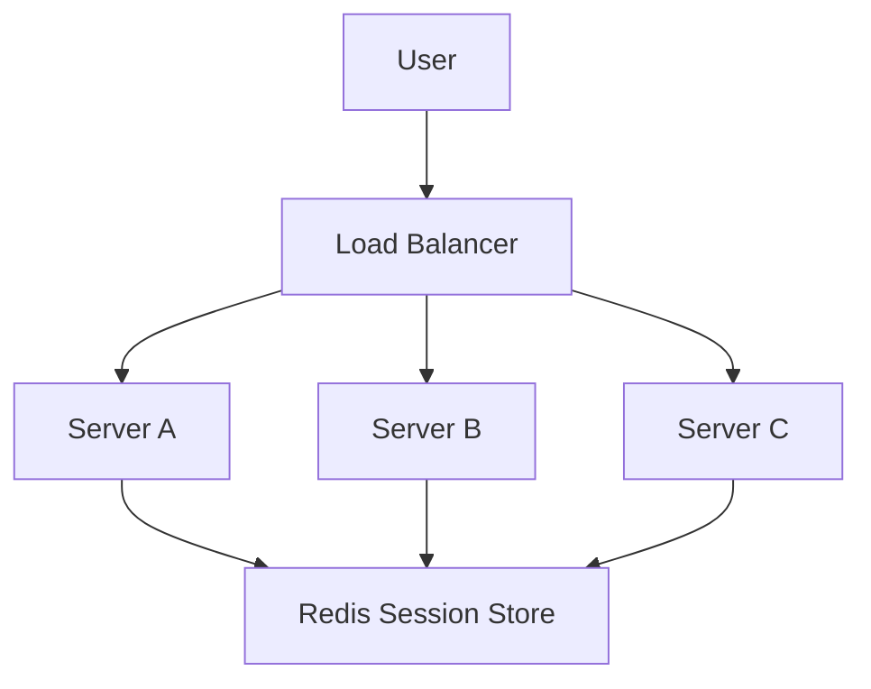

# Day-20 : Session Management & Rate Limiting

## Important Connection From Previous Topics

Previously we learned:

```text
Authentication
↓
Who Are You?

Authorization
↓
What Can You Do?

Sessions

JWT

Access Tokens

Refresh Tokens
```

---

Today's Questions:

```text
How Long Should A User Stay Logged In?

How Do Sessions Expire?

How Do We Logout Users?

How Do We Stop API Abuse?
```

---

Answer:

```text
Session Management

Rate Limiting
```

---

# Session Management

## What Is Session Management?

After Login:

```text
User
↓
Authenticated
```

---

Question:

```text
How Long Should User
Remain Logged In?
```

---

This entire process is called:

```text
Session Management
```

---

# Session Lifecycle

Every Session Has:

```text
Creation

Validation

Expiration

Logout

Deletion
```

---

# Session Creation

User:

```text
Email

Password
```

---

Backend:

```text
Verify Credentials
↓
Generate Session ID
```

Example:

```text
sess_ABC123
```

---

Store:

```text
sess_ABC123
↓
User101
```

inside:

```text
Redis
```

---

Browser receives:

```text
Session Cookie
```

---

# Session Validation

Every Request:

```text
Cookie
↓
Session ID
↓
Backend
```

---

Backend Checks:

```text
Session Exists?
```

---

If Yes:

```text
Allow Request
```

---

If No:

```text
401 Unauthorized
```

---

# Session Expiration

Question:

Should Sessions Live Forever?

```text
No
```

---

Example:

```text
TTL = 24 Hours
```

---

TTL:

```text
Time To Live
```

---

After:

```text
24 Hours
```

Session expires automatically.

---

# Why Sessions Expire

Examples:

```text
Lost Device

Cyber Cafe

Shared Laptop

Stolen Browser Cookie
```

---

Permanent Sessions:

```text
Huge Security Risk
```

---

# Sliding Expiration

Interview Favorite.

---

Normal Expiration:

```text
Login
↓
24 Hours
↓
Session Expires
```

---

Even if user is active.

---

Better:

```text
User Active
↓
Reset TTL
↓
24 More Hours
```

---

Example:

```text
Session TTL = 24 Hours

User Uses App At Hour 23

TTL Reset
↓
24 More Hours
```

---

This is:

```text
Sliding Session Expiration
```

---

# Logout Flow

User clicks:

```text
Logout
```

---

Backend:

```text
Delete Session
```

from Redis.

---

Future Requests:

```text
Session Missing
↓
401 Unauthorized
```

---

# JWT Logout Problem

Sessions:

```text
Delete Session
```

Easy.

---

JWT:

```text
Stateless
```

---

Backend never stores JWT.

---

Question:

```text
How To Logout User?
```

---

Solutions:

### Short Expiration

Example:

```text
15 Minute Access Token
```

---

### Token Blacklisting

Store revoked JWTs.

---

Problem:

```text
JWT Becomes Stateful
```

---

# Session Scaling Problem

Suppose:

```text
10 Backend Servers
```

---

Bad Design:

```text
Store Sessions
In Local Memory
```

---

Problem:

```text
Login
↓
Server A

Session Stored
↓
Server A
```

---

Next Request:

```text
Load Balancer
↓
Server D
```

---

Server D:

```text
Session Missing
```

---

Result:

```text
User Appears Logged Out
```

---

# Solution

Use:

```text
Shared Session Store
```

Usually:

```text
Redis
```

---

Architecture:



---

# Sticky Sessions

Alternative Approach.

---

Idea:

```text
User101
↓
Always Server A
```

---

Load Balancer remembers.

---

# Problems With Sticky Sessions

## Problem 1

Server Crash

```text
Server A Down
↓
Sessions Lost
```

---

## Problem 2

Uneven Load Distribution

```text
Server A
Heavy

Server B
Idle
```

---

Modern Systems Prefer:

```text
Redis Session Store
```

---

# Rate Limiting

## What Problem Does It Solve?

Suppose:

```text
1 User
↓
1 Million Requests
```

---

Problems:

```text
Server Overload

Resource Exhaustion

DDoS Risk

Higher Costs
```

---

Need:

```text
Request Control
```

---

# Common Use Cases

## Login API

```text
5 Attempts / Minute
```

---

Prevents:

```text
Brute Force Attacks
```

---

## OTP API

```text
3 Requests / Hour
```

---

Prevents:

```text
OTP Spam
```

---

## Public APIs

```text
100 Requests / Minute
```

---

Prevents:

```text
API Abuse
```

---

# Where Should Rate Limiting Be Applied?

Bad:

```text
Every Service
```

---

Good:

```text
API Gateway
```

---

Architecture:

```text
Client
 ↓
API Gateway
 ↓
Backend Services
```

---

# Rate Limiting Algorithms

## Fixed Window

Example:

```text
100 Requests
Per Minute
```

---

Store:

```text
Counter
```

---

If:

```text
Counter > 100
```

Reject Request.

---

### Problem

```text
99 Requests
11:59

99 Requests
12:00
```

---

User sends:

```text
198 Requests
In 2 Seconds
```

---

# Sliding Window

Instead Of:

```text
Current Minute
```

Track:

```text
Last 60 Seconds
```

continuously.

---

Benefits:

```text
More Accurate

Fairer
```

---

# Token Bucket

Most Practical.

---

Imagine:

```text
Bucket
=
100 Tokens
```

---

Each Request:

```text
Consumes 1 Token
```

---

No Tokens:

```text
Reject Request
```

---

Tokens Refill Gradually.

---

Benefits:

```text
Allows Small Bursts

Widely Used
```

---

# Why Redis For Rate Limiting?

Redis is:

```text
In Memory

Extremely Fast

Supports TTL

Distributed
```

---

Perfect For:

```text
Request Counters
```

---

Example:

```text
User101
↓
Count = 57
↓
TTL = 60 Seconds
```

---

# HTTP Response

When Rate Limit Exceeded:

```http
429 Too Many Requests
```

---

Must Remember.

---

# What Should We Rate Limit On?

## Before Authentication

Examples:

```http
POST /login

POST /signup

POST /forgotPassword

POST /sendOTP
```

---

User Identity Not Verified Yet.

---

Rate Limit Using:

```text
IP Address

Email + IP

Phone + IP
```

---

# After Authentication

Examples:

```http
POST /createPost

POST /likePost

POST /comment

POST /uploadImage
```

---

JWT Already Verified.

---

Rate Limit Using:

```text
UserID
```

---

# Interview Cheat Sheet

```text
Login
Signup
OTP
Forgot Password
↓
IP
Email + IP
Phone + IP
```

---

```text
Create Post
Like Post
Comment
Profile APIs
Upload APIs
↓
UserID
```

---

# Session vs JWT Logout

| Sessions       | JWT             |
| -------------- | --------------- |
| Delete Session | Wait Expiration |
| Easy Logout    | Harder Logout   |
| Stateful       | Stateless       |

---

# Sticky Sessions vs Shared Session Store

| Sticky Sessions     | Redis Session Store |
| ------------------- | ------------------- |
| Simple              | Scalable            |
| Uneven Load         | Balanced Load       |
| Server Failure Risk | Safer               |
| Not Preferred       | Preferred           |

---

# Common Interview Questions

## Q1

Why do sessions expire?

---

## Q2

What is Sliding Session Expiration?

---

## Q3

What is a Sticky Session?

---

## Q4

Why are Sticky Sessions discouraged?

---

## Q5

Where should Rate Limiting be implemented?

---

## Q6

Why is Redis used for Rate Limiting?

---

## Q7

What HTTP status code is returned when limit is exceeded?

---

## Q8

Should Login APIs be rate limited by UserID?

---

# Interview Practice Scenarios

## Scenario 1

### Situation

Instagram has:

```text
10 Backend Servers
```

Developer Suggests:

```text
Store Sessions In Local Memory
```

---

### Interview Answer

No. Requests may be routed to different servers by the load balancer. A shared session store such as Redis should be used so all servers can validate the same session.

---

## Scenario 2

### Situation

Session TTL:

```text
24 Hours
```

User is active after:

```text
23 Hours
```

---

### Question

How can we avoid forcing re-login?

---

### Interview Answer

Use Sliding Session Expiration. Reset the TTL whenever the user performs an activity.

---

## Scenario 3

### Situation

Company Uses Sticky Sessions.

Server crashes.

---

### Interview Answer

All sessions tied to that server are lost and load distribution becomes uneven. Shared session storage is preferred.

---

## Scenario 4

### Situation

Login API receives:

```text
1000 Password Attempts
```

from same source.

---

### Interview Answer

Apply Rate Limiting at the API Gateway. Since the user is not authenticated yet, rate limit using IP Address or Email + IP instead of UserID.

---

## Scenario 5

### Situation

Design:

```text
100 Requests / Minute
Per User
```

Rate Limiting System.

---

### Interview Answer

```text
Client
↓
API Gateway
↓
Redis Counter
↓
Token Bucket Algorithm
↓
Backend Service
```

Redis stores counters and token information. The API Gateway checks available tokens before forwarding requests.

---

# Key Takeaways

1. Session Management controls user login lifecycle.
2. Sessions have creation, validation, expiration and logout phases.
3. Sliding Expiration improves user experience.
4. JWT logout is harder than Session logout.
5. Shared Session Stores scale better than local memory.
6. Sticky Sessions are generally avoided.
7. Rate Limiting protects systems from abuse.
8. API Gateway is the preferred place for Rate Limiting.
9. Redis is commonly used for counters.
10. Login APIs use IP-based limits while authenticated APIs use UserID-based limits.

---

# 30-Second Revision

```text
Session
↓
Creation
Validation
Expiration
Logout

TTL
↓
Time To Live

Sliding Expiration
↓
Reset TTL On Activity

Sticky Sessions
↓
Not Preferred

Redis
↓
Shared Session Store

Rate Limiting
↓
Protect System

Fixed Window

Sliding Window

Token Bucket

429
↓
Too Many Requests

Before Login
↓
IP / Email + IP

After Login
↓
UserID
```

---

# Interview Keywords

```text
Session Management

Session Lifecycle

TTL

Sliding Expiration

Sticky Sessions

Shared Session Store

Redis

Rate Limiting

API Gateway

Fixed Window

Sliding Window

Token Bucket

429 Too Many Requests

IP Based Limiting

UserID Based Limiting
```
