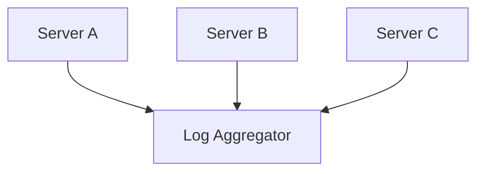

# Day-21 : Logging, Monitoring & Metrics

## Important Connection From Previous Topics

Previously we learned:

```text
Load Balancers

Caches

Databases

Replication

Sharding

APIs

Authentication

Rate Limiting
```

---

Question:

```text
How Do We Know
Whether Our System Is Healthy
Or Dying?
```

---

Answer:

```text
Logs

Metrics

Monitoring
```

---

# The Three Pillars Of Observability

```text
Logs
=
What Happened?

Metrics
=
How Much Happened?

Monitoring
=
Is Something Wrong Right Now?
```

---

# Logging

## What Is Logging?

A log is a record of an event that happened inside the system.

---

Example:

```text
2026-06-18 10:30:00

User101 Logged In
```

---

This is:

```text
Log Entry
```

---

# Why Logs Exist

Logs help answer:

```text
What Happened?

When Did It Happen?

Who Triggered It?

Why Did It Fail?
```

---

# Examples Of Logs

```text
User Logged In

User Signed Up

Order Created

Payment Failed

Database Connection Failed

API Timeout
```

---

# Bad Logging

```text
Something Failed
```

---

Problem:

```text
No Useful Information
```

---

# Good Logging

```text
Payment Failed

UserID = 101

OrderID = 5001

Reason = Card Declined
```

---

# Log Levels

## DEBUG

Used during development.

Example:

```text
JWT Payload
```

---

## INFO

Normal events.

Example:

```text
User Logged In
```

---

## WARN

Potential issue.

Example:

```text
Redis Response Slow
```

---

## ERROR

Something failed.

Example:

```text
Payment Failed
```

---

# Centralized Logging

Suppose:

```text
10 Backend Servers
```

---

Bad:

```text
Server A Logs

Server B Logs

Server C Logs
```

---

Difficult To Debug.

---

Solution:

```text
Centralized Log Storage
```

---

Architecture:



---

# Metrics

## What Are Metrics?

Metrics are numerical measurements about system health.

---

Examples:

```text
CPU Usage

Memory Usage

Latency

Request Rate

Error Rate
```

---

# CPU Usage

Example:

```text
CPU = 90%
```

---

Possible Meaning:

```text
CPU Bottleneck
```

---

# Memory Usage

Example:

```text
RAM = 95%
```

---

Possible Meaning:

```text
Memory Leak

Memory Pressure
```

---

# Request Rate

Example:

```text
10,000 Requests/Second
```

---

Shows:

```text
Traffic
```

---

# Error Rate

Formula:

```text
Error Rate

=
Failed Requests
/
Total Requests
× 100
```

---

Example:

```text
100,000 Requests

5,000 Failures
```

---

Calculation:

```text
5000 / 100000

=
5%
```

---

Error Rate:

```text
5%
```

---

# Latency

Latency means:

```text
Response Time
```

---

Example:

```text
800ms
```

---

Meaning:

```text
Request Taking
0.8 Seconds
```

---

# Golden Signals

Interview Favorite.

---

Google's Four Golden Signals:

```text
Latency

Traffic

Errors

Saturation
```

---

Shortcut:

```text
LTES

Latency

Traffic

Errors

Saturation
```

---

# Saturation

Means:

```text
Resource Utilization
```

---

Examples:

```text
CPU

Memory

Disk

Network
```

---

# Monitoring

## What Is Monitoring?

Monitoring means continuously checking metrics and generating alerts when thresholds are crossed.

---

Flow:

```text
Application
↓
Metrics
↓
Monitoring System
↓
Alert
↓
Engineer
```

---

# Example Alerts

## CPU Alert

```text
CPU > 90%
```

---

## Memory Alert

```text
Memory > 90%
```

---

## Latency Alert

```text
Latency > 1 Second
```

---

## Error Rate Alert

```text
Error Rate > 5%
```

---

# Dashboards

Metrics are usually displayed using dashboards.

---

Examples:

```text
CPU

Memory

Latency

Error Rate

Traffic
```

---

Allows engineers to understand system health at a glance.

---

# Observability

Observability means:

```text
Can We Understand
What Is Happening
Inside The System?
```

---

Built Using:

```text
Logs

Metrics

Monitoring
```

---

# Production Debugging Flow

Suppose users complain:

```text
Instagram Feed Is Slow
```

---

Step 1

```text
Check Metrics
```

---

Questions:

```text
CPU High?

Latency High?

Error Rate High?

Database CPU High?
```

---

Step 2

```text
Check Monitoring Alerts
```

---

Questions:

```text
Did Any Threshold Cross?

Any Active Alerts?
```

---

Step 3

```text
Check Logs
```

---

Questions:

```text
Which Event Failed?

Which API Failed?

Which Query Failed?
```

---

Step 4

```text
Find Root Cause
```

---

# Common Interview Questions

## Q1. Difference Between Logs And Metrics?

### Answer

Logs record individual events and provide detailed information.

Metrics provide numerical summaries and help identify unhealthy components quickly.

---

## Q2. Why Not Use Logs For Everything?

### Answer

Logs are detailed but expensive to analyze at scale. Metrics provide fast summaries and are better suited for monitoring overall system health.

---

## Q3. What Is Monitoring?

### Answer

Monitoring is the process of continuously observing system metrics and generating alerts whenever predefined thresholds are crossed.

---

## Q4. What Are The Four Golden Signals?

### Answer

```text
Latency

Traffic

Errors

Saturation
```

---

## Q5. What Metrics Would You Track For Instagram Feed Service?

### Answer

```text
CPU Usage

Memory Usage

Latency

Error Rate

Request Rate (RPS)

Cache Hit Rate
```

---

## Q6. How Would You Debug A Slow API?

### Answer

```text
Check Metrics
↓
Identify Problem Component
↓
Check Monitoring Alerts
↓
Analyze Logs
↓
Find Root Cause
```

---

# Interview Practice Scenarios

## Scenario 1

### Situation

Instagram feed suddenly becomes slow.

### Question

Which should you check first:

```text
Logs

Metrics

Monitoring Alerts
```

and why?

### Interview Answer

First check Metrics, then Logs.

Metrics provide an overall view of system health and help identify which component is facing issues, such as CPU, Database, Memory, or Network. Once the problematic component is identified, Logs can be used to understand the exact event or error that caused the issue.

---

## Scenario 2

### Situation

You see:

```text
CPU = 95%

Latency = 800ms
```

### Question

What possible bottleneck exists?

### Interview Answer

The most visible bottleneck is CPU saturation because CPU usage has reached 95%.

The high latency of 800ms may be caused by CPU saturation, database delays, cache misses, or network issues. More metrics are required before concluding that the network is the bottleneck.

---

## Scenario 3

### Situation

A developer says:

```text
We Already Have Logs.

We Don't Need Metrics.
```

### Question

Do you agree?

### Interview Answer

No.

Both Logs and Metrics are required for good observability.

Metrics help identify which component is unhealthy, while Logs help explain why that component became unhealthy.

---

## Scenario 4

### Situation

An API has:

```text
100,000 Requests

5,000 Failures
```

### Question

What is the error rate?

Would you consider it healthy?

### Interview Answer

Error Rate:

```text
5000 / 100000

=
5%
```

Whether this is healthy depends on the use case.

For critical systems such as Payments, a 5% error rate is unacceptable.

For less critical features such as Likes or Comments, it is less severe but still requires investigation.

---

## Scenario 5

### Situation

Design a monitoring strategy for:

```text
Instagram Feed Service
```

### Question

Mention:

```text
Logs

Metrics

Alerts
```

### Interview Answer

Logs:

```text
User Login

Signup

Post Upload

Delete Operations

API Failures

Database Failures

Cache Failures
```

---

Metrics:

```text
CPU Usage

Memory Usage

Latency

Error Rate

Request Rate (RPS)

Cache Hit Rate
```

---

Alerts:

```text
CPU > 90%

Memory > 90%

Latency > 1 Second

Error Rate > 5%
```

---

# Key Takeaways

1. Logs record detailed events.
2. Metrics provide numerical summaries.
3. Monitoring generates alerts based on metrics.
4. Centralized logging is important in distributed systems.
5. Latency measures response time.
6. Error Rate measures failures.
7. Golden Signals help evaluate system health.
8. Metrics help identify problems.
9. Logs help find root causes.
10. Observability combines Logs, Metrics and Monitoring.

---

# 30 Second Revision

```text
Logs
↓
What Happened?

Metrics
↓
How Much Happened?

Monitoring
↓
Alert On Problems

Golden Signals
↓
Latency
Traffic
Errors
Saturation

Debugging
↓
Metrics
↓
Alerts
↓
Logs
↓
Root Cause
```

---

# Interview Keywords

```text
Logging

Log Levels

DEBUG

INFO

WARN

ERROR

Metrics

CPU Usage

Memory Usage

Latency

Error Rate

Traffic

Golden Signals

Monitoring

Alerts

Observability

Centralized Logging

Root Cause Analysis
```
