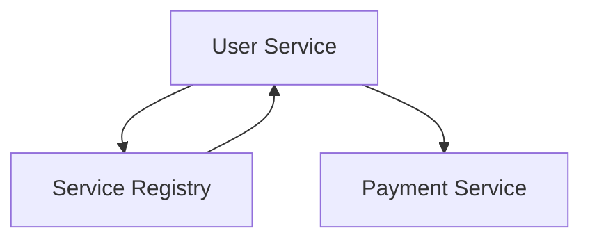
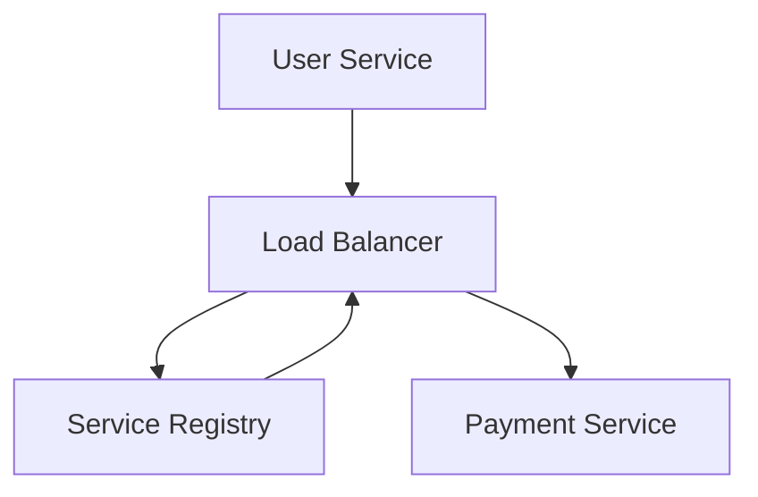
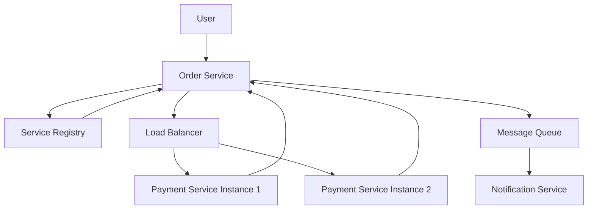

# Day-23 : Service Discovery & Service Registry

## Important Connection From Previous Topics

Previously we learned:

```text
Microservices

API Gateway

Load Balancers

Message Queues
```

---

Question:

```text
How Does Service A
Find Service B?
```

---

Problem:

```text
Service IPs Change

Services Scale Up

Services Scale Down

Instances Crash
```

---

Solution:

```text
Service Discovery
```

---

# The Problem

Suppose:

```text
User Service
```

needs:

```text
Payment Service
```

---

Developer writes:

```text
10.0.0.5
```

inside code.

---

Initially:

```text
Works Fine
```

---

Later:

```text
Payment Service
↓
New Instance
↓
10.0.0.9
```

---

Old IP:

```text
10.0.0.5
```

dies.

---

Question:

```text
How Does User Service Know?
```

---

Answer:

```text
It Doesn't
```

---

Requests Fail.

---

# Service Discovery

## Definition

Service Discovery is the mechanism through which services dynamically locate other services without using hardcoded IP addresses.

---

Instead Of:

```text
10.0.0.5
```

Use:

```text
payment-service
```

---

Benefits:

```text
Automatic Discovery

Automatic Recovery

Automatic Scaling
```

---

# Service Registry

## Definition

A Service Registry is a central directory that stores information about all active service instances.

---

Think:

```text
Phone Directory
For Services
```

---

Example:

```text
payment-service

10.0.0.5

10.0.0.9

10.0.0.12
```

---

Registry always knows:

```text
Which Instances Are Alive
```

---

# Service Registration

When a service starts:

```text
Payment Service
```

it registers itself.

---

Flow:

```text
Payment Service
↓
Service Registry
↓
Register Me
```

---

Registry stores:

```text
payment-service
↓
10.0.0.9
```

---

# Health Checks

Question:

```text
How Does Registry Know
Whether A Service Is Alive?
```

---

Answer:

```text
Health Checks

Heartbeats
```

---

Example:

Every:

```text
10 Seconds
```

service sends:

```text
I Am Alive
```

---

If heartbeat stops:

```text
Remove Service
```

from registry.

---

# Service Discovery Flow



---

Flow:

```text
User Service
↓
Ask Registry
↓
Where Is Payment Service?
↓
Registry Returns Healthy Instances
↓
Call Service
```

---

# Client-Side Discovery

## Definition

Client Service directly queries the registry.

---

Architecture:


---

Responsibility:

```text
Client Service
```

handles discovery.

---

# Server-Side Discovery

## Definition

Load Balancer handles discovery.

---

Architecture:



---

Benefits:

```text
Simpler Client

Centralized Routing

Common In Cloud Systems
```

---

# Client-Side vs Server-Side Discovery

| Client Side             | Server Side                    |
| ----------------------- | ------------------------------ |
| Client Queries Registry | Load Balancer Queries Registry |
| More Client Logic       | Simpler Client                 |
| Client Selects Instance | Load Balancer Selects Instance |
| Netflix Eureka Style    | Kubernetes Style               |

---

# Service Discovery + Load Balancing

Suppose Registry returns:

```text
10.0.0.5

10.0.0.9

10.0.0.12
```

---

Question:

```text
Which Instance
Should Receive Request?
```

---

Answer:

```text
Load Balancer
```

---

Algorithms:

```text
Round Robin

Weighted Round Robin

Least Connections
```

---

# Real World Examples

Examples:

```text
Netflix Eureka

Consul

Zookeeper

Kubernetes Service Discovery
```

---

# Kubernetes Service Discovery

Instead Of:

```text
10.0.0.5
```

services call:

```text
payment-service
```

---

Kubernetes resolves:

```text
payment-service
↓
Actual Pod IP
```

automatically.

---

# Why Service Discovery Exists

Without Discovery:

```text
Hardcoded IPs

Manual Updates

Broken Services
```

---

With Discovery:

```text
Automatic Discovery

Automatic Recovery

Automatic Scaling
```

---

# Common Interview Questions

## Q1. What Problem Does Service Discovery Solve?

### Answer

Service Discovery eliminates the need for hardcoded IP addresses and allows services to dynamically find other healthy service instances.

---

## Q2. Why Can't We Hardcode IP Addresses?

### Answer

Service instances frequently scale, restart, and change IP addresses. Hardcoding IPs causes failures whenever infrastructure changes.

---

## Q3. What Is A Service Registry?

### Answer

A Service Registry is a central directory that maintains information about all active service instances and their locations.

---

## Q4. How Does A Registry Know A Service Is Alive?

### Answer

Using Health Checks or Heartbeats. If a service stops responding, the registry removes it from the list of healthy instances.

---

## Q5. Difference Between Client-Side And Server-Side Discovery?

### Answer

Client-Side Discovery:

```text
Client Queries Registry
Client Selects Instance
```

Server-Side Discovery:

```text
Load Balancer Queries Registry
Load Balancer Selects Instance
```

---

## Q6. How Does Kubernetes Implement Service Discovery?

### Answer

Services communicate using service names instead of IP addresses. Kubernetes automatically resolves service names to healthy pod instances.

---

# Interview Practice Scenarios

## Scenario 1

### Situation

Developer Hardcodes:

```text
Payment Service
=
10.0.0.5
```

inside User Service.

### Interview Answer

I would not agree.

Hardcoded IPs become invalid whenever services scale, restart, or move to new instances. Instead, services should use Service Discovery through a Service Registry, which dynamically provides healthy service instances.

---

## Scenario 2

### Situation

Payment Service crashes.

A new instance starts with a different IP.

### Interview Answer

Using Service Discovery, User Service does not need code changes. It asks the Service Registry for healthy Payment Service instances, and the registry returns the new instance automatically.

---

## Scenario 3

### Situation

A service registers itself but suddenly crashes.

### Interview Answer

The registry continuously performs Health Checks or receives Heartbeats from services. If the service stops responding, it is automatically removed from the registry.

---

## Scenario 4

### Situation

Registry returns:

```text
10.0.0.5

10.0.0.9

10.0.0.12
```

### Interview Answer

A Load Balancer selects one instance using algorithms such as:

```text
Round Robin

Weighted Round Robin

Least Connections
```

and routes the request accordingly.

---

## Scenario 5

### Situation

Design communication between:

```text
Order Service

Payment Service

Notification Service
```

Mention:

```text
Service Discovery

Registry

Load Balancing
```

---

### Interview Answer

I would use a microservices architecture where each service registers itself with a Service Registry.

When the Order Service needs to process a payment, it queries the Service Registry for healthy Payment Service instances. The registry returns all available instances, and a Load Balancer selects one instance using an algorithm such as Round Robin or Least Connections.

After successful payment, the Order Service updates the order status and publishes an event to a Message Queue. The Notification Service consumes the event and sends notifications asynchronously.

This design avoids hardcoded IPs, supports automatic scaling, provides fault tolerance, and maintains loose coupling between services.

---

### Complete Flow



---

### Architecture Explanation

```text
User Places Order
↓
Order Service Receives Request
↓
Order Service Queries Service Registry
↓
Registry Returns Healthy Payment Instances
↓
Load Balancer Selects One Instance
↓
Payment Processed
↓
Order Status Updated
↓
Event Published To Queue
↓
Notification Service Consumes Event
↓
Notification Sent To User
```

---

# Key Takeaways

1. Service Discovery removes hardcoded IP dependencies.
2. Service Registry stores active service locations.
3. Services register themselves when they start.
4. Health Checks and Heartbeats detect failures.
5. Client-Side Discovery places discovery logic in the client.
6. Server-Side Discovery places discovery logic in a Load Balancer.
7. Service Discovery works closely with Load Balancing.
8. Kubernetes provides built-in Service Discovery.
9. Discovery enables automatic scaling and recovery.
10. Service Discovery is essential in Microservice architectures.

---

# 30 Second Revision

```text
Microservices
↓
Need To Find Each Other

Service Discovery
↓
Find Services Dynamically

Service Registry
↓
Stores Service Locations

Health Checks
↓
Detect Failed Services

Client Side Discovery
↓
Client Queries Registry

Server Side Discovery
↓
Load Balancer Queries Registry

Service Discovery
+
Load Balancing
=
Scalable Microservices
```

---

# Interview Keywords

```text
Service Discovery

Service Registry

Service Registration

Health Checks

Heartbeats

Client-Side Discovery

Server-Side Discovery

Load Balancer

Round Robin

Least Connections

Dynamic Infrastructure

Kubernetes Service Discovery

Fault Tolerance

Automatic Recovery
```
