# Day-24 : Distributed Transactions & Saga Pattern

# Why Do We Need Distributed Transactions?

In a Monolithic Application:

```text
Order
↓
Payment
↓
Inventory
```

all operations happen inside:

```text
One Database
```

---

Traditional SQL Transactions work perfectly:

```sql
BEGIN TRANSACTION

Create Order

Process Payment

Reserve Inventory

COMMIT
```

---

If any step fails:

```sql
ROLLBACK
```

Everything returns to its original state.

---

# Monolith Transaction Flow

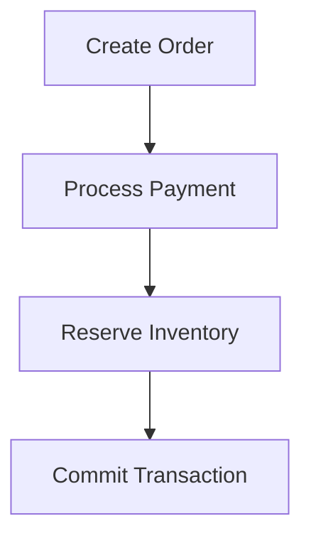

---

# The Problem In Microservices

Suppose we have:

```text
Order Service

Payment Service

Inventory Service
```

Each service owns:

```text
Its Own Database
```

---

Architecture:

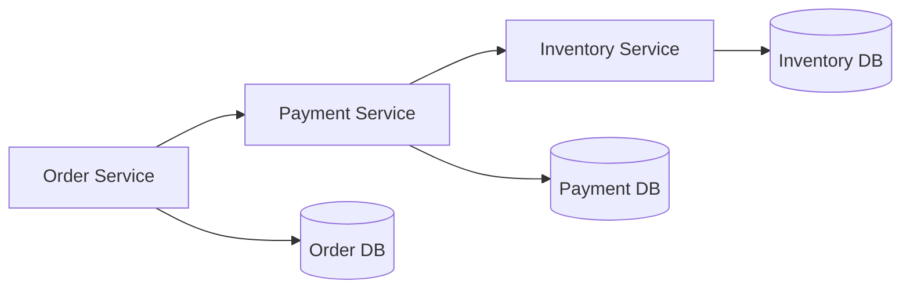

---

Question:

What happens if:

```text
Order Created
✓

Payment Success
✓

Inventory Failure
✗
```

?

---

Result:

```text
Customer Money Deducted

Inventory Not Reserved

Order Not Completed
```

---

System enters:

```text
Inconsistent State
```

---

# Why Normal Transactions Don't Work?

Traditional Transactions require:

```text
Single Database
```

---

Microservices have:

```text
Multiple Services

Multiple Databases

Multiple Servers
```

---

Therefore:

```text
ROLLBACK
```

cannot happen across all services automatically.

---

# Distributed Transaction

## Definition

A transaction that spans multiple services and multiple databases.

---

Example:

```text
Order Service

Payment Service

Inventory Service
```

must succeed together.

---

# Solution 1 : Two Phase Commit (2PC)

## Idea

Introduce a:

```text
Coordinator
```

that controls all services.

---

# Phase 1 : Prepare

Coordinator asks:

```text
Can You Commit?
```

---

Flow:

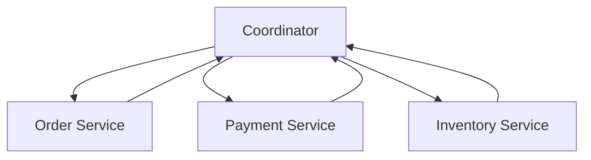

---

Responses:

```text
Ready

Ready

Ready
```

---

# Phase 2 : Commit

Coordinator sends:

```text
Commit
```

to everyone.

---

Flow:

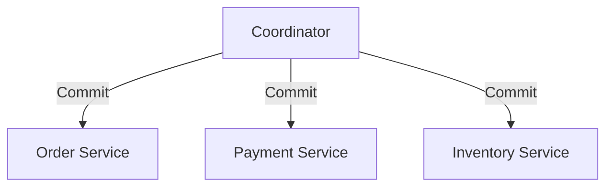

---

# Problems With 2PC

## Problem 1

Coordinator Failure

```text
Coordinator Crashes
↓
Everything Waits
```

---

## Problem 2

Blocking Nature

Services remain locked.

---

## Problem 3

Poor Scalability

Not suitable for modern large-scale microservices.

---

# Modern Solution : Saga Pattern

## Definition

Instead of:

```text
One Large Transaction
```

use:

```text
Multiple Small Transactions
```

Each service commits independently.

---

# Success Flow

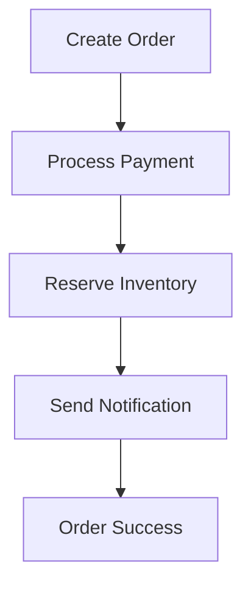

---

Flow:

```text
Order Created
↓
Payment Success
↓
Inventory Reserved
↓
Notification Sent
↓
Order Completed
```

---

# What Happens If Something Fails?

Example:

```text
Order Created
✓

Payment Success
✓

Inventory Failure
✗
```

---

This creates:

```text
Temporary Inconsistency
```

---

# Compensation Transactions

## Definition

Actions that undo previously completed operations.

---

Example:

```text
Payment Success
✓

Inventory Failure
✗
```

---

Compensation:

```text
Refund Payment

Cancel Order
```

---

# Failure Flow

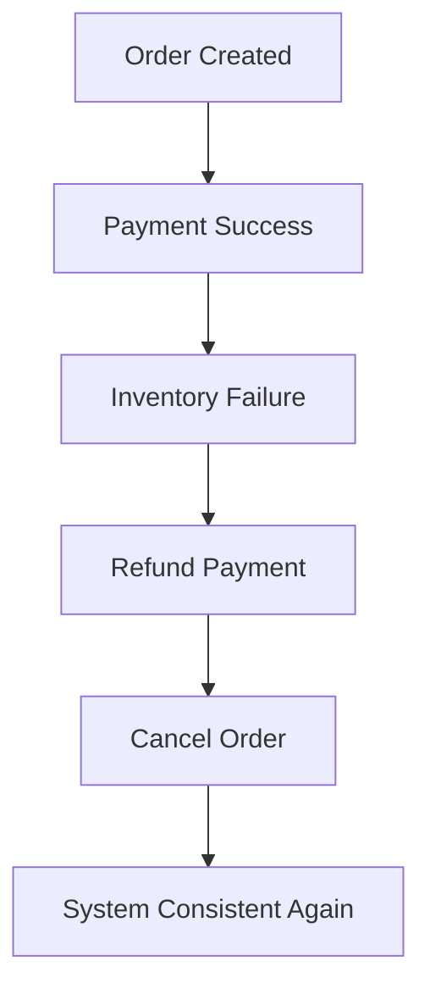

---

# Eventual Consistency

Very Important Interview Concept.

---

Temporary State:

```text
Money Deducted

Order Pending
```

---

Compensation Runs:

```text
Refund Payment

Cancel Order
```

---

Final State:

```text
System Consistent Again
```

---

This is called:

```text
Eventual Consistency
```

---

# Types Of Saga Pattern

There are two ways to implement Saga:

```text
1. Choreography

2. Orchestration
```

---

# Choreography Saga

## Definition

No central coordinator exists.

Services communicate using events.

---

Flow:

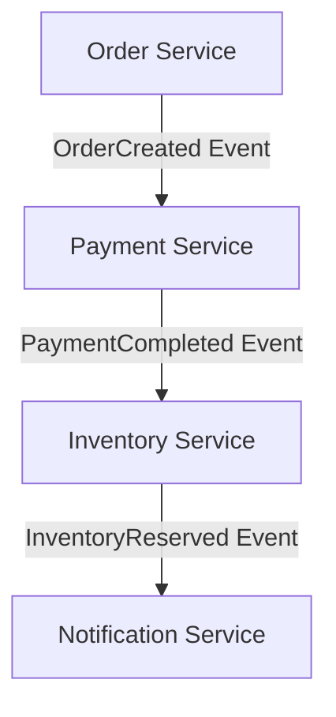

---

Example:

```text
Order Created
↓
Payment Service Listens

Payment Success
↓
Inventory Service Listens

Inventory Reserved
↓
Notification Service Listens
```

---

# Advantages

```text
Simple

Decentralized

No Coordinator
```

---

# Disadvantages

Large systems become:

```text
Hard To Understand

Hard To Debug
```

---

Many events are flowing between services.

---

# Orchestration Saga

## Definition

Introduce a:

```text
Saga Orchestrator
```

which controls the workflow.

---

# Success Flow

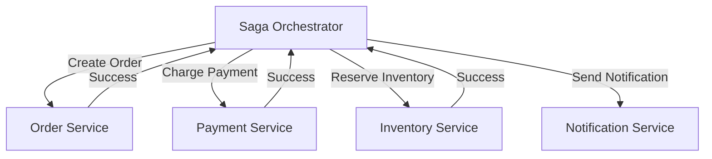

---

The orchestrator decides:

```text
What Happens Next
```

---

# Failure Flow

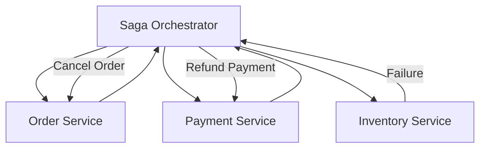

---

# Advantages

```text
Easy To Understand

Easy To Debug

Centralized Workflow
```

---

# Disadvantages

```text
Extra Component

Single Control Point
```

---

# Choreography vs Orchestration

| Choreography | Orchestration |
|------------|------------|
| Event Driven | Coordinator Driven |
| No Central Controller | Saga Orchestrator |
| Decentralized | Centralized |
| Harder To Debug | Easier To Debug |
| Simpler Setup | More Control |
| Good For Small Systems | Good For Large Systems |

---

# Real E-Commerce Example

Services:

```text
Order Service

Payment Service

Inventory Service

Notification Service
```

---

# Success Flow

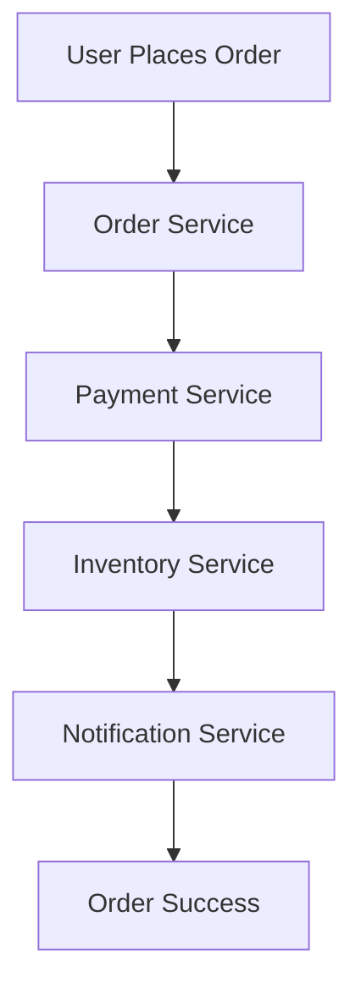

---

# Failure Flow

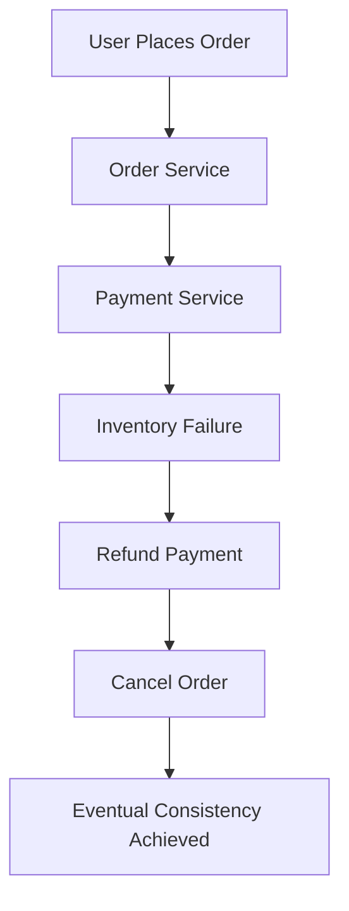

---

# Common Interview Questions

## Q1. Why Are Distributed Transactions Difficult?

### Answer

Because multiple services maintain independent databases, making traditional SQL transactions and rollbacks impossible across the entire system.

---

## Q2. Why Doesn't SQL Transaction Work Across Microservices?

### Answer

SQL transactions work within a single database. Microservices have separate databases, so a single rollback cannot be applied everywhere.

---

## Q3. What Is Two Phase Commit?

### Answer

A distributed transaction protocol where a coordinator first asks all participants if they are ready to commit and then instructs them to commit.

---

## Q4. Problems With 2PC?

### Answer

```text
Blocking

Coordinator Failure

Poor Scalability
```

---

## Q5. What Is Saga Pattern?

### Answer

Saga Pattern is a distributed transaction pattern where each service performs a local transaction and, if a failure occurs, compensation transactions undo previous actions.

---

## Q6. What Is A Compensation Transaction?

### Answer

A compensation transaction reverses previously completed operations to restore consistency.

Example:

```text
Refund Payment

Cancel Order
```

---

## Q7. What Is Eventual Consistency?

### Answer

A temporary inconsistent state may exist after a failure, but compensation transactions eventually restore the system to a consistent state.

---

## Q8. Difference Between Choreography And Orchestration?

### Answer

Choreography uses events without a central coordinator, while Orchestration uses a Saga Orchestrator to control the entire workflow.

---

# Interview Practice Scenarios

## Scenario 1

### Situation

```text
Order Created ✓

Payment Success ✓

Inventory Failure ✗
```

### Interview Answer

I would use Saga Pattern. Since Inventory Reservation failed, compensation transactions would execute:

```text
Refund Payment
↓
Cancel Order
```

restoring the system to a consistent state.

---

## Scenario 2

### Situation

A developer suggests using one SQL transaction across 10 microservices.

### Interview Answer

I would not agree because each microservice owns its own database. Traditional SQL transactions work only within a single database and cannot safely coordinate across multiple independent services.

Saga Pattern would be a better solution.

---

## Scenario 3

### Situation

Payment succeeds but Inventory fails.

### Interview Answer

Compensation actions should be executed:

```text
Refund Payment
↓
Cancel Order
```

to achieve eventual consistency.

---

## Scenario 4

### Situation

A company has 100 microservices and event flows are becoming difficult to understand.

### Interview Answer

I would prefer Orchestration because a central Saga Orchestrator makes workflows easier to understand, monitor, and debug compared to event-heavy choreography systems.

---

## Scenario 5

### Situation

Design an E-Commerce Order Flow using:

```text
Order Service

Payment Service

Inventory Service

Notification Service
```

Explain:

```text
Saga Pattern

Failure Handling

Compensation Transactions
```

### Interview Answer

I would use Saga Pattern because the transaction spans multiple services and databases.

Success Flow:

```text
Create Order
↓
Process Payment
↓
Reserve Inventory
↓
Send Notification
↓
Order Success
```

Failure Flow:

```text
Inventory Failure
↓
Refund Payment
↓
Cancel Order
```

This ensures eventual consistency while avoiding the scalability limitations of Two Phase Commit.

---

# 30 Second Revision

```text
Distributed Transaction
↓
Multiple Services

2PC
↓
Coordinator

Problems
↓
Blocking
Coordinator Failure

Saga Pattern
↓
Local Transactions

Failure
↓
Compensation

Compensation
↓
Refund Payment
Cancel Order

Consistency
↓
Eventual Consistency

Saga Types
↓
Choreography
Orchestration
```

---

# Interview Keywords

```text
Distributed Transactions

Two Phase Commit

2PC

Saga Pattern

Compensation Transaction

Eventual Consistency

Choreography

Orchestration

Saga Orchestrator

Local Transactions

Coordinator

Distributed Systems
```