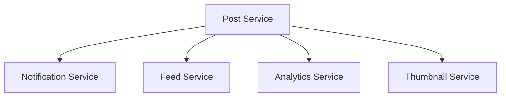
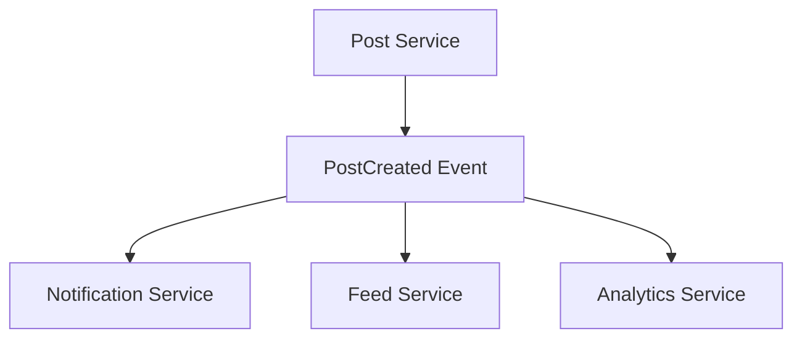
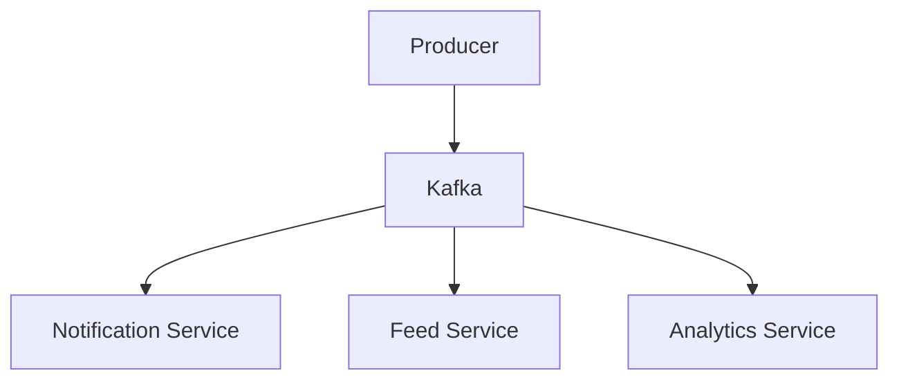
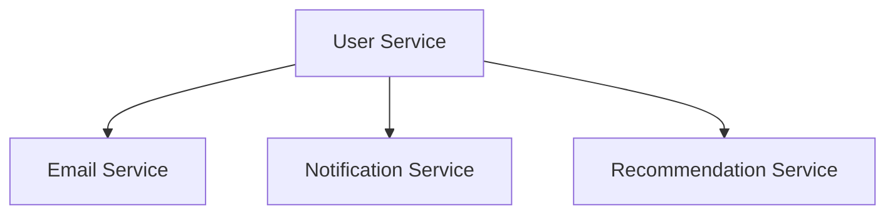
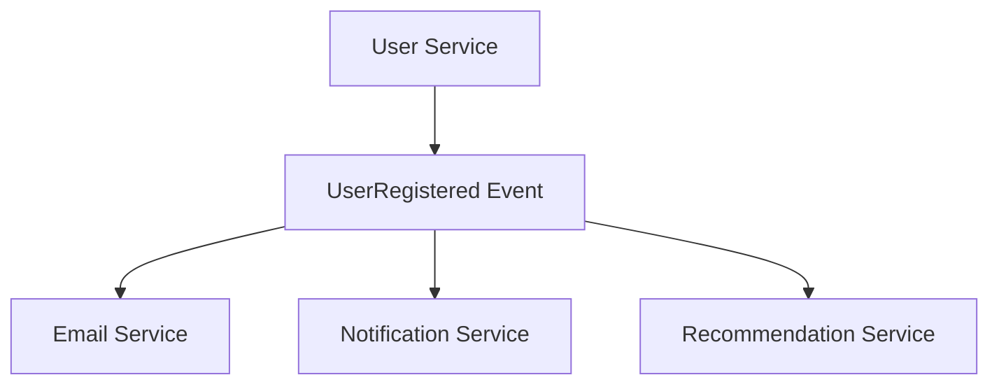
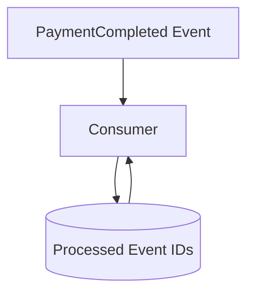
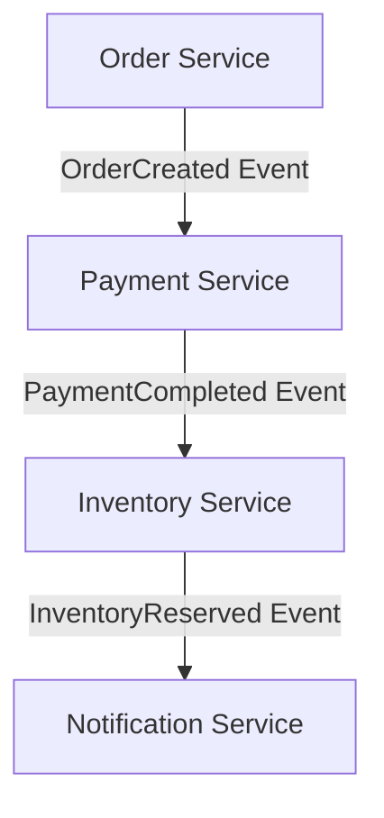

# Day-25 : Event Driven Architecture (EDA)

# Why Does Event Driven Architecture Exist?

In a traditional microservices architecture, services often communicate directly with each other.

For example, when a user uploads a post:

```text
Post Service
↓
Notification Service

Post Service
↓
Feed Service

Post Service
↓
Analytics Service

Post Service
↓
Thumbnail Service
```

As the system grows, this creates tight coupling because the Post Service becomes dependent on many downstream services.

Every time a new service is introduced, the Post Service must be modified.

This makes the system difficult to maintain and scale.

Event Driven Architecture solves this problem by introducing events.

---

# Traditional Direct Communication



---

# Problems With Direct Communication

As more services are added:

```text
Post Service
↓
10 Different Services
```

the system becomes:

```text
Tightly Coupled

Hard To Maintain

Difficult To Scale

Difficult To Extend
```

---

# What Is Event Driven Architecture?

Event Driven Architecture is a design pattern where services communicate through events instead of directly calling each other.

A service publishes an event whenever something important happens.

Other services can subscribe to that event and react independently.

The producer does not know who consumes the event.

The consumer does not know who produced the event.

This creates loose coupling.

---

# Event Driven Architecture Flow



---

# What Is An Event?

An event is a record that something has already happened in the system.

Examples:

```text
UserRegistered

OrderCreated

PaymentCompleted

InventoryReserved

PostCreated
```

Events are generally written in past tense because they describe something that has already occurred.

---

# Core Components Of EDA

Every Event Driven Architecture consists of three major components.

---

## Producer

A producer is the service that generates an event.

Example:

```text
Post Service
```

creates:

```text
PostCreated Event
```

---

## Event Broker

The Event Broker receives events from producers and delivers them to interested consumers.

Examples:

```text
Kafka

RabbitMQ
```

---

## Consumer

Consumers subscribe to events and react when those events occur.

Examples:

```text
Notification Service

Feed Service

Analytics Service
```

---

# Producer Consumer Flow



---

# Real Example : User Signup

Suppose a user signs up.

Without EDA:



The User Service must directly call every service.

---

With EDA:



The User Service only publishes the event.

Any new service can subscribe later without changing the User Service.

---

# Why Companies Use EDA

Suppose tomorrow we introduce:

```text
Recommendation Service
```

that needs user signup information.

Without EDA:

```text
Modify User Service
```

Again.

---

With EDA:

```text
Subscribe To UserRegistered Event
```

No producer changes are required.

This makes the architecture highly extensible.

---

# Benefits Of Event Driven Architecture

## Loose Coupling

Producers and consumers do not know about each other.

---

## Independent Scaling

Consumers can scale independently.

---

## Easy Extension

New consumers can subscribe to existing events without changing producers.

---

## Better Fault Isolation

If one consumer fails, producers can continue publishing events.

---

# Problems With Event Driven Architecture

EDA is powerful but introduces new challenges.

---

## Debugging Becomes Hard

A single request may travel through:

```text
Multiple Events

Multiple Services
```

before completion.

Finding where a failure occurred becomes difficult.

---

## Event Ordering Problems

Events may arrive in a different order than expected.

Example:

```text
PaymentCompleted

OrderCreated
```

which can cause issues.

---

## Duplicate Events

An Event Broker may deliver the same event multiple times.

Consumers must be able to handle duplicate events safely.

---

# Idempotency In Event Driven Architecture

This is one of the most important interview concepts.

Suppose Kafka delivers:

```text
PaymentCompleted
```

twice.

---

Bad Consumer:

```text
Give Cashback
Give Cashback Again
```

Result:

```text
Customer Gets Double Cashback
```

Incorrect.

---

Good Consumer:

The consumer stores the processed Event IDs.

Before processing an event, it checks whether that Event ID has already been processed.

If it has, the event is ignored.

---

# Event Idempotency Flow



---

# Event Idempotency Example

Event:

```text
Event ID = evt_123
```

Consumer receives it.

Consumer checks:

```text
Processed Event Store
```

---

If:

```text
evt_123 Exists
```

Ignore Event.

---

If:

```text
evt_123 Does Not Exist
```

Process Event.

Store:

```text
evt_123
```

for future duplicate checks.

---

# API Idempotency vs Event Idempotency

| API World                | Event Driven World     |
| ------------------------ | ---------------------- |
| Idempotency Key          | Event ID               |
| Request                  | Event                  |
| API Server               | Consumer               |
| Duplicate Request        | Duplicate Event        |
| Ignore Duplicate Request | Ignore Duplicate Event |

---

# Why Does Kafka Deliver Duplicate Events?

Kafka follows:

```text
At Least Once Delivery
```

This means:

```text
An Event Will Not Be Lost
```

but it may be delivered more than once.

Therefore:

```text
Consumers Must Be Idempotent
```

---

# Event Driven Architecture And Saga Pattern

Remember Saga Choreography from Day 24.

Saga Choreography is built on top of Event Driven Architecture.

---

# Saga Choreography Flow



---

Each service reacts to events instead of being controlled by a central orchestrator.

---

# Request Response vs Event Driven

| Request Response     | Event Driven              |
| -------------------- | ------------------------- |
| Direct Communication | Event Based Communication |
| Tight Coupling       | Loose Coupling            |
| Easier Debugging     | Harder Debugging          |
| Immediate Response   | Asynchronous Processing   |
| Less Flexible        | Highly Extensible         |

---

# Common Interview Questions

## Q1. What Is Event Driven Architecture?

### Answer

Event Driven Architecture is a design pattern where services communicate through events instead of direct service-to-service calls.

---

## Q2. What Is An Event?

### Answer

An event is a record that describes something that has already happened in the system.

Example:

```text
OrderCreated

PaymentCompleted

UserRegistered
```

---

## Q3. What Is A Producer?

### Answer

A producer is a service that generates and publishes events.

---

## Q4. What Is A Consumer?

### Answer

A consumer is a service that subscribes to and reacts to events.

---

## Q5. What Is An Event Broker?

### Answer

An Event Broker is responsible for transporting events from producers to consumers.

Examples:

```text
Kafka

RabbitMQ
```

---

## Q6. Why Is EDA Useful?

### Answer

EDA reduces coupling between services, improves scalability, and allows new consumers to be added without changing producers.

---

## Q7. What Is Idempotency In EDA?

### Answer

Idempotency ensures that duplicate events do not produce duplicate side effects.

Consumers track processed Event IDs and ignore duplicates.

---

## Q8. Why Is Debugging Hard In EDA?

### Answer

A request can travel through multiple services and events, making it difficult to trace failures.

---

# Interview Practice Scenarios

## Scenario 1

### Situation

Post Service directly calls:

```text
Notification Service

Analytics Service

Feed Service

Thumbnail Service
```

### Interview Answer

This design creates tight coupling. As the system grows, every new consumer requires changes in Post Service. Event Driven Architecture would be a better choice because Post Service can simply publish a PostCreated event and remain independent of consumers.

---

## Scenario 2

### Situation

A company wants to add a Recommendation Service after user signup.

### Interview Answer

EDA is ideal because Recommendation Service can simply subscribe to the UserRegistered event. No changes are required in User Service.

---

## Scenario 3

### Situation

Kafka delivers:

```text
PaymentCompleted
```

twice.

### Interview Answer

Consumers should be idempotent. Each event should contain a unique Event ID. Before processing, the consumer checks whether the Event ID has already been processed. If it has, the event is ignored.

---

## Scenario 4

### Situation

50 consumers are listening to events.

Debugging is becoming difficult.

### Interview Answer

This is a common drawback of Event Driven Architecture. Since requests travel through many services and events, tracing failures becomes harder.

---

## Scenario 5

### Situation

Design an Instagram Post Upload System using:

```text
Post Service

Notification Service

Feed Service

Analytics Service

Kafka
```

### Interview Answer

The Post Service acts as the producer and publishes a PostCreated event.

Kafka acts as the Event Broker and distributes the event.

The Notification Service, Feed Service, and Analytics Service act as consumers.

This design keeps Post Service loosely coupled and allows new services to subscribe without modifying existing producer logic.

---

# 30 Second Revision

```text
Producer
↓
Creates Event

Event Broker
↓
Kafka

Consumers
↓
React To Event

Benefits
↓
Loose Coupling
Scalability
Extensibility

Problems
↓
Debugging
Ordering
Duplicates

Duplicate Events
↓
Idempotent Consumers

Event ID
↓
Ignore Duplicates

Saga Choreography
↓
Built On EDA
```

---

# Interview Keywords

```text
Event Driven Architecture

Producer

Consumer

Event Broker

Kafka

RabbitMQ

Loose Coupling

Event Streaming

Asynchronous Processing

Event ID

Idempotent Consumer

At Least Once Delivery

Event Ordering

Saga Choreography
```
