# Day-26 : Kafka vs RabbitMQ | Message Queue vs Event Streaming

# Why Do We Need Kafka and RabbitMQ?

In modern distributed systems, services often need to communicate asynchronously.

For example, when a user uploads a post:

```text
Send Notification

Update Feed

Update Analytics

Update Recommendations
```

The question is:

Should we distribute work to workers?

OR

Should we inform multiple services that an event occurred?

The answer determines whether we should use RabbitMQ or Kafka.

---

# Traditional Queue Model

A producer creates a task.

A worker consumes the task.

Once the task is completed, the message is removed.

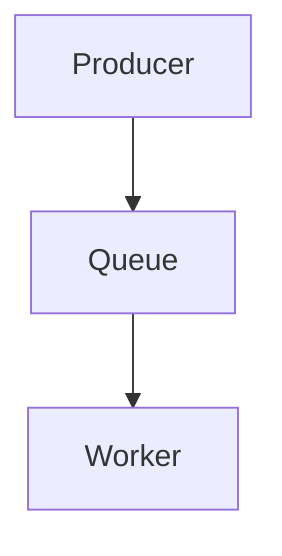

This is the foundation of RabbitMQ.

---

# RabbitMQ

RabbitMQ is a Message Queue.

Its primary purpose is to distribute tasks among workers.

The focus is:

```text
Do Some Work
```

Examples:

```text
Send Email

Generate Thumbnail

Resize Image

Generate PDF

Convert Video

Send SMS
```

Once the task is completed, the message is removed from the queue.

---

# RabbitMQ Flow

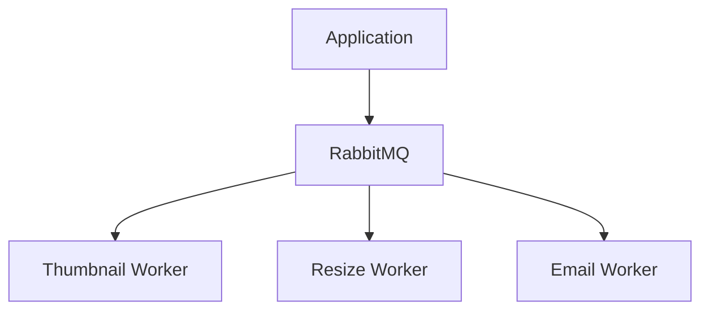

---

# RabbitMQ Mental Model

Think:

```text
Task
↓
Worker
↓
Task Completed
↓
Message Removed
```

---

# Kafka

Kafka is an Event Streaming Platform.

Its primary purpose is to distribute business events.

The focus is:

```text
Inform The System
That Something Happened
```

Examples:

```text
UserRegistered

OrderCreated

PaymentCompleted

PostCreated

InventoryReserved
```

Unlike RabbitMQ, Kafka stores events for a configurable retention period.

Multiple consumers can independently read the same event.

---

# Kafka Flow

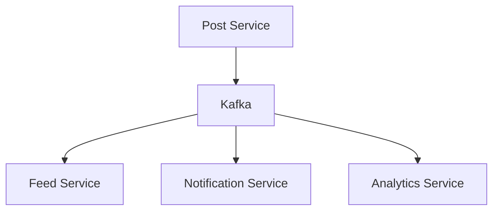

---

# Kafka Mental Model

Think:

```text
Event Occurred
↓
Store Event
↓
Multiple Services Consume
↓
Event Remains Stored
```

---

# Core Difference

| RabbitMQ                            | Kafka                                |
| ----------------------------------- | ------------------------------------ |
| Message Queue                       | Event Streaming Platform             |
| Task Processing                     | Event Distribution                   |
| Message Removed After Processing    | Event Retained                       |
| Worker Oriented                     | Consumer Oriented                    |
| One Consumer Usually Processes Task | Multiple Consumers Can Process Event |
| Background Jobs                     | Business Events                      |

---

# Message Lifecycle

## RabbitMQ

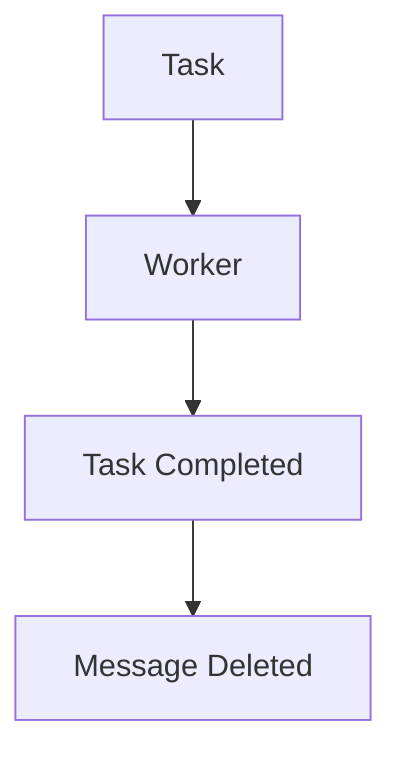

After processing:

```text
Message Gone
```

---

## Kafka

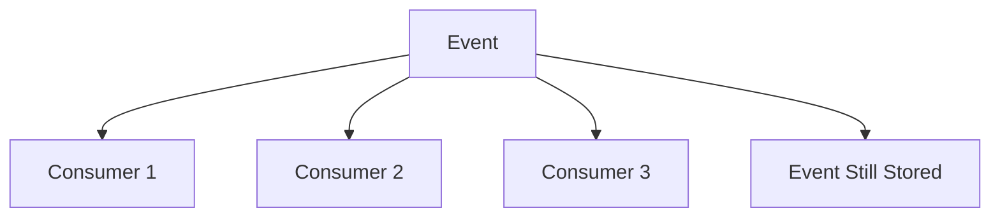

After processing:

```text
Event Remains Available
```

---

# Kafka Topics

Kafka stores events inside Topics.

Examples:

```text
UserRegistered Topic

OrderCreated Topic

PostCreated Topic

PaymentCompleted Topic
```

---

# Topic Flow

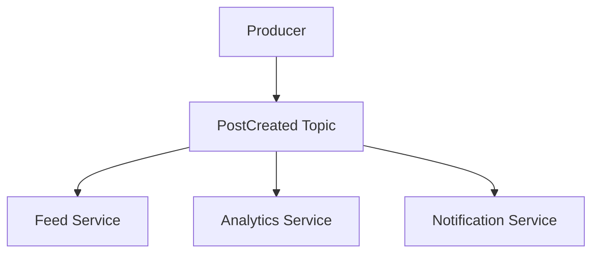

---

# Kafka Partitions

As traffic increases, a single topic becomes difficult to process.

Kafka solves this using Partitions.

A Topic can be divided into multiple partitions.

---

# Partition Flow

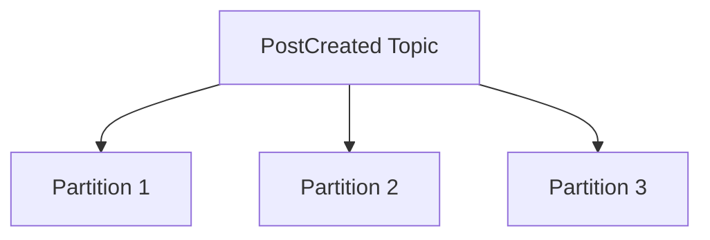

---

# Why Partitions?

Partitions allow parallel processing.

```text
More Partitions
↓
More Consumers
↓
More Throughput
```

---

# Consumer Groups

Suppose:

```text
500,000 Events / Second
```

A single consumer cannot process this traffic.

Kafka introduces Consumer Groups.

Each consumer within the same group processes different partitions.

---

# Consumer Group Flow

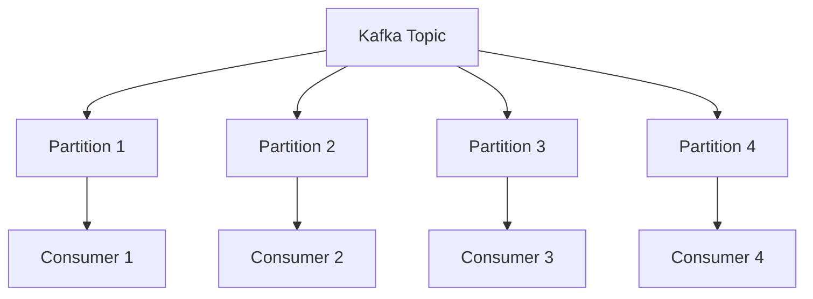

---

# Important Interview Point

Within a Consumer Group:

```text
One Partition
↓
One Consumer
```

Therefore:

```text
Consumers > Partitions
```

does not improve throughput.

---

# Ordering In Kafka

Kafka guarantees ordering only within a partition.

Example:

```text
Partition 1

Post1
Post2
Post3
```

Order is preserved.

---

However:

```text
Partition 1
Partition 2
```

do not have a global ordering guarantee.

---

# Event Replay

One of Kafka's biggest advantages.

Suppose Analytics Service crashes.

Events continue arriving.

Kafka stores them.

When Analytics Service recovers:

```text
Read Missed Events
↓
Process Them
```

This is called Event Replay.

---

# Event Replay Flow

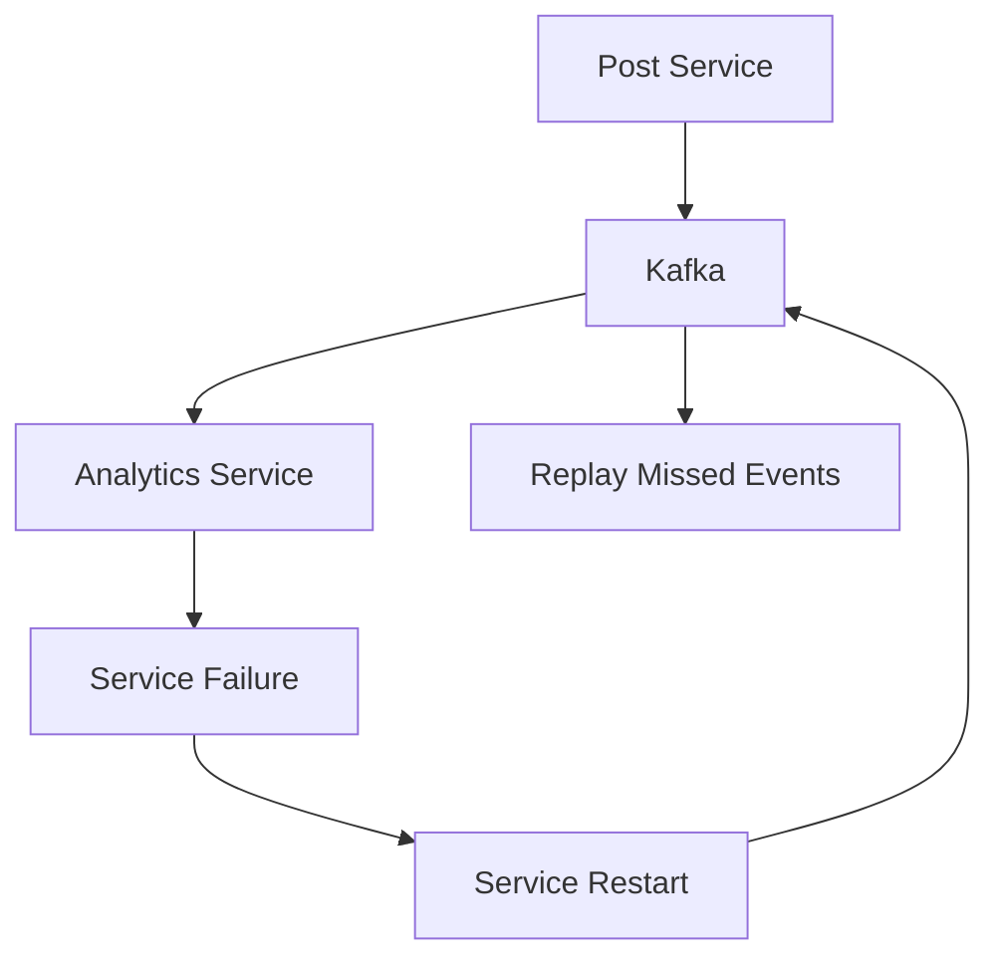

---

# Kafka Retention

Kafka can store events for:

```text
7 Days

30 Days

90 Days
```

or longer depending on configuration.

Benefits:

```text
Replay

Recovery

Auditing

Analytics
```

---

# When To Use RabbitMQ

Use RabbitMQ when the requirement is:

```text
Do Some Work
```

Examples:

```text
Send Email

Generate Thumbnail

Resize Image

Convert Video

Generate PDF

Send SMS
```

---

# When To Use Kafka

Use Kafka when the requirement is:

```text
Inform The System
That Something Happened
```

Examples:

```text
UserRegistered

OrderCreated

PaymentCompleted

PostCreated

InventoryReserved
```

---

# RabbitMQ vs Kafka Interview Shortcut

Ask yourself:

```text
Need To Do Work?
```

If Yes:

```text
RabbitMQ
```

---

Ask:

```text
Need To Inform The System
That An Event Occurred?
```

If Yes:

```text
Kafka
```

---

# Common Interview Questions

## Q1. What Is RabbitMQ?

### Answer

RabbitMQ is a Message Queue used primarily for task distribution and background job processing.

---

## Q2. What Is Kafka?

### Answer

Kafka is an Event Streaming Platform used to distribute and store business events.

---

## Q3. What Is A Kafka Topic?

### Answer

A Topic is a logical stream of events inside Kafka.

Examples:

```text
PostCreated

OrderCreated

PaymentCompleted
```

---

## Q4. What Is A Partition?

### Answer

A Partition is a subdivision of a Kafka Topic that enables parallel processing and horizontal scalability.

---

## Q5. What Is A Consumer Group?

### Answer

A Consumer Group is a collection of consumers that share the work of processing a topic's partitions.

---

## Q6. What Is Event Replay?

### Answer

Event Replay allows a service to reprocess previously stored events from Kafka after a failure or restart.

---

## Q7. What Ordering Guarantee Does Kafka Provide?

### Answer

Kafka guarantees ordering only within a single partition.

---

## Q8. When Would You Choose RabbitMQ Over Kafka?

### Answer

I would choose RabbitMQ for background tasks and job processing where the message is consumed once and then discarded.

---

## Q9. When Would You Choose Kafka Over RabbitMQ?

### Answer

I would choose Kafka when multiple services need to independently consume the same event and when event retention or replay is required.

---

# Interview Practice Scenarios

## Scenario 1

### Situation

The system needs:

```text
Send Welcome Email

Generate Thumbnail

Resize Image
```

### Interview Answer

I would choose RabbitMQ because these are background tasks that need to be processed by workers. Once the task is completed, the message can be removed. Event retention and replay are not required.

### Flow


---

## Scenario 2

### Situation

The same event must be processed by:

```text
Feed Service

Analytics Service

Recommendation Service

Notification Service
```

### Interview Answer

I would choose Kafka because multiple independent services need to consume the same business event. Kafka stores the event in a topic and allows multiple consumer groups to read it independently.

### Flow

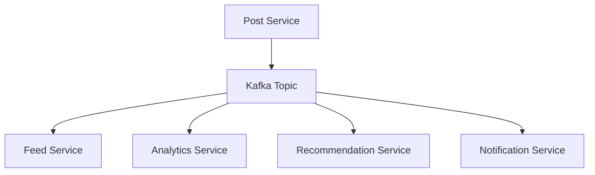

---

## Scenario 3

### Situation

Analytics Service was down for 3 hours.

Management wants all missed events processed.

### Interview Answer

I would use Kafka because Kafka retains events. When Analytics Service recovers, it can continue reading from its last committed offset and replay all missed events.

### Flow

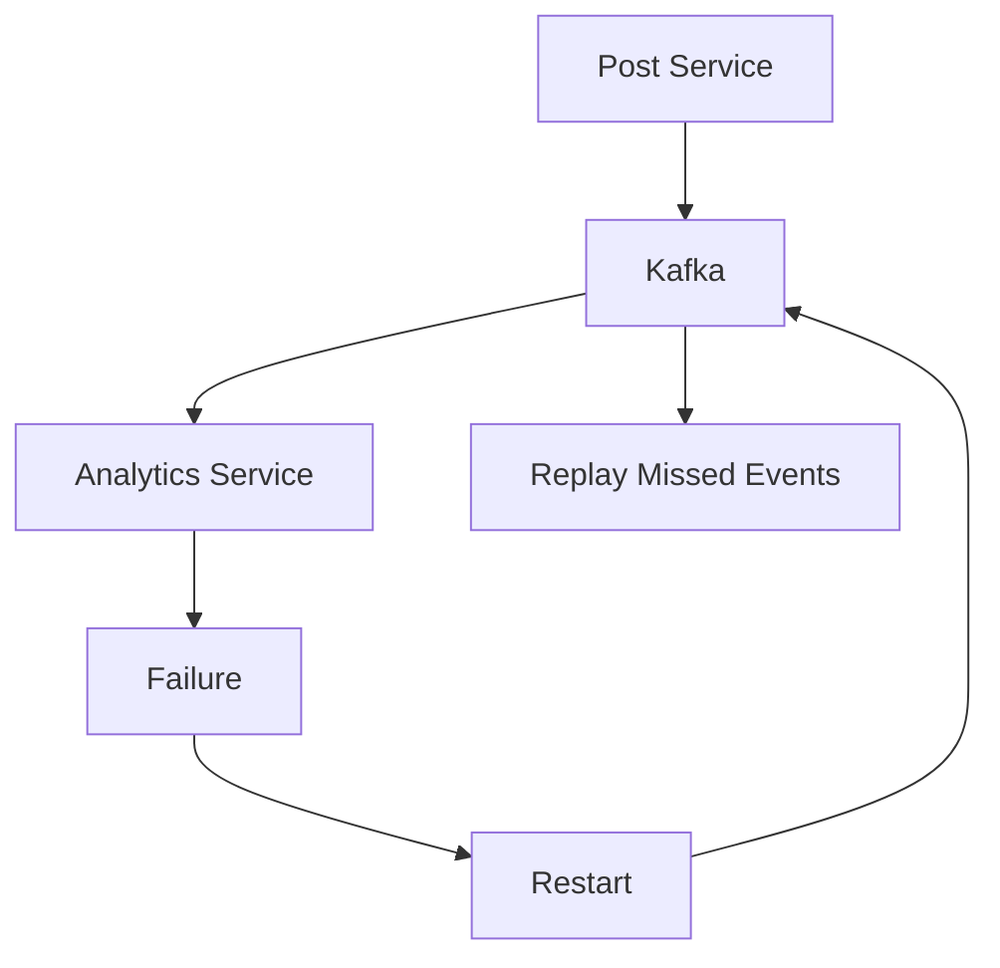

---

## Scenario 4

### Situation

A Kafka Topic receives:

```text
500,000 Events / Second
```

### Interview Answer

I would scale the system using partitions and consumer groups. Multiple consumers can process different partitions in parallel, increasing throughput.

### Flow


---

## Scenario 5

### Situation

Design an Instagram Post Upload Event Pipeline.

### Interview Answer

I would use Kafka as the event streaming platform.

When a user uploads a post, the Post Service acts as the producer and publishes a PostCreated event to a Kafka Topic.

The topic is divided into partitions to support high throughput.

Feed Service, Analytics Service, Notification Service, and Recommendation Service belong to different consumer groups and consume the same event independently.

If a service crashes, it can replay missed events using Kafka's retention mechanism.

### Complete Flow

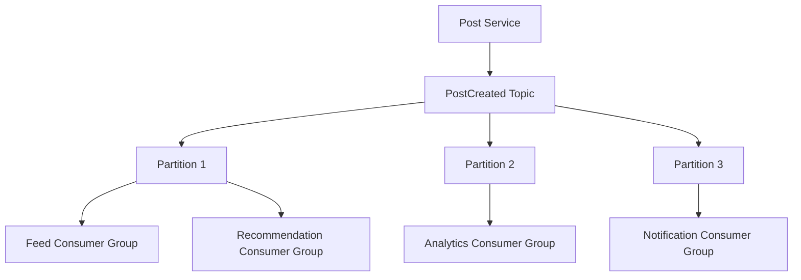

---

# 30 Second Revision

```text
RabbitMQ
↓
Task Processing

Kafka
↓
Event Streaming

Topic
↓
Stores Events

Partition
↓
Parallel Processing

Consumer Group
↓
Horizontal Scaling

Event Replay
↓
Recover Missed Events

Rule
↓
Do Work → RabbitMQ

Inform System → Kafka
```

---

# Interview Keywords

```text
RabbitMQ

Kafka

Message Queue

Event Streaming

Topic

Partition

Consumer Group

Event Replay

Retention

Producer

Consumer

Background Jobs

Business Events

Horizontal Scaling
```
