# Day-27 : Kafka Internal Architecture

# Why Do We Need To Understand Kafka Internals?

So far, we have learned:

```text
Producer

Consumer

Topic

Partitions

Consumer Groups
```

However, in interviews, you are often asked:

```text
How Does Kafka Actually Store Data?

What Happens If A Broker Crashes?

How Does Kafka Scale To Millions Of Events?

How Does Kafka Prevent Data Loss?

How Do Consumers Resume After Failure?
```

To answer these questions, we need to understand Kafka's internal architecture.

---

# Kafka Architecture Overview

A Kafka Cluster consists of:

```text
Producer

Broker

Topic

Partition

Consumer

Consumer Group
```

---

# High Level Architecture

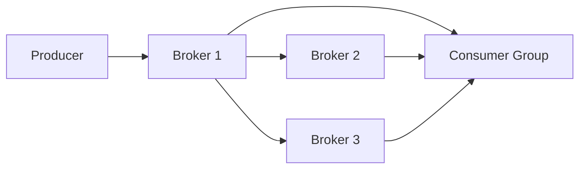

---

# What Is A Kafka Broker?

A Broker is simply a Kafka Server.

Just like MySQL runs on a Database Server:

```text
MySQL
↓
Database Server
```

Kafka runs on:

```text
Kafka
↓
Broker
```

A Kafka Cluster is made up of multiple brokers.

Example:

```text
Broker 1

Broker 2

Broker 3
```

---

# What Is A Topic?

A Topic is a logical category of events.

Examples:

```text
PostCreated

UserRegistered

PaymentCompleted

OrderCreated
```

---

# Topic Flow

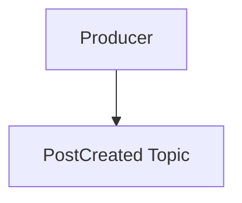

---

# Important Interview Point

A Topic does NOT actually store data.

The actual storage happens inside Partitions.

Think:

```text
Topic
=
Folder

Partition
=
Actual Storage Shelf
```

---

# What Is A Partition?

A Partition is the actual storage unit in Kafka.

Suppose we have:

```text
PostCreated Topic
```

Kafka may divide it into:

```text
Partition 1

Partition 2

Partition 3
```

---

# Partition Structure

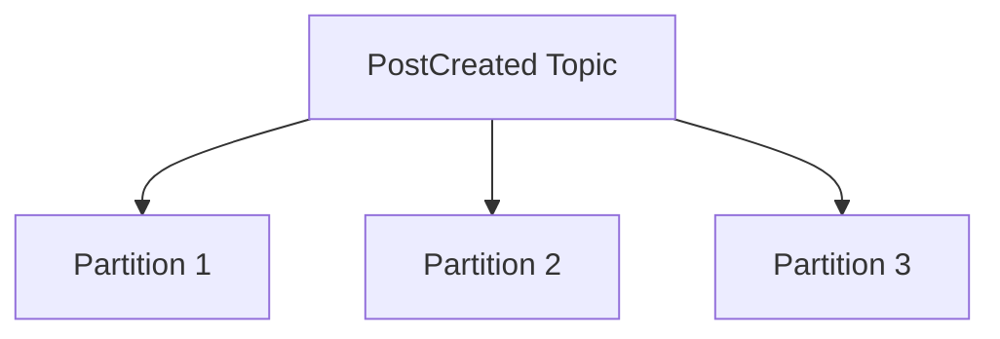

---

# Why Are Partitions Needed?

Without partitions:

```text
One Topic
↓
One Storage Unit
↓
Bottleneck
```

---

Partitions enable:

```text
Parallel Reads

Parallel Writes

Horizontal Scaling
```

---

# Real World Example

Suppose Instagram receives:

```text
1 Million Posts Per Second
```

A single partition cannot handle all traffic.

Kafka distributes the load across multiple partitions.

Example:

```text
User1 Post
→ Partition 1

User2 Post
→ Partition 2

User3 Post
→ Partition 3
```

---

# Topic vs Partition

Think of a library.

```text
Science Books
```

is a Topic.

Inside the Science section:

```text
Shelf 1

Shelf 2

Shelf 3
```

are Partitions.

The books inside the shelves are Events.

---

# What Is An Offset?

Every event inside a partition gets a unique position called an Offset.

Example:

```text
Offset 0 → Post1

Offset 1 → Post2

Offset 2 → Post3

Offset 3 → Post4
```

---

# Offset Structure

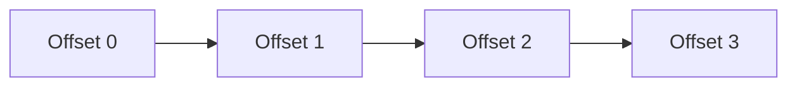

---

# Why Are Offsets Important?

Consumers track offsets.

Suppose a consumer reads:

```text
Offset 500
```

and crashes.

When it restarts:

```text
Continue From Offset 501
```

instead of:

```text
Read Everything Again
```

---

# Consumer Recovery Flow

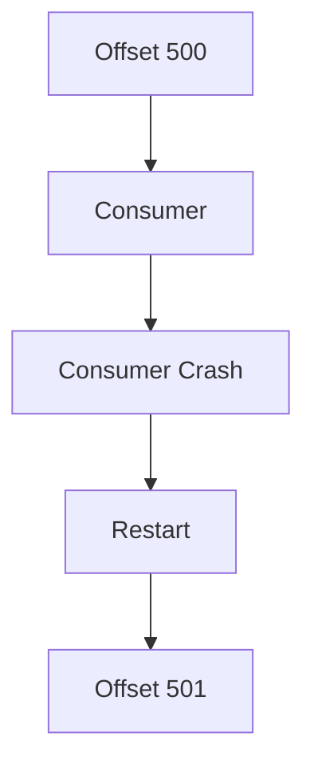

---

# Replication

What happens if a Kafka Broker crashes?

Would all data be lost?

No.

Kafka uses Replication.

---

# Replication Concept

Each partition has:

```text
Leader Replica

Follower Replica

Follower Replica
```

---

# Replication Flow

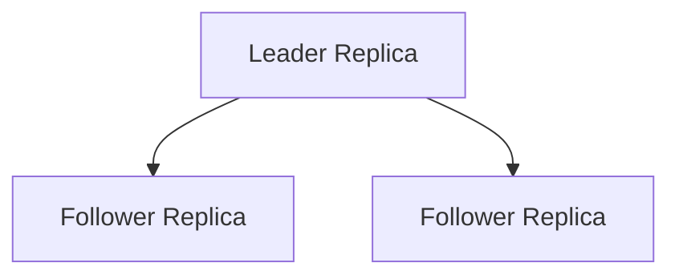

---

# What Is A Leader Replica?

All reads and writes go through the Leader.

---

# Write Flow

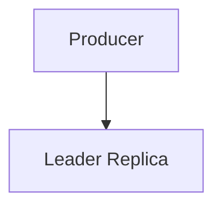

---

# What Are Followers?

Followers continuously copy data from the Leader.

This ensures that data exists in multiple places.

---

# Follower Sync Flow


---

# Replication Factor

Very Important Interview Concept.

Example:

```text
Replication Factor = 3
```

means:

```text
1 Leader

2 Followers
```

for every partition.

---

# Example

Partition 1:

```text
Leader → Broker 1

Follower → Broker 2

Follower → Broker 3
```

---

# Why Replication?

Benefits:

```text
High Availability

Fault Tolerance

Data Protection
```

---

# Broker Failure

Suppose:

```text
Broker 1
```

contains the Leader Replica.

Suddenly:

```text
Broker 1 Crashes
```

---

Kafka automatically promotes a follower to become the new leader.

---

# Leader Election Flow

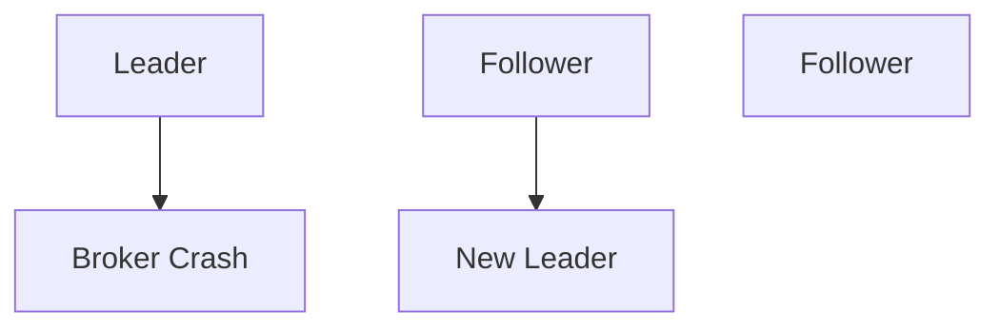

---

This process is called:

```text
Leader Election
```

---

# Consumer Groups

Suppose:

```text
100,000 Events / Second
```

need processing.

One consumer cannot handle this traffic.

Kafka introduces Consumer Groups.

---

# Consumer Group Example

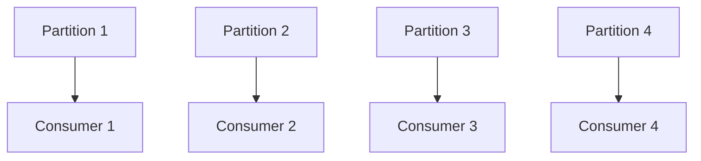

---

Each consumer processes different partitions.

This enables:

```text
Horizontal Scaling
```

---

# Rebalancing

Suppose:

```text
Consumer 2 Crashes
```

Kafka automatically redistributes partitions.

---

# Rebalancing Flow

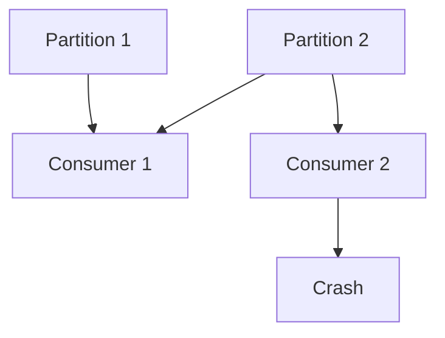

---

This process is called:

```text
Consumer Group Rebalancing
```

---

# End To End Flow

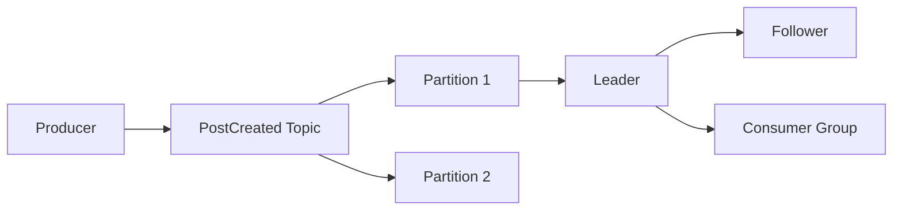

---

# Common Interview Questions

## Q1. What Is A Kafka Broker?

### Answer

A Broker is a Kafka Server responsible for storing partitions and serving producer and consumer requests.

---

## Q2. What Is A Topic?

### Answer

A Topic is a logical category of events. Topics organize events but do not directly store data.

---

## Q3. What Is A Partition?

### Answer

A Partition is the actual storage unit inside a Topic. Kafka uses partitions to enable parallel processing and horizontal scaling.

---

## Q4. Why Are Partitions Needed?

### Answer

Partitions distribute load across multiple servers and enable parallel reads and writes.

---

## Q5. What Is An Offset?

### Answer

An Offset is the unique position of an event inside a partition.

---

## Q6. Why Are Offsets Important?

### Answer

Offsets allow consumers to track progress and resume processing after failures.

---

## Q7. What Is Replication?

### Answer

Replication creates multiple copies of partition data across brokers to improve fault tolerance.

---

## Q8. What Is A Replication Factor?

### Answer

Replication Factor defines how many copies of a partition should exist.

Example:

```text
Replication Factor = 3

1 Leader
2 Followers
```

---

## Q9. What Happens If A Broker Crashes?

### Answer

Kafka promotes one of the follower replicas to become the new leader through Leader Election.

---

## Q10. What Is Rebalancing?

### Answer

Rebalancing is the process of redistributing partitions among consumers when consumers join or leave a consumer group.

---

# Interview Practice Scenarios

## Scenario 1

### Situation

A Topic receives:

```text
1 Million Events / Second
```

and one partition becomes a bottleneck.

### Interview Answer

I would increase the number of partitions and add more consumers. This enables parallel processing and horizontal scaling.

---

## Scenario 2

### Situation

A Kafka Broker crashes.

### Interview Answer

Kafka prevents data loss through replication. If the leader replica crashes, a follower replica is automatically promoted to become the new leader.

---

## Scenario 3

### Situation

A consumer processed:

```text
Offset 500
```

and then crashed.

### Interview Answer

The consumer stores its offset. After restarting, it resumes from Offset 501 instead of reading all events again.

---

## Scenario 4

### Situation

A Topic has:

```text
12 Partitions
```

and:

```text
2 Consumers
```

### Interview Answer

Kafka will distribute the 12 partitions across the 2 consumers. The system will still work correctly, although each consumer will need to process multiple partitions.

---

## Scenario 5

### Situation

Design a Kafka setup for Instagram Post Uploads.

Explain:

```text
Topics

Partitions

Replication Factor

Offsets

Consumer Groups

Leader Election
```

### Interview Answer

I would create a Kafka Topic named:

```text
PostCreated
```

and divide it into multiple partitions to support high throughput.

Each partition would have a replication factor of 3, consisting of one leader and two follower replicas.

Feed Service, Analytics Service, Notification Service, and Recommendation Service would belong to separate consumer groups so that all services can independently consume the same event.

Consumers would track offsets to recover from failures.

If a broker crashes, Kafka would automatically elect a follower replica as the new leader, ensuring high availability and fault tolerance.

---

# 30 Second Revision

```text
Broker
↓
Kafka Server

Topic
↓
Logical Category

Partition
↓
Actual Storage

Offset
↓
Position Of Event

Replication
↓
Multiple Copies

Leader
↓
Handles Reads And Writes

Followers
↓
Copy Data

Consumer Group
↓
Parallel Processing

Leader Election
↓
Follower Becomes Leader

Rebalancing
↓
Redistribute Partitions
```

---

# Interview Keywords

```text
Kafka Broker

Topic

Partition

Offset

Leader Replica

Follower Replica

Replication Factor

Consumer Group

Leader Election

Rebalancing

Fault Tolerance

High Availability

Horizontal Scaling
```
