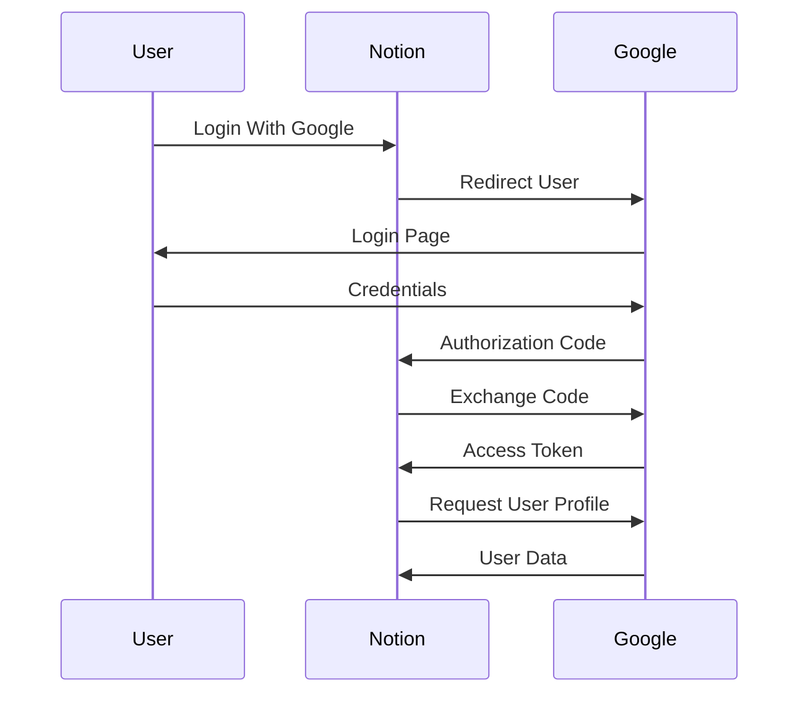
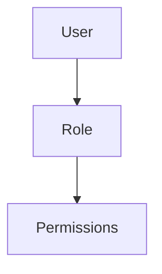
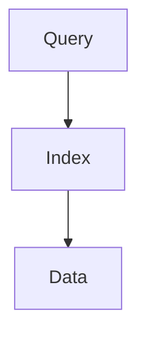
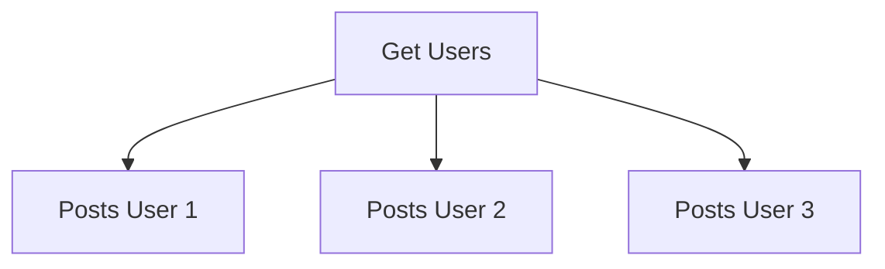

# Day 28 - Security & Database Optimization

## Overview

In large-scale systems, two major challenges arise:

1. Securing user authentication and authorization.
2. Maintaining database performance as data grows to millions or billions of records.

This chapter covers:

- OAuth 2.0
- RBAC
- ABAC
- Database Indexing
- Composite Indexes
- Left-Most Prefix Rule
- Query Optimization
- N+1 Query Problem
- Database Bottlenecks
- SQL vs NoSQL

---

# OAuth 2.0

## Why OAuth Exists

Consider:

```text
Login With Google
```

Without OAuth, third-party applications would need access to the user's Google password.

Problems:

```text
Password Leakage

Security Risks

Credential Theft

Loss Of User Trust
```

OAuth solves this problem by allowing applications to access user resources without knowing the user's password.

---

## Definition

OAuth is an authorization framework that allows a third-party application to access limited resources on behalf of a user without sharing the user's credentials.

---

## OAuth Actors

### Resource Owner

The user who owns the data.

Example:

```text
Shashwat
```

### Client

The application requesting access.

Example:

```text
Notion
```

### Authorization Server

The service responsible for authenticating the user.

Example:

```text
Google
```

### Resource Server

The service storing the protected resources.

Example:

```text
Google Profile
Google Drive
Google Contacts
```

---

## OAuth Flow



---

# OAuth vs JWT

| JWT | OAuth |
|-------|-------|
| Authentication | Authorization |
| Who Are You? | What Can You Access? |
| User Identity | Resource Access |
| Used Within Application | Used Between Applications |

---

# Authorization

Authentication verifies identity.

Authorization determines permissions.

Example:

```text
User Logged In
↓
Can User Delete Posts?
```

---

# RBAC (Role Based Access Control)

Permissions depend on roles.

Example:

```text
Admin
↓
All Permissions

Moderator
↓
Delete Comments

User
↓
View Posts
```

---

## RBAC Flow



---

## Advantages

```text
Simple

Easy To Manage

Widely Used
```

---

# ABAC (Attribute Based Access Control)

Permissions depend on attributes.

Examples:

```text
Department

Location

Age

Time

Resource Type
```

---

## Example Rule

```text
Allow Access

If

Department = HR

AND

Location = Ahmedabad
```

---

## Advantages

```text
Fine Grained Control

Flexible

Enterprise Friendly
```

---

# Database Performance Problem

Suppose:

```text
100 Million Rows
```

Query:

```sql
SELECT *
FROM users
WHERE email='abc@gmail.com';
```

Without optimization:

```text
Full Table Scan
```

---

# Indexing

Indexes help databases find data quickly without scanning the entire table.

---

## Real World Analogy

Book Index

```text
Topic
↓
Page Number
```

Database Index

```text
Value
↓
Row Location
```

---

## Index Flow



---

# B-Tree Index

Most SQL databases use B-Tree indexes.

Benefits:

```text
Fast Search

Sorting

Range Queries
```

---

# Composite Index

Suppose:

```sql
SELECT *
FROM posts
WHERE user_id = 101
AND created_at > '2025-01-01';
```

A better index is:

```sql
(user_id, created_at)
```

instead of:

```sql
(user_id)

(created_at)
```

---

# Left-Most Prefix Rule

Given:

```sql
(user_id, created_at)
```

Works efficiently for:

```sql
WHERE user_id = 101
```

and

```sql
WHERE user_id = 101
AND created_at > '2025-01-01'
```

---

Does NOT efficiently work for:

```sql
WHERE created_at > '2025-01-01'
```

because:

```text
user_id
```

is the left-most column.

---

# Query Optimization

## Bad Query

```sql
SELECT *
FROM users;
```

---

## Better Query

```sql
SELECT id,name
FROM users;
```

Benefits:

```text
Less Data

Less IO

Faster Query
```

---

# Pagination

Bad:

```sql
SELECT *
FROM posts;
```

Better:

```sql
SELECT *
FROM posts
LIMIT 20;
```

---

# N+1 Query Problem

Very common interview question.

---

Suppose:

```text
100 Users
```

Query 1:

```sql
Get Users
```

Then:

```sql
Get Posts For User 1

Get Posts For User 2

...

Get Posts For User 100
```

Total:

```text
101 Queries
```

---

## N+1 Flow



---

## Solutions

```text
JOIN

Batch Loading

Pre-Fetching
```

---

# Database Bottlenecks

Databases generally become:

```text
Read Heavy

or

Write Heavy
```

---

## Read Heavy Systems

Examples:

```text
Instagram Feed

YouTube

Netflix
```

Solutions:

```text
Read Replicas

Caching

CDN
```

---

## Write Heavy Systems

Examples:

```text
Chat Systems

Payment Logs

Analytics
```

Solutions:

```text
Partitioning

Sharding

Message Queues
```

---

# SQL vs NoSQL

## SQL

Choose SQL when:

```text
Strong Consistency

Transactions

Relationships

ACID Properties
```

Examples:

```text
Banking

Payments

Orders
```

---

## NoSQL

Choose NoSQL when:

```text
Massive Scale

Flexible Schema

High Throughput

Horizontal Scaling
```

Examples:

```text
Instagram Feed

Analytics

Social Media Posts
```

---

# Common Interview Questions

## Q1. What is OAuth?

### Answer

OAuth is an authorization framework that allows third-party applications to access user resources without sharing passwords.

---

## Q2. Difference Between OAuth and JWT?

### Answer

JWT is used for authentication, while OAuth is used for authorization.

---

## Q3. What is RBAC?

### Answer

RBAC assigns permissions based on roles such as Admin, Moderator, and User.

---

## Q4. What is ABAC?

### Answer

ABAC assigns permissions based on attributes such as department, location, and resource type.

---

## Q5. What is an Index?

### Answer

An index is a data structure that improves query performance by avoiding full table scans.

---

## Q6. What is a Composite Index?

### Answer

A composite index consists of multiple columns and helps optimize queries using those columns together.

---

## Q7. What is the Left-Most Prefix Rule?

### Answer

A composite index can efficiently serve queries starting from its first indexed column.

---

## Q8. What is the N+1 Query Problem?

### Answer

It occurs when one query fetches parent records and additional queries fetch related records individually, leading to excessive database calls.

---

## Q9. When Would You Choose SQL?

### Answer

When strong consistency, transactions, and relationships are important.

---

## Q10. When Would You Choose NoSQL?

### Answer

When scalability, flexibility, and high throughput are more important than strict consistency.

---

# Scenario Based Questions

## Scenario 1

A startup stores Google passwords in its own database for Login With Google.

### Answer

I would not approve this design because it introduces major security risks. Instead, I would use OAuth, where Google authenticates the user and issues an access token without exposing the user's password.

---

## Scenario 2

A query on a 100 million row table takes 12 seconds.

### Answer

I would inspect the execution plan, identify full table scans, create appropriate indexes, optimize joins and filters, and consider caching or read replicas if required.

---

## Scenario 3

Index:

```sql
(user_id, created_at)
```

Query:

```sql
WHERE created_at > '2025-01-01'
```

### Answer

The query will not efficiently use the composite index because it violates the Left-Most Prefix Rule.

---

## Scenario 4

1 Query fetches users and 100 queries fetch posts.

### Answer

This is the N+1 Query Problem. I would solve it using JOINs, batch loading, or pre-fetching.

---

## Scenario 5

Design database choices for:

### Banking System

Use SQL because transactions require ACID properties and strong consistency.

### Instagram Feed

Use NoSQL because it supports horizontal scaling, high throughput, and eventual consistency.