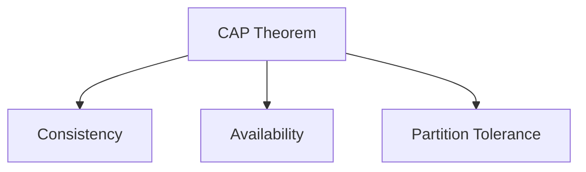
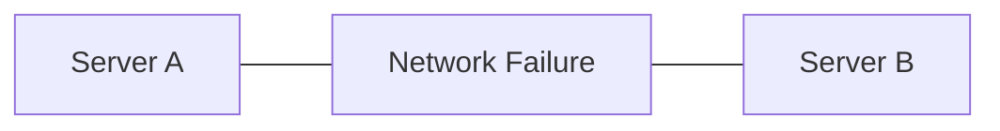
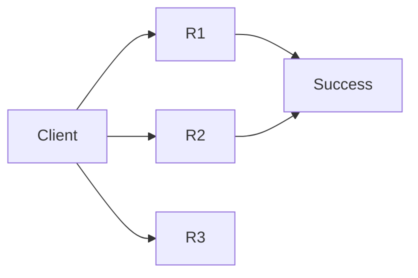
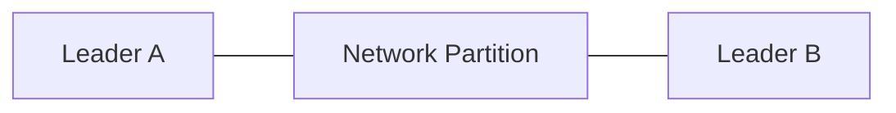
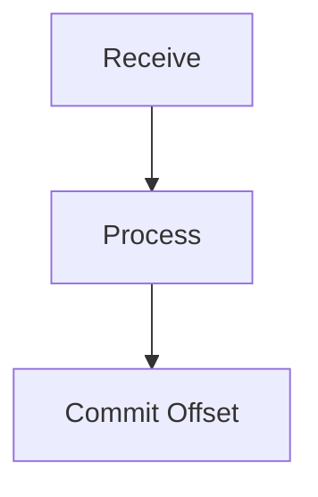

# Day 29 - Distributed Systems & Architecture Tradeoffs

# Overview

In this chapter, we cover some of the most important distributed system concepts used in modern large-scale systems.

Topics Covered:

- CAP Theorem
- Consistency Models
- Quorum
- Split Brain
- Kafka Partition Key
- Delivery Guarantees
- Offset Commit
- Retention Policy
- Architecture Tradeoffs
- Architecture Decision Making

---

# CAP Theorem

## Definition

CAP Theorem states that during a network partition, a distributed system can guarantee only two out of the following three properties:

```text
Consistency (C)

Availability (A)

Partition Tolerance (P)
```

---

## Consistency (C)

Every user sees the same data at the same time.

Example:

```text
Bank Account

Balance = ₹500
```

All servers should immediately show:

```text
₹500
```

---

## Availability (A)

Every request receives a response.

Even if some servers are unavailable.

---

## Partition Tolerance (P)

The system continues working even if servers cannot communicate with each other.

---

## CAP Visualization



---

# Why Can't We Have All Three?

Suppose:



Balance before update:

```text
₹1000
```

Server A updates:

```text
₹500
```

Network partition occurs.

Now:

```text
Server A = ₹500

Server B = ₹1000
```

Either:

```text
Serve Requests
↓
Lose Consistency
```

or

```text
Reject Requests
↓
Lose Availability
```

---

# CP Systems

Choose:

```text
Consistency

Partition Tolerance
```

Sacrifice:

```text
Availability
```

Examples:

```text
Banking

Payments

Inventory Systems
```

---

# AP Systems

Choose:

```text
Availability

Partition Tolerance
```

Sacrifice:

```text
Strong Consistency
```

Examples:

```text
Instagram Feed

Facebook Likes

Twitter Timeline
```

---

# Consistency Models

---

## Strong Consistency

After a write:

```text
Write
↓
Immediately Visible Everywhere
```

Example:

```text
Bank Transfer
```

---

## Eventual Consistency

After a write:

```text
Write
↓
Replication Delay
↓
Eventually Consistent
```

Example:

```text
Instagram Likes
```

---

## Comparison

| Strong Consistency | Eventual Consistency |
| ------------------ | -------------------- |
| Immediate Sync     | Delayed Sync         |
| Higher Latency     | Lower Latency        |
| Banking            | Social Media         |
| Payments           | Feeds                |

---

# Quorum

Quorum means a majority of replicas must agree before an operation succeeds.

---

## Example

Replicas:

```text
R1

R2

R3
```

Majority:

```text
2
```

---

## Write Quorum

Write succeeds only when majority acknowledges.



---

## Read Quorum

Read from majority replicas to reduce stale reads.

---

# Split Brain

## Definition

A situation where two nodes both believe they are the leader.

---

## Example



---

## Problems

```text
Conflicting Writes

Multiple Truths

Data Corruption
```

---

## Solutions

```text
Leader Election

Quorum

Consensus Algorithms
```

---

# Kafka Partition Key

## Why Partition Key Exists

Kafka must decide which partition should store a message.

---

## Example

```text
UserID = 101
```

Kafka hashes:

```text
101
```

and routes it to:

```text
Partition 2
```

---

## Important Rule

Same key always goes to the same partition.

Example:

```text
User 101
↓
Partition 2

User 101
↓
Partition 2

User 101
↓
Partition 2
```

---

## Why?

To maintain ordering.

---

# Delivery Guarantees

---

# At Most Once

```text
No Duplicates

Messages May Be Lost
```

Flow:

```text
Receive Message
↓
Commit Offset
↓
Crash
↓
Message Lost
```

---

# At Least Once

```text
No Message Loss

Duplicates Possible
```

Flow:

```text
Receive Message
↓
Process Message
↓
Crash Before Commit
↓
Message Reprocessed
```

Kafka default behavior.

---

# Exactly Once

```text
No Message Loss

No Duplicates
```

Most expensive option.

---

# Offset Commit

Offsets should be committed only after successful processing.

---

## Wrong Flow

```text
Receive
↓
Commit
↓
Process
```

Crash:

```text
Message Lost
```

---

## Correct Flow



---

# Retention Policy

Kafka stores events even after consumers read them.

Examples:

```text
7 Days

30 Days

90 Days
```

---

## Benefits

```text
Replay

Recovery

Auditing

Analytics
```

---

# Architecture Tradeoffs

---

# Why Not Cache Everything?

Problems:

```text
Stale Data

Memory Cost

Cache Invalidation
```

---

# Why Not Use Redis For Everything?

Problems:

```text
Memory Expensive

Limited Capacity

Potential Data Loss
```

---

# Why Not Use Kafka Everywhere?

Problems:

```text
Operational Complexity

Ordering Challenges

Maintenance Overhead
```

---

# Why Not Use Microservices Everywhere?

Problems:

```text
Distributed Transactions

Network Calls

Debugging Complexity

Operational Overhead
```

---

# Why Not Shard From Day One?

Problems:

```text
Rebalancing Complexity

Cross Shard Queries

Increased Maintenance
```

---

# Architecture Decision Framework

Before choosing any component ask:

```text
How Many Users?

Traffic Volume?

Consistency Requirement?

Latency Requirement?

Budget Constraints?
```

---

# Example

100 Users:

```text
Monolith
```

100 Million Users:

```text
Microservices
```

---

# Common Interview Questions

## Q1. What is CAP Theorem?

### Answer

CAP states that during a network partition, a distributed system can guarantee either Consistency or Availability, but not both simultaneously.

---

## Q2. Difference Between Strong Consistency and Eventual Consistency?

### Answer

Strong consistency guarantees immediate visibility of updates, while eventual consistency allows temporary inconsistency but converges over time.

---

## Q3. What is Quorum?

### Answer

Quorum is the minimum majority of replicas required to approve a read or write operation.

---

## Q4. What is Split Brain?

### Answer

Split Brain occurs when multiple nodes believe they are the leader due to network partitioning.

---

## Q5. What is a Kafka Partition Key?

### Answer

A Partition Key determines which partition stores a message and helps maintain ordering.

---

## Q6. Difference Between At Most Once and At Least Once?

### Answer

At Most Once may lose messages but never duplicates them. At Least Once guarantees no message loss but may produce duplicates.

---

## Q7. What is Retention Policy?

### Answer

Retention Policy defines how long Kafka stores events before deleting them.

---

# Scenario Based Questions

## Scenario 1

Instagram likes show:

```text
100

101

100

101
```

for a few seconds.

### Answer

Yes, this is acceptable.

Instagram is an AP system that prioritizes Availability and Partition Tolerance over Strong Consistency. Temporary inconsistency is acceptable because likes are not mission-critical data.

---

## Scenario 2

Banking system experiences a network partition.

Would you choose CP or AP?

### Answer

I would choose CP.

Banking systems require strong consistency. It is better to reject requests temporarily than allow inconsistent account balances or incorrect transactions.

---

## Scenario 3

A Kafka consumer crashes after processing a message but before committing the offset.

### Answer

The message will be reprocessed when the consumer restarts.

This follows At Least Once delivery semantics. No message is lost, but duplicate processing is possible.

---

## Scenario 4

You have:

```text
5 Replicas
```

How many replicas are needed for quorum?

### Answer

Majority is required.

```text
(5 / 2) + 1 = 3
```

Therefore:

```text
3 Replicas
```

are needed for quorum.

---

## Scenario 5

Design architecture decisions for:

### 100 Users

```text
Monolith

SQL Database

No Kafka

Minimal Redis
```

Reason:

```text
Simple

Cheap

Easy To Maintain
```

---

### 1 Million Users

```text
Modular Monolith

SQL + Read Replicas

Redis Cache

Message Queue
```

Reason:

```text
Growing Traffic

Improved Performance

Controlled Complexity
```

---

### 100 Million Users

```text
Microservices

Kafka

Redis

CDN

Sharding

Replication

NoSQL Where Needed
```

Reason:

```text
Massive Scale

Independent Scaling

High Throughput

Fault Tolerance
```

---

# 30 Second Revision

```text
CAP
↓
Choose CP or AP

Strong Consistency
↓
Immediate Sync

Eventual Consistency
↓
Delayed Sync

Quorum
↓
Majority Agreement

Split Brain
↓
Multiple Leaders

Partition Key
↓
Ordering

At Most Once
↓
May Lose

At Least Once
↓
May Duplicate

Exactly Once
↓
Perfect Delivery

Retention
↓
Replay & Recovery

Tradeoffs
↓
No Tool Solves Everything
```

---

# Interview Keywords

```text
CAP Theorem

Consistency

Availability

Partition Tolerance

Strong Consistency

Eventual Consistency

Quorum

Split Brain

Leader Election

Partition Key

Delivery Guarantees

Offset Commit

Retention Policy

Architecture Tradeoffs
```
