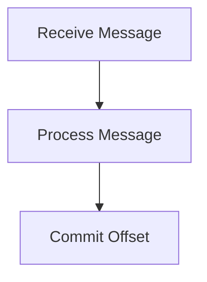
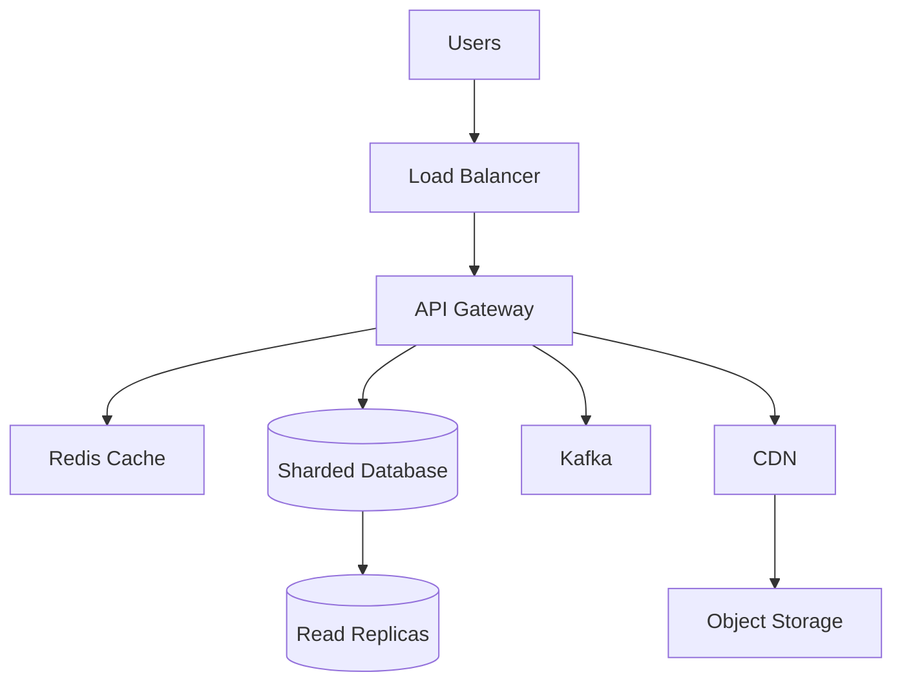

# Day 30 - Advanced Distributed Systems & Architecture Decision Making

## Hot Partition Problem

### Example

Partitioning By:

```text
Country
```

Traffic:

```text
India = 90%

Others = 10%
```

Result:

```text
Uneven Traffic Distribution
```

---

### Solution

Choose better partition keys.

Examples:

```text
UserID

OrderID

UUID
```

Characteristics:

```text
High Cardinality

Uniform Distribution

Even Traffic Spread
```

---

# Shard Key Selection

One of the most important database decisions.

---

## Bad Shard Keys

```text
Country

State

City

Age Group
```

Reason:

```text
Uneven Distribution

Hot Partitions
```

---

## Good Shard Keys

```text
UserID

OrderID

UUID
```

Reason:

```text
Uniform Distribution

Better Scalability

Even Load Distribution
```

---

# Kafka Partition Key

## Definition

A partition key determines which partition receives an event.

Kafka uses:

```text
hash(partitionKey) % numberOfPartitions
```

to select the partition.

---

## Example

```text
UserID = 101
```

```text
hash(101) % 3
```

Result:

```text
Partition 2
```

---

# Why Same Key Should Go To Same Partition

Example:

```text
Order Created

Order Paid

Order Delivered
```

All three events must remain ordered.

Therefore:

```text
OrderID
```

should be used as the partition key.

---

## Benefit

```text
Ordering Guarantee
```

within a partition.

---

# Delivery Guarantees

---

## At Most Once

```text
No Duplicates

Messages May Be Lost
```

Flow:

```text
Receive Message
↓
Commit Offset
↓
Crash
↓
Message Lost
```

---

## At Least Once

```text
No Message Loss

Duplicates Possible
```

Flow:

```text
Receive Message
↓
Process Message
↓
Crash Before Commit
↓
Message Reprocessed
```

Kafka default behavior.

---

## Exactly Once

```text
No Message Loss

No Duplicates
```

Most expensive.

Used when correctness is critical.

Example:

```text
Financial Ledger

Banking Systems
```

---

# Offset Commit

Offsets should only be committed after successful processing.

---

## Wrong Approach

```text
Receive
↓
Commit
↓
Process
```

Problem:

```text
Crash
↓
Message Lost
```

---

## Correct Approach



---

# Retention Policy

Kafka stores events even after consumption.

Examples:

```text
7 Days

30 Days

90 Days
```

---

## Benefits

```text
Replay

Recovery

Auditing

Analytics
```

---

# Log Compaction

Normal retention:

```text
Keep Everything
```

---

Log compaction:

```text
Keep Latest Value Per Key
```

---

## Example

```text
User 101 = Ahmedabad

User 101 = Mumbai

User 101 = Bangalore
```

After compaction:

```text
User 101 = Bangalore
```

Only latest state remains.

---

## Use Cases

```text
User Profiles

Configuration Data

Current State Storage
```

---

# Architecture Tradeoffs

---

## Why Not Cache Everything?

Problems:

```text
Stale Data

Memory Cost

Cache Invalidation Complexity
```

---

## Why Not Redis For Everything?

Problems:

```text
Expensive

RAM Limited

Durability Concerns
```

---

## Why Not Kafka For Everything?

Problems:

```text
Operational Complexity

Ordering Challenges

Infrastructure Cost
```

---

## Why Not RabbitMQ For Everything?

Problems:

```text
No Event Replay

Not Suitable For Event Streaming
```

---

## Why Not Microservices For Everything?

Problems:

```text
Distributed Transactions

Network Calls

Debugging Complexity

Operational Overhead
```

---

## Why Not Shard From Day One?

Problems:

```text
Cross-Shard Queries

Rebalancing

Increased Complexity
```

---

# Architecture Decision Framework

Before selecting any component, ask:

```text
How Many Users?

Read Heavy Or Write Heavy?

Consistency Requirement?

Latency Requirement?

Budget Constraints?
```

---

# Common Interview Questions

## Q1. What is Consistent Hashing?

### Answer

Consistent Hashing is a hashing technique that minimizes key redistribution when nodes are added or removed from a distributed system.

---

## Q2. Why Do We Need Virtual Nodes?

### Answer

Virtual nodes improve load balancing by distributing a physical node across multiple positions on the hash ring.

---

## Q3. What is a Hot Key?

### Answer

A hot key is a frequently accessed key that receives disproportionate traffic and overloads a single server.

---

## Q4. What is a Hot Partition?

### Answer

A hot partition occurs when one partition receives significantly more traffic than other partitions.

---

## Q5. Why Is Partition Key Important In Kafka?

### Answer

Partition keys determine partition assignment and preserve event ordering within a partition.

---

## Q6. Difference Between At Most Once And At Least Once?

### Answer

At Most Once may lose messages but avoids duplicates, while At Least Once guarantees delivery but may create duplicates.

---

## Q7. What Is Log Compaction?

### Answer

Log compaction keeps only the latest value for each key while removing older versions.

---

# Scenario Based Questions

## Scenario 1

Your Redis cluster has:

```text
3 Nodes
```

A fourth node is added.

Why is Consistent Hashing better than:

```text
hash(key)%N
```

### Answer

In traditional hashing, adding a new node changes the modulo value, causing almost all keys to be reassigned and triggering large-scale data migration.

With Consistent Hashing, both servers and keys are placed on a hash ring. When a new node is added, only the keys belonging to the affected range move to the new node.

Benefits:

```text
Minimal Rehashing

Reduced Data Movement

Better Scalability
```

---

## Scenario 2

A partition receives:

```text
90% Traffic
```

while others remain almost idle.

### Answer

This is a Hot Partition problem.

The partitioning strategy is creating uneven traffic distribution.

Solution:

```text
Choose Better Shard Keys

UserID

OrderID

UUID
```

These provide more uniform distribution and prevent hotspots.

---

## Scenario 3

Kafka Events:

```text
Order Created

Order Paid

Order Delivered
```

Why should they use the same partition key?

### Answer

Kafka guarantees ordering only within a partition.

Using the same partition key ensures all order-related events are stored in the same partition and processed in the correct sequence.

Example:

```text
Order Created
↓
Order Paid
↓
Order Delivered
```

instead of:

```text
Order Created
↓
Order Delivered
↓
Order Paid
```

---

## Scenario 4

An e-commerce company proposes:

```text
Store Everything In Redis
```

### Answer

I would not recommend this design.

Reasons:

```text
RAM Is Expensive

Limited Capacity

Durability Concerns

Operational Cost
```

Redis should be used as a cache for frequently accessed data such as:

```text
User Profiles

Sessions

Feeds

Product Information
```

while the primary database remains the source of truth.

---

## Scenario 5

Design the storage and scaling strategy for:

```text
500 Million Users

5 Billion Requests Per Day
```

### Answer

For a system serving 500 million users and 5 billion requests per day, my primary goals would be:

```text
Scalability

High Availability

Low Latency

Fault Tolerance
```

---

### Database Choice

For transactional workloads requiring:

```text
ACID

Strong Consistency

Relationships
```

I would use:

```text
PostgreSQL

MySQL
```

For large-scale workloads such as:

```text
Feeds

Analytics

User Activity
```

I would use:

```text
MongoDB

Cassandra
```

---

### Sharding Strategy

The data would be sharded across multiple database nodes.

Shard keys should provide:

```text
High Cardinality

Uniform Distribution
```

Examples:

```text
UserID

OrderID

UUID
```

---

### Replication Strategy

Each shard would contain:

```text
1 Primary

Multiple Read Replicas
```

Flow:

```text
Writes
↓
Primary

Reads
↓
Read Replicas
```

Benefits:

```text
Read Scaling

Failover

High Availability
```

---

### Caching Layer

Redis would cache:

```text
User Profiles

Feeds

Trending Content

Session Data

Hot Records
```

Flow:

```text
Client
↓
Redis
↓
Database
```

---

### Message Broker

For background jobs:

```text
RabbitMQ

BullMQ
```

For event streaming:

```text
Kafka
```

Benefits:

```text
High Throughput

Consumer Groups

Replay Capability

Partitioning
```

---

### CDN

Static assets such as:

```text
Images

Videos

Documents
```

would be served through a CDN.

Benefits:

```text
Reduced Latency

Global Availability

Reduced Origin Load
```

---

### High Level Architecture



---

### Interview Closing Statement

For a system serving 500 million users, I would use horizontal scaling through sharding, replication for high availability, Redis for low-latency access, Kafka for event-driven workloads, and a CDN for static content delivery. The exact database choice would depend on the consistency and transaction requirements of the business domain.