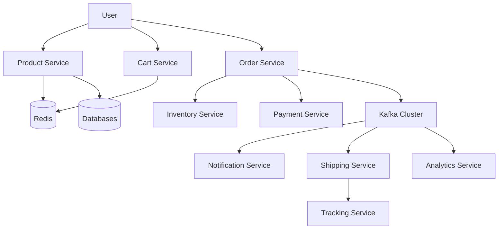
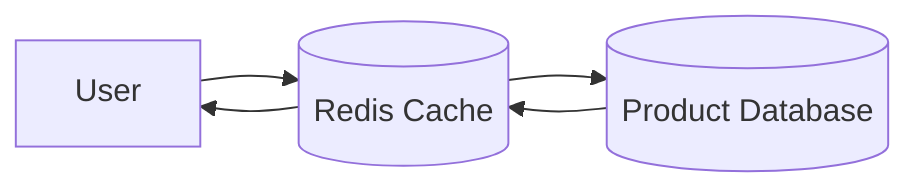
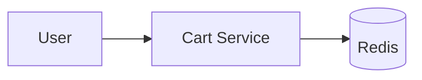
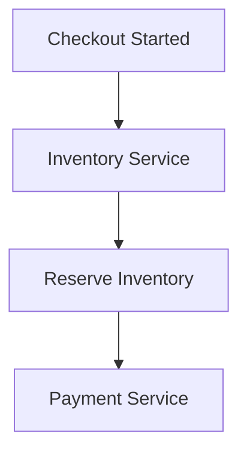
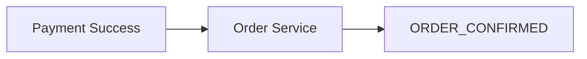
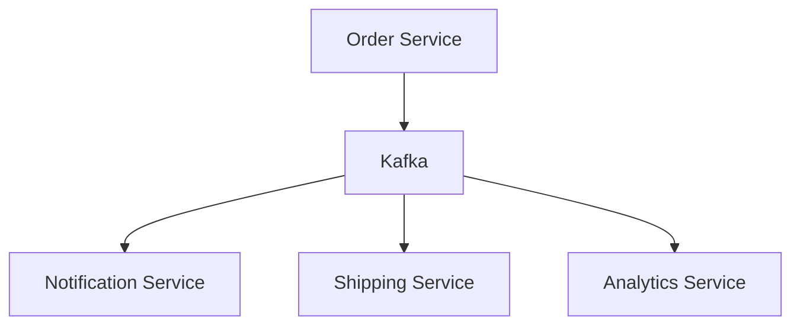
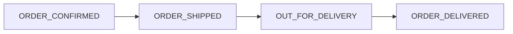
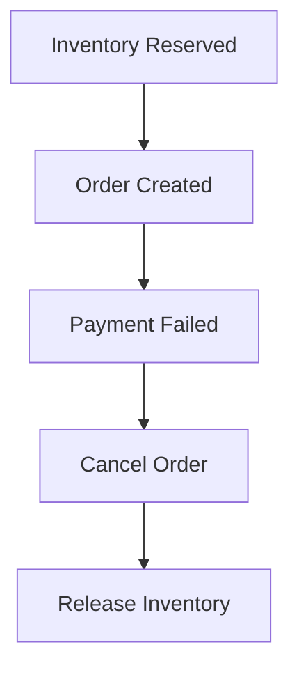
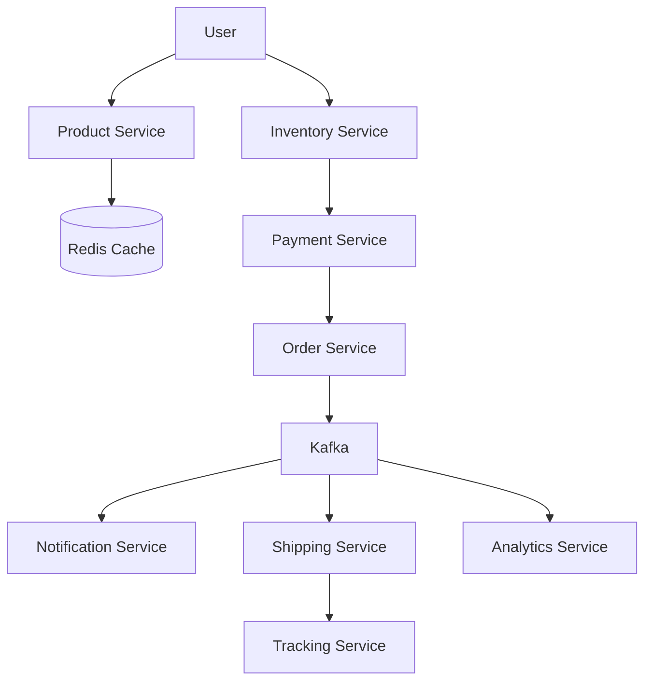

# E-Commerce System Architecture

## High Level Architecture

---

## Product Browsing Flow

---

## Cart Flow

---

## Inventory Reservation Flow

---

## Order Confirmation Flow

---

## Event Driven Architecture

---

## Shipping Flow

---

## Saga Pattern Rollback

---

## Complete End-To-End Flow

