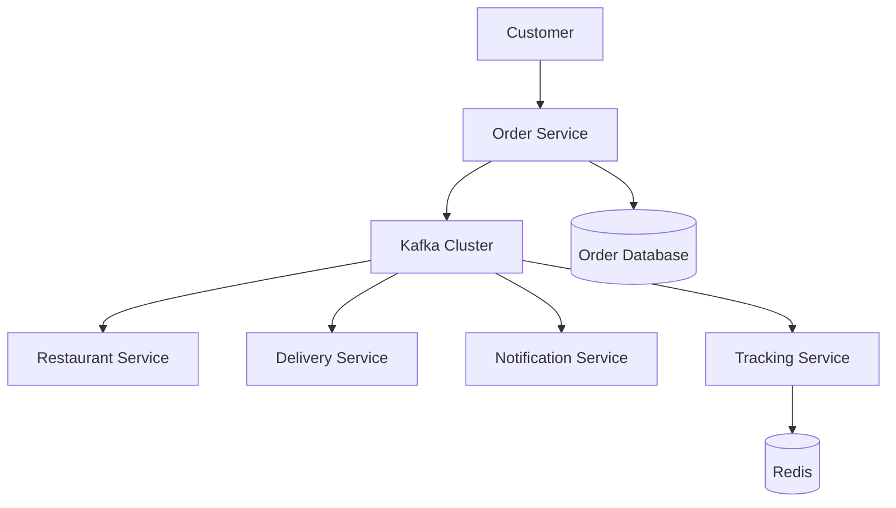
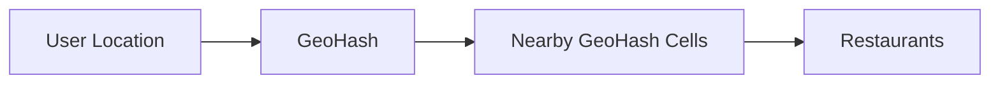
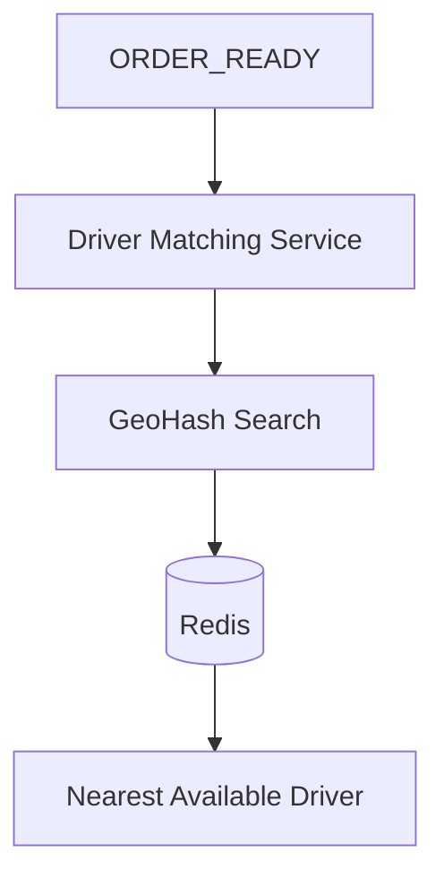
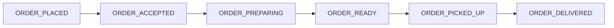
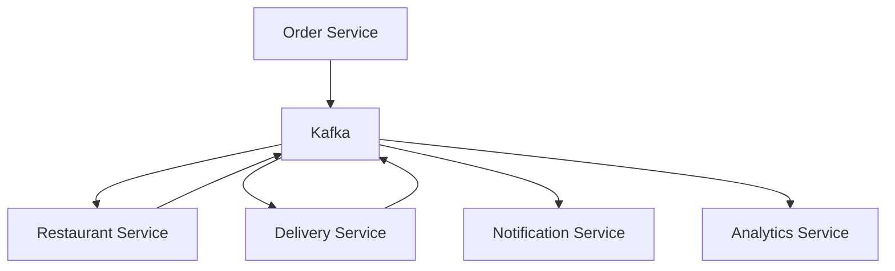
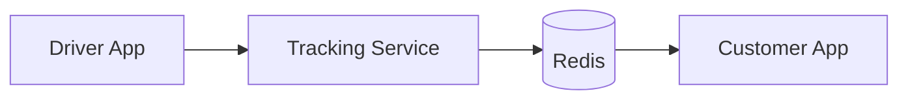
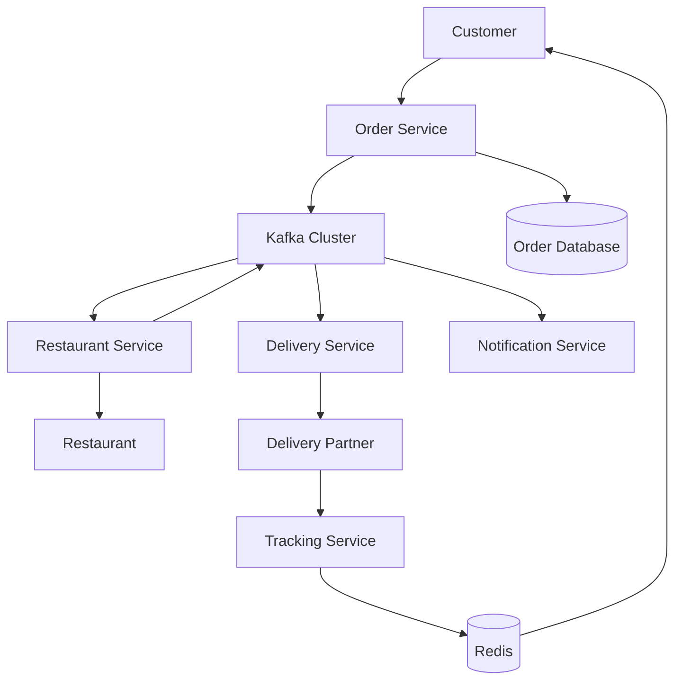

# Food Delivery System Architecture

## High Level Architecture

---

## Nearby Restaurant Search

---

## Driver Matching Flow

---

## Order Lifecycle

---

## Event Driven Architecture

---

## Live Tracking Flow

---

## Complete Food Delivery Architecture

