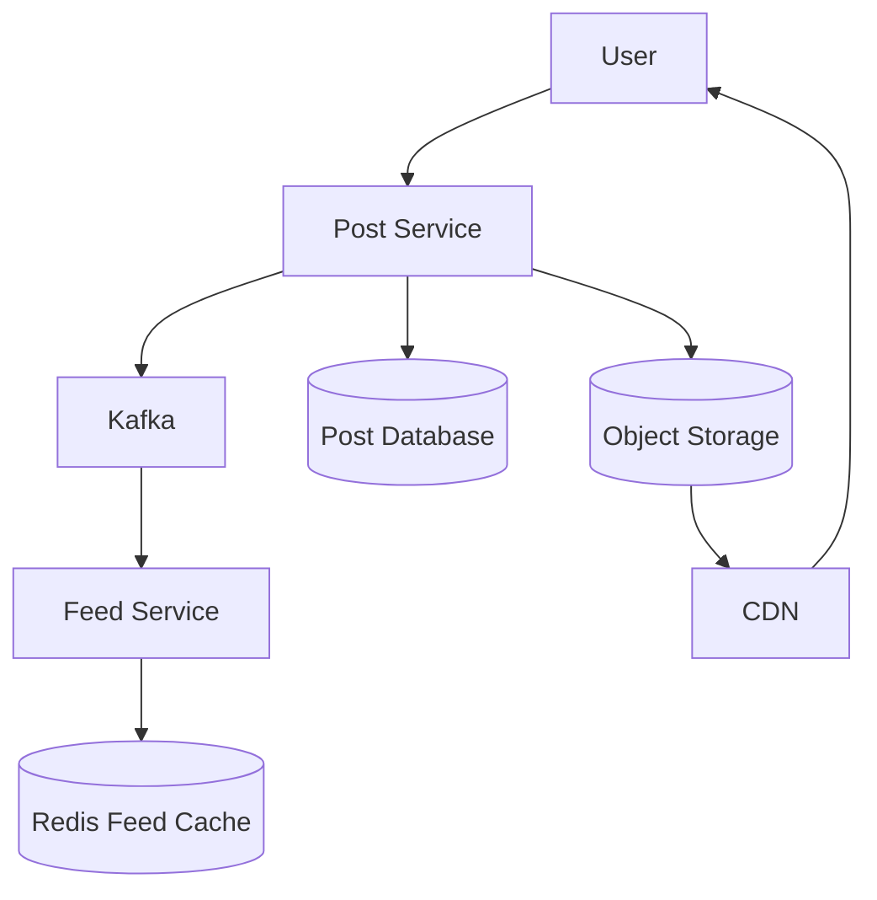
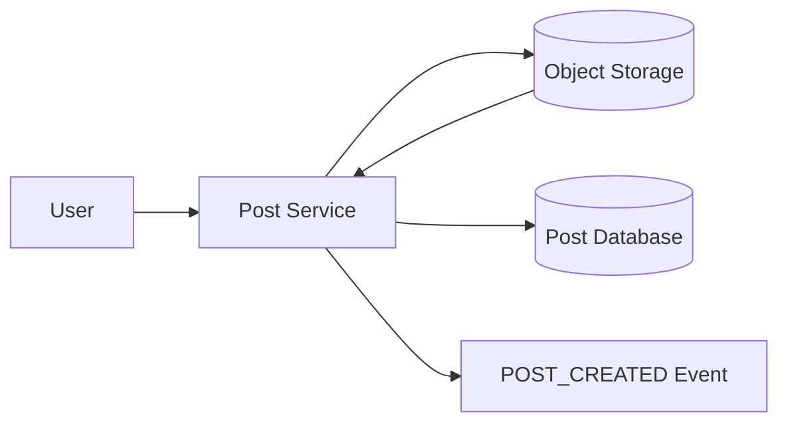
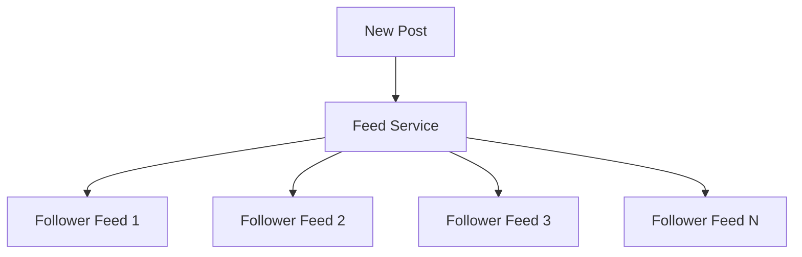
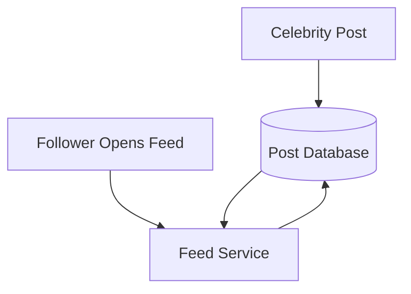
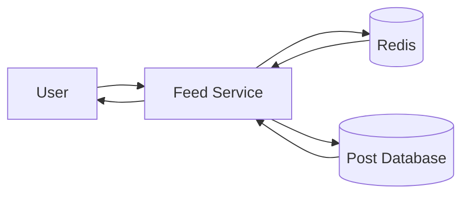
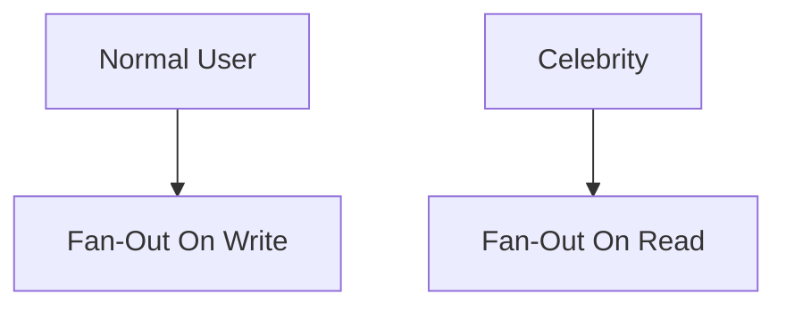
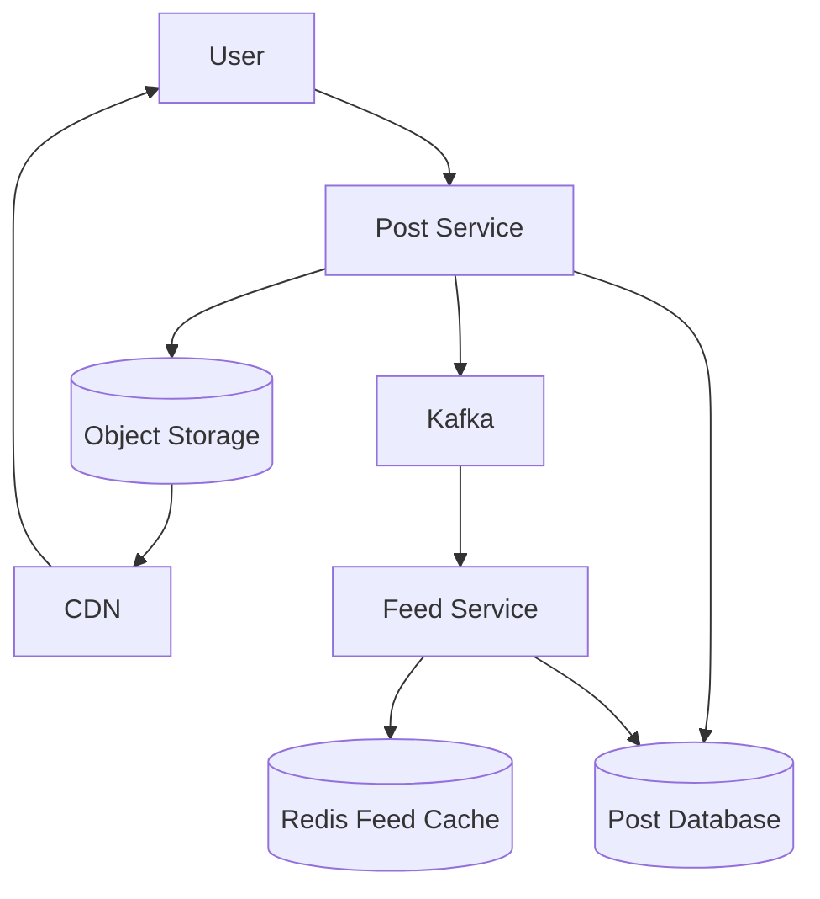

# Instagram Feed System Architecture

## High Level Architecture

---

## Post Creation Flow

---

## Fan-Out On Write

---

## Fan-Out On Read

---

## Feed Loading Flow

---

## Celebrity Handling

---

## Complete Feed Architecture

