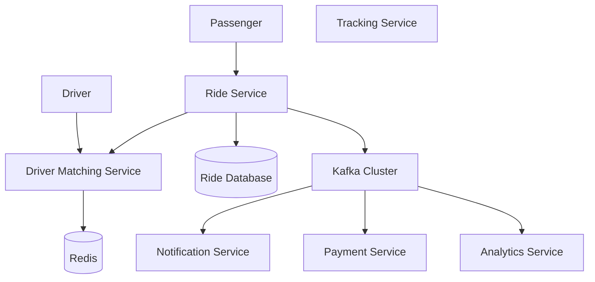
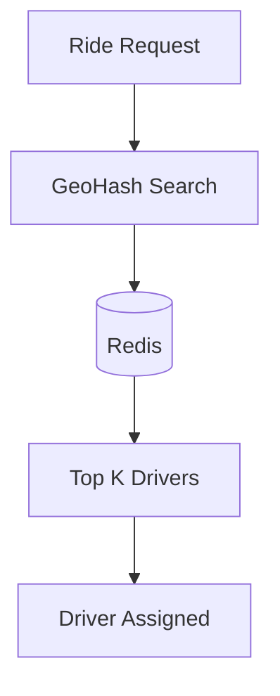
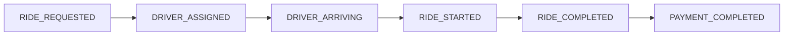
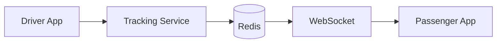
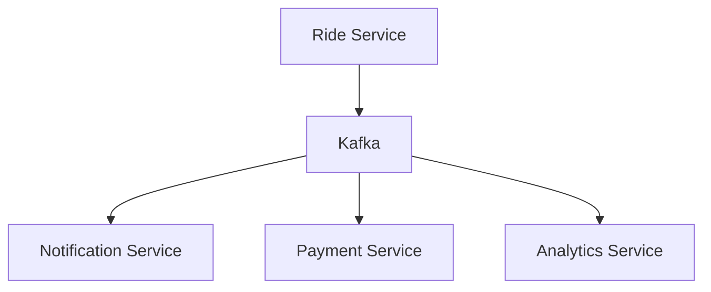
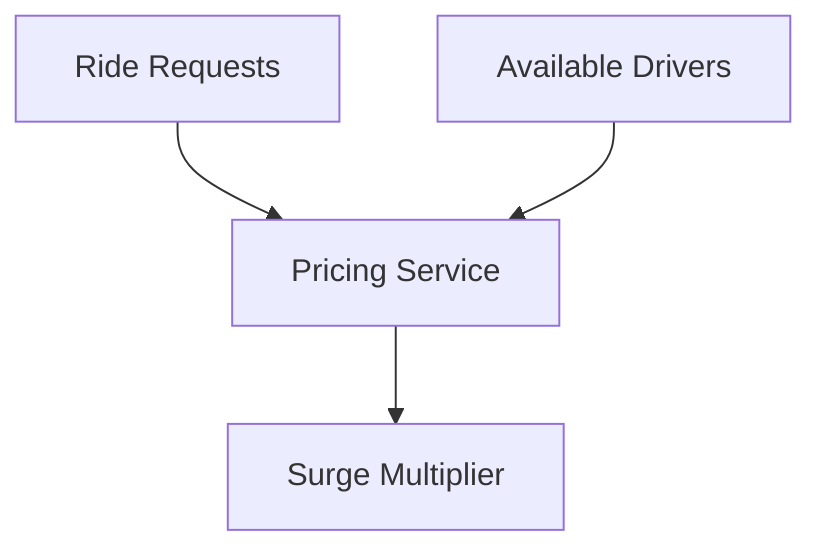
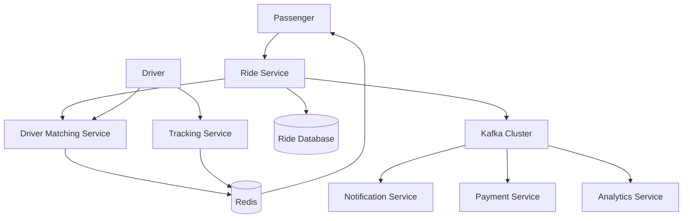

# Ride Sharing System Architecture

## High Level Architecture

---

## Driver Matching Flow

---

## Ride Lifecycle

---

## Live Tracking Flow

---

## Kafka Event Flow

---

## Surge Pricing Flow

---

## Complete End-To-End Architecture

