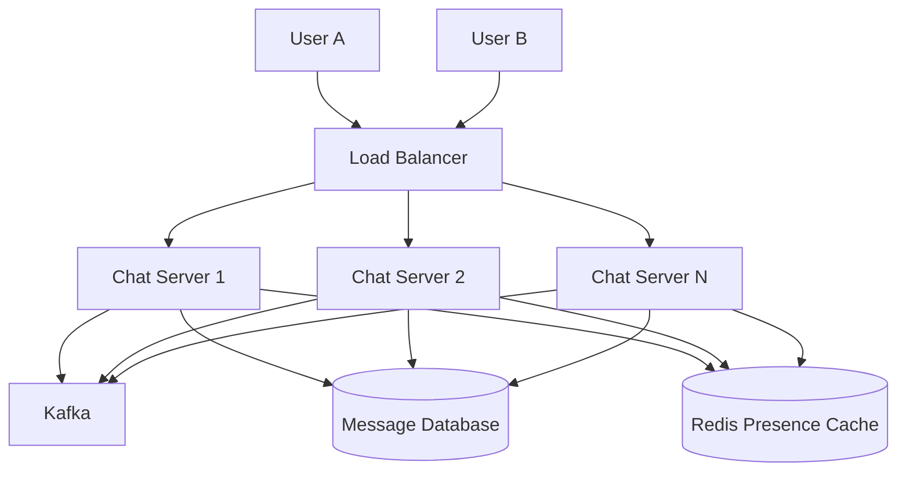
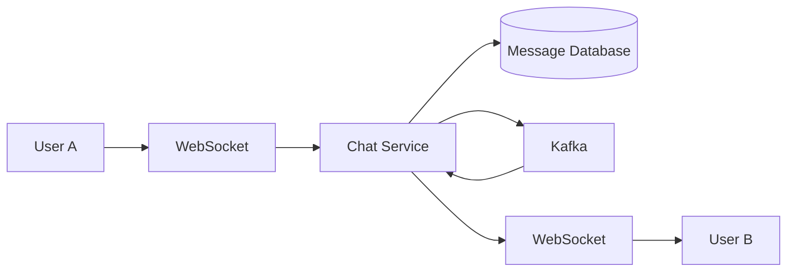
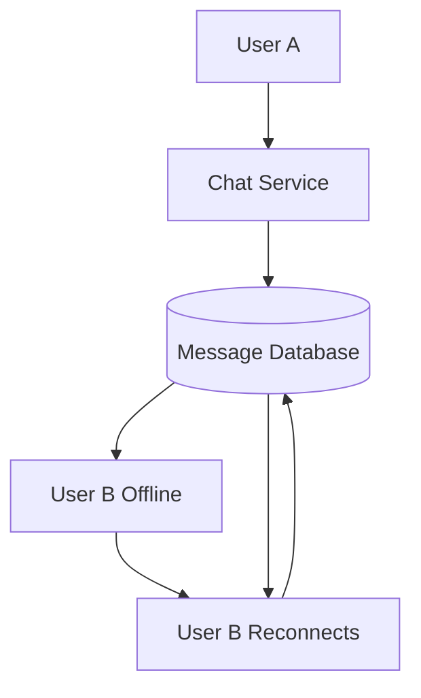
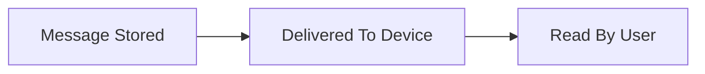
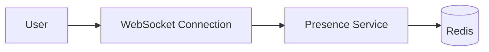
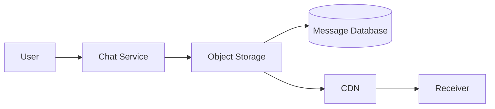
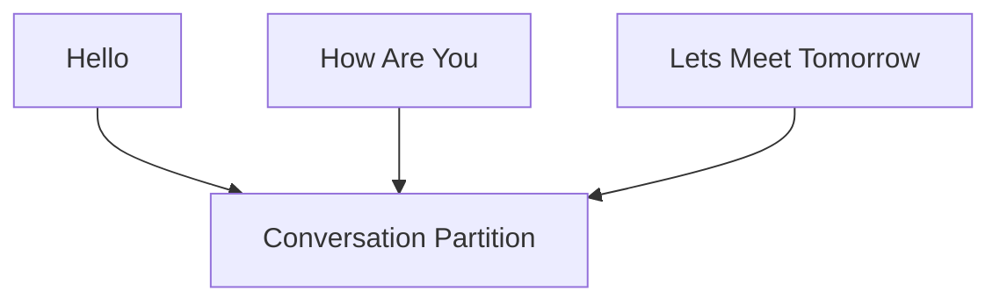
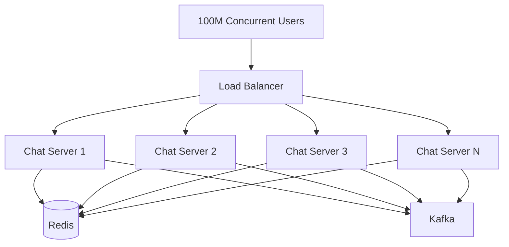
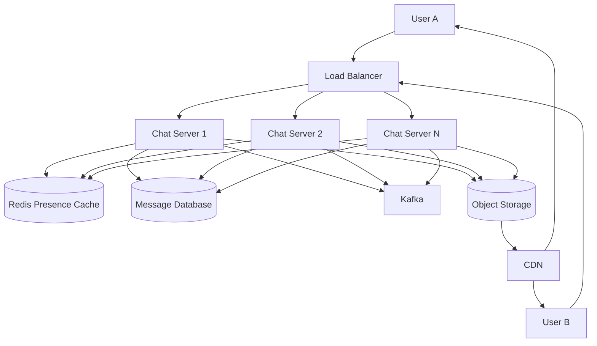

# WhatsApp Chat System Architecture

## High Level Architecture

---

## Message Sending Flow

---

## Offline Message Flow

---

## Read Receipt Flow

---

## Presence Service Flow

---

## Media Upload Flow

---

## Message Ordering Using Kafka

---

## Chat Service Scaling

---

## Complete WhatsApp Architecture

